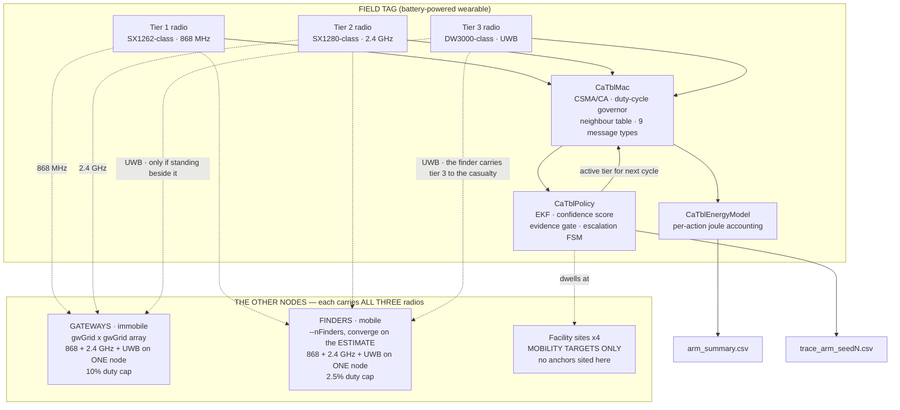
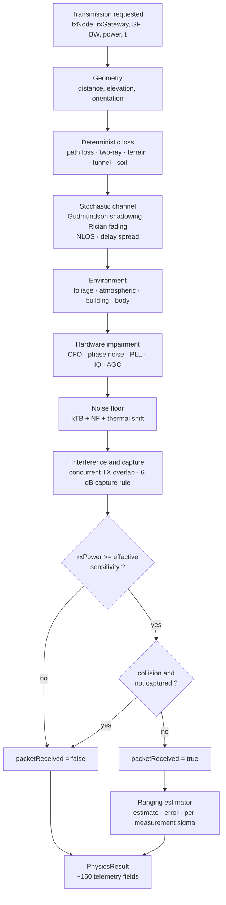
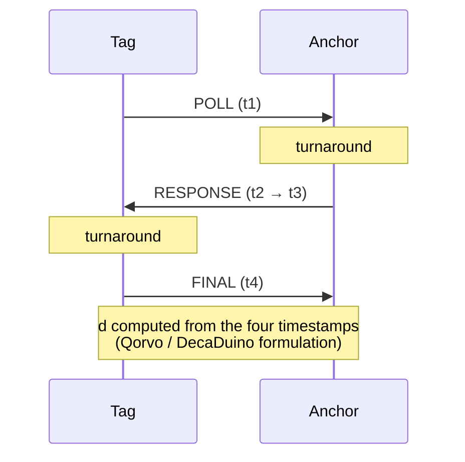
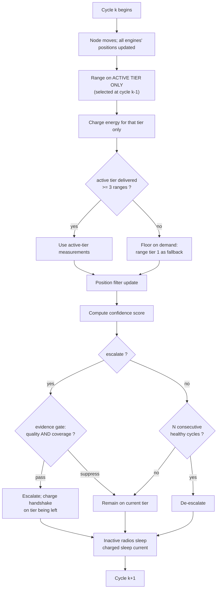
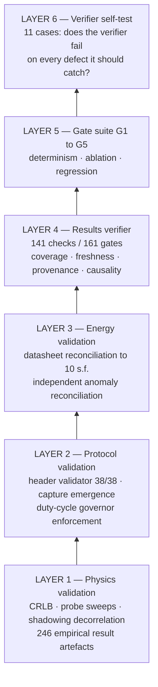

# CA-TBL — Architecture Specification

**Confidence-Aware Tier-Based Localization for GPS-Denied Search and Rescue**

|                               |                                                                                  |
| ----------------------------- | -------------------------------------------------------------------------------- |
| **Document**            | Architecture Specification (1 of 2)                                              |
| **Companion**           | `Simulation.md` — specifications, methodology, per-seed results               |
| **Scope**               | Radio architecture, physics engines, MAC, energy model, handoff, verification    |
| **Out of scope**        | Position estimator internals (EKF, confidence score) — see`Simulation.md` §7 |
| **Platform**            | ns-3.47, C++17, custom`lora-physics-engine` module                             |
| **Evidence convention** | Every factual claim carries a tag`[E-nn]` resolved in §12                     |

---

## Table of contents

1. [Problem statement](#1-problem-statement)
2. [Architecture overview](#2-architecture-overview)
3. [Deployment geometry](#3-deployment-geometry)
4. [The three physics engines](#4-the-three-physics-engines)
5. [Per-transmission processing pipeline](#5-per-transmission-processing-pipeline)
6. [Ranging methods](#6-ranging-methods)
7. [MAC layer](#7-mac-layer)
8. [Energy model](#8-energy-model)
9. [Handoff mechanism](#9-handoff-mechanism)
10. [Dataset generation](#10-dataset-generation)
11. [Verification architecture](#11-verification-architecture)
12. [Evidence index](#12-evidence-index)
13. [References](#13-references)

---

## 1. Problem statement

### 1.1 Why GNSS is insufficient

- GNSS fails under dense canopy, in mountain valleys, underground, inside structures, and in smoke.
- These are precisely the environments in which ground search-and-rescue operates.
- A replacement must provide **continuous** position, at **actionable accuracy**, on a **battery-powered wearable**.

### 1.2 Why no single radio suffices

| Constraint                                             | Consequence                                 |
| ------------------------------------------------------ | ------------------------------------------- |
| Long range requires low frequency and narrow bandwidth | Coarse ranging — tens of metres at best    |
| Fine ranging requires wide bandwidth                   | Short range and high receive current        |
| Battery life requires low duty cycle                   | Cannot run the precision radio continuously |

- The three constraints are mutually exclusive in one radio.
- **Architectural response:** three radios in a hierarchy, plus a decision layer that spends precision only where it is both *useful* and *feasible*.

### 1.3 Design requirement (fixed in advance)

```
Availability  A ≥ 0.95   at   Accuracy  R ≤ 25 m
```

- **Availability denominator:** all 1440 decision cycles of a run. A cycle with no fix counts against.
- Rationale: a system cannot be searched with if it is accurate only on the occasions it happens to work.

---

## 2. Architecture overview

### 2.1 Tier summary

| # | Band               | Reference part | Role                                       | Measured r80       | Evidence   |
| - | ------------------ | -------------- | ------------------------------------------ | ------------------ | ---------- |
| 1 | 868 MHz sub-GHz    | SX1262-class   | Wide-area coverage floor; always reachable | **1515.3 m** | `[E-01]` |
| 2 | 2.4 GHz ISM        | SX1280-class   | Mid-range refinement, two-way ToF          | **1149.5 m**  | `[E-01]` |
| 3 | UWB Ch9 (7.99 GHz) | DW3000-class   | Short-range precision, TWR. At this range a *fixed* gateway offers tier 3 only to something beside it — a **finder** is what carries it to the casualty (§3.3) | **12.8 m**   | `[E-01]` |

> **r80** = distance at which 80 % of packets are still received, from the built-in probe sweep. Limitation stated at `[E-02]`.

### 2.2 Hardware realisability

- 868 MHz + 2.4 GHz LoRa **can** share one multi-band transceiver die (LR1121-class). `[R-11]`
- UWB **cannot** — it needs 500 MHz instantaneous bandwidth and a different front end. No LoRa vendor integrates it.
- **Therefore: one board, two radio ICs.** The documentation states this rather than claiming "one chip", because it is checkable in a datasheet in under a minute.

### 2.3 System block diagram



**Where `CaTblPolicy` runs.** The diagram draws it inside the tag because that is where the
scenario evaluates it. Since 2026-09-29 it is *modelled* on the gateway network by default,
as ch10 §10.1 specifies (`--gatewayEdgeServer`, default true). The tag broadcasts, the
gateways measure and report over the backhaul, and the fix comes back in one downlink per
fix; that is what the tag is billed, with no per-gateway reply. The filter's inputs and
arithmetic are the same either way, so at defaults only energy differs from node-side
estimation, which stays reachable as `--gatewayEdgeServer=false`. Getting a tier-2 or
tier-3 range to the gateway's estimator is not billed (`docs/TECH_DEBT.md` L.2.3).

### 2.4 Software module map

| Module                   | Path                                                    | Responsibility                            |
| ------------------------ | ------------------------------------------------------- | ----------------------------------------- |
| `LoRaPhysicsEngine`    | `src/lora-physics-engine/model/lora-physics-engine.*` | 868 MHz propagation + ranging             |
| `LoRa2p4PhysicsEngine` | `…/lora-2p4-physics-engine.*`                        | 2.4 GHz propagation + ranging             |
| `LoRaUWBPhysicsEngine` | `…/lora-uwb-physics-engine.*`                        | UWB propagation + ranging                 |
| `CaTblHeader`          | `…/ca-tbl-header.*`                                  | Message taxonomy, wire sizes              |
| `CaTblMac`             | `…/ca-tbl-mac.*`                                     | CSMA/CA, duty cycle, APC, neighbour cache |
| `CaTblChannel`         | `scratch/ca_tbl_causal_sim.cc`                        | Shared medium, capture arbitration        |
| `CaTblEnergyModel`     | `…/ca-tbl-energy-model.*`                            | Datasheet-current energy accounting       |
| `CaTblPolicy`          | `…/ca-tbl-policy.*`                                  | EKF, PCS, evidence gate, escalation FSM   |
| Scenario harness         | `scratch/ca_tbl_causal_sim.cc`                        | Geometry, mobility, arms, sweep driver    |
| Verifier                 | `scratch/python_handoff/verify_causal_sim.py`         | 141 checks / 161 gates                    |
| Gate suite               | `scripts/catbl_gates.sh`                              | G1–G5 end-to-end                         |

---

## 3. Deployment geometry

> **Corrected 2026-09-07 (`99fdf1a`).** This section previously specified three
> *disjoint* anchor populations, one per tier, in different places. That was wrong, and
> the code implemented the wrong thing because this document specified it. The system has
> **one population of tri-band nodes**; a tier is a choice of **which radio to use**, not
> of **whom to talk to**. The superseded text is preserved in §3.5 as the legacy model,
> because results published before that date were produced under it.

### 3.1 Node classes

There are three classes, and they differ in **mobility and role only**. Every node in
every class carries **all three radios** — 868 MHz, 2.4 GHz and UWB.

| Class | Mobile? | ids | Role | Duty cap `[R-04]` |
| --- | --- | --- | --- | --- |
| **Gateway** | no — the only immobile class | `101+` | Fixed infrastructure. Beacons on all three tiers. | 10 % (access point) |
| **Finder** | yes | `501+` | A searcher carrying a radio. Registered on all three tiers exactly like a gateway; the *only* difference is that its position changes. | 2.5 % (field device) |
| **Field node** | yes | lost node `1`, peer/relay tags `2+` | The subject being localised. Runs the filter, makes the tier decision. | 2.5 % (field device) |

- A finder needs **no special case** anywhere in the ranging, energy or MAC path — which
  is why it is modelled as a mobile gateway rather than as a new kind of thing. It
  therefore cannot accidentally receive accounting a gateway would not.
- Finder mobility is a **modelling choice not fixed by the project brief**, and the
  strongest assumption in the corrected system. It is recorded, with what it was chosen
  over, in `docs/DESIGN_DECISIONS.md` §1.

### 3.2 Placement rules

- **Gateways** — `gwGrid × gwGrid` regular array spanning ±0.9 × `boxHalf`, at 15 m
  height. Default `gwGrid = 3`, i.e. **9 gateways**. The same id and the same position
  are registered in **all three** tier lists, so the setup loop builds one MAC per
  (gateway, tier) on that tier's channel — three radios on one node.
- **Finders** — `--nFinders`, default **0**. Start at the box centre; motion per
  `--finderMode`.
- **Facility sites** — 4, at (±0.47·`boxHalf`, ±0.47·`boxHalf`). They are **mobility
  targets only** and host **no anchors**. The field node dwells at them; that is all they
  do.

> **`--uwbTriad`, `--t2Triad`, `--uwbAnchors`, `--t2Anchors` and `--sitingMode` have no
> effect under the default topology.** They parameterise the legacy per-tier rings and are
> read only when `--topology=1`.

### 3.3 Why this is the mechanism, not a detail

UWB reaches **tens of metres** (`r80` ≈ 12.8 m, §2.1). A *fixed* gateway can therefore
offer tier 3 only to something already standing beside it.

Measured under the corrected topology, seed 7, 600 s, `boxHalf` 1000, `ca_tbl_full`:

| finders | UWB fixes | mean UWB neighbours | total energy |
| --- | --- | --- | --- |
| 0 | 0 | **0.01** | 109.0 J |
| 4, touring (`--finderMode=0`) | 0 | 0.15 | 94.3 J |
| 4, converging (`--finderMode=1`) | **21** | **0.78** | **51.0 J** |

**Escalation to UWB is a statement about a searcher having arrived**, not about the
casualty having wandered somewhere useful. Under the legacy model the lost node reached
UWB by walking near a facility, which *manufactured* tier-3 coverage the architecture is
supposed to earn — and in doing so it hid the mechanism the whole design rests on.

### 3.4 Ground-truth visibility labels

`vis868 / vis2p4 / visUwb` count anchors of each tier within a **nominal** radius of the
node's **true** position. These are labels for the trigger confusion matrix, **not**
reception gates — the engines decide reception.

| tier | nominal radius | basis |
| --- | --- | --- |
| 868 MHz | 3000 m | r50, 64-site decorrelated probe |
| 2.4 GHz | 900 m | r50, **censored** — the sweep ends at 900 m with PDR 0.804 and the tier has not fallen off. A lower bound. |
| UWB | 30 m | r50 29.5 m |

**These are r50, deliberately, and an earlier "correction" to r80 silently zeroed the
entire trigger metric.** A fix needs three ranges out of N anchors, not one: at per-link
p = 0.5 with N = 5, P(≥3 of 5) = 0.5, so r50 *is* the distance at which a fix becomes a
coin flip — which is what "could this tier plausibly have solved here" means. A label
radius must also never equal the anchor ring radius it labels; setting both to 10.0 m made
the label unsatisfiable and `visUwb` identically zero on every arm.

### 3.5 The legacy model (`--topology=1`)

Three disjoint anchor populations: tier-1 gateways on the grid, **tier-2 anchors 3 per
facility site on a 150 m ring**, **tier-3 anchors 5 per site on a 10 m ring**, with
`--sitingMode` choosing whether tier 3 co-located with tier 2 or sat in the gaps between
the tier-2 clusters at the same radius.

**Retained only so results published before 2026-09-07 remain reproducible. It does not
describe the system and is not a configuration to run for new work.**

`--topology=0` and `--topology=1` are **different deployments**. They do not share a
baseline, no null control relates them, and `baseline_v7` does not reproduce under the
corrected topology — it is not supposed to. Switching this flag is a change of *scenario*,
not of *configuration*.

### 3.6 The dimensionless scaling axis

- **Axis:** `spacing / r80`, where `spacing = 0.47 × boxHalf` and `r80 = 1149.5 m` (tier
  2, measured after the six-decibel sensitivity-table correction; the pre-correction value
  was 909.5 m and every figure derived from it was regenerated).
- **Why dimensionless:** a result stated as "needed above `boxHalf` = 2200 m" is a fact
  about this simulator. A result stated as "needed above `spacing/r80` ≈ 1.0" transfers to
  any radio pair with a known r80.

| `boxHalf` (m)             | 1500           | 2000           | 2500           | 3000           | 4000           | 5000           | 6000           |
| --------------------------- | -------------- | -------------- | -------------- | -------------- | -------------- | -------------- | -------------- |
| site spacing (m)            | 705            | 940            | 1175           | 1410           | 1880           | 2350           | 2820           |
| **`spacing / r80`** | **0.78** | **1.03** | **1.29** | **1.55** | **2.07** | **2.58** | **3.10** |

> **Scope, under the corrected topology.** `spacing` is the *facility* spacing, and
> facilities no longer host anchors — so this axis now describes the **mobility** scale
> (how far the node walks between dwell points) rather than the tier-2 *anchor* spacing it
> was constructed to describe. The gateway pitch is `0.9 × boxHalf × 2/(gwGrid−1)`, which
> is the quantity a tier-2 coverage argument now needs. Every published figure on this
> axis predates the correction; see §12.

---

## 4. The three physics engines

### 4.1 Why three engines, not one parameterised engine

| Physical difference    | 868 MHz                | UWB (7.99 GHz)                                                             | Consequence                               |
| ---------------------- | ---------------------- | -------------------------------------------------------------------------- | ----------------------------------------- |
| Vegetation attenuation | Few dB                 | Tens of dB                                                                 | Same forest: nuisance vs. wall            |
| Thermal noise floor    | −123 dBm over 125 kHz | **−87 dBm** over 499.2 MHz                                          | 36 dB penalty before any propagation loss |
| Detection mechanism    | CSS processing gain    | Coherent preamble integration, 1024 symbols →**30.1 dB** `[R-03]` | Different sensitivity models entirely     |

- A single engine with a frequency parameter would have concealed all three.
- Three engines make them explicit, separately configurable, and separately testable.

### 4.1.1 Why three tiers — measured, not asserted

The table above is a datasheet argument. The independent propagation model replaced it with
a measured surface, swept over frequency and bandwidth jointly
(`src/catbl-propagation-study/`, §5.1).

**The range-precision frontier is real and the tiers sit on it.** No `(f, BW)` beats all
three tiers on both range and precision **when each design is judged at its own operating
point**. The frontier's log-log slope is +2.2000 and is unchanged to four decimals at both
limits of the unvalidated terrain term.

**But the premise is narrower than "no such radio exists", and the report says so.**
Judged at a common short distance instead, a counterexample does exist — **169 MHz at 250,
500 or 800 kHz** beats all three tiers on both axes, because at 100 m a low-frequency link
has enough surplus budget that its CRLB beats UWB's despite 600× less bandwidth. It is
excluded for two independent reasons, neither of which is the frontier:

1. **Not allocatable.** The CEPT plan for 169.4–169.8125 MHz caps channels at 50 kHz
   (ECC/DEC/(05)02) and FCC narrowbanding caps 150–174 MHz at 12.5 kHz, while the whole
   band is 412.5 kHz wide. (Region 3 is a partial gap: Japan's allocation is a narrowband
   service allocation; China and Australia were not resolved.)
2. **It cannot resolve its own first path.** Range resolution `c/(2·BW)` is 599.6 m at
   250 kHz against a rural delay spread needing 1–10 MHz to resolve. It claims a sigma
   **8400× finer than its own resolution cell**; UWB claims one 5× finer. The CRLB assumes
   a single resolved path and that assumption fails outright. This holds in every
   jurisdiction.

**The design rule that transfers:** tiering is justified by the **width of the operating
envelope**, not by the radios. Where the envelope is narrow — every node at a common short
range — a single well-chosen radio would do, and the architecture does not pay.

The parameter that dominates range is not frequency but the **path-loss exponent**: over
1.6–6.0 it moves `r80` by **353×**, against 18.9× for a 2.2-decade sweep of carrier
frequency. Environment selection outranks radio selection.

### 4.2 Submodule catalogue

Each engine composes ~35 submodules. Grouped by physical category:

#### 4.2.1 Deterministic geometry and propagation

- Log-distance path loss, environment-specific path-loss exponent
- Two-ray ground reflection
- Terrain: Fresnel-zone clearance, earth-curvature bulge, multi-edge diffraction, reflection count
- Tunnel / confined-space waveguide
- Soil attenuation for ground-proximate links

#### 4.2.2 Stochastic channel

- **Gudmundson spatially-correlated shadowing** `[R-13]` — decorrelates over distance rather than being redrawn per sample. This is what gives outages realistic *duration*.
- Rician / Rayleigh fading with sampled K-factor
- Delay spread, coherence bandwidth, frequency-selective penalty
- NLOS submodule — distance-dependent obstruction probability, `P_nlos = 1 − exp(−d/scale)`
- Correlated obstruction across spatially near links

#### 4.2.3 Environment

- Foliage: static depth-dependent loss + wind-driven dynamic variation
- Atmospheric: rain-rate sampling, snow, humidity refractivity, temperature-dependent CFO, effective earth radius *k*
- Building entry loss, wall-material penetration, floor attenuation
- Human body shadowing (the tag is worn)
- Temporal blockage events

#### 4.2.4 Radio hardware realism

- Per-device transmit-power variation
- Oscillator drift, thermal drift, phase noise, spur response
- PLL lock state and cycle slips
- Symbol synchronisation error, timing jitter
- IQ impairment, image rejection, ADC clipping, AGC convergence
- RF front-end non-linearity and desensitisation
- CSS PHY modelling, micro-DSP FFT confidence, spectrum occupancy

#### 4.2.5 Link outcome

- Receiver sensitivity per spreading factor and coding rate
- Interference, capture effect, collision overlap fraction
- Symbol-error probability → CRC success probability
- Successive interference cancellation recovery
- Cooperative / distributed decode gain across gateways

#### 4.2.6 Ranging

- Per-tier estimator producing: range estimate, range error, and a **per-measurement sigma** consumed by the position filter as measurement noise

### 4.3 Telemetry output

- `ProcessTransmission()` returns a structure with **~150 fields** — every intermediate term, not only the outcome.
- Consequence: the link budget is auditable term-by-term rather than being a black box. This is what made the diagnostic work in §11.5 possible.

---

## 5. Per-transmission processing pipeline



**Note on ordering:** NLOS is computed early because downstream submodules (delay spread, terrain reflection) are conditioned on it — the DAG coupling is explicit in the code rather than implied.

---

### 5.1 Which pipeline stages are actually active

The pipeline above shows what the engine *can* apply. It over-states what it *does* apply
in any given scenario, and the gap is not small: in the `probe_v7` configuration
(`RURAL_FORESTED` for 868 MHz, `RURAL_OPEN` for 2.4 GHz and UWB, `WEATHER_CLEAR_DRY`,
outdoor), **eight of the sixteen terms in the engine's loss sum are structurally zero.**

Four of them are hard-assigned `0.0` on a line *after* the line that computes them:

| term | computed at | zeroed at |
|---|---|---|
| `result.antennaGainDb` | `lora-physics-engine.cc:340` | **`:341`** |
| `result.dopplerPenaltyDb` | `:536` | **`:537`** |
| `multipathPenaltyDb` | `:489` | **`:596`** |
| `state.soilAttenuationDb` | (submodule) | **`:593`** |

A reader tracing the pipeline, or the loss sum at `:597-601`, will count these as
contributing. They do not. **Anyone reasoning about this engine from its structure rather
than from its assignments will over-count what it does** — and reading the submodule that
computes a term is not enough, because the assignment that discards it is in the caller.

The remaining four are gated off by scenario rather than by assignment:
`interferencePenaltyDb` (no concurrent transmitter in the probe),
`thermalEfficiencyLossDb` (initialised `0.0`, never reassigned, `:583`),
`tier3LossDb` (tunnel requires `ENV_TUNNEL_CONFINED`), and
`state.propagationLossBiasDb` (zeroed under `RANGING_PHYSICS_DERIVED`,
`lora-ranging-submodule.cc:214`, `:247`). All five components of `tier2LossDb` are gated
too — three on `state.isIndoor`, which defaults `false` (`lora-physics-parameters.h:51`),
body shadowing on `nodeIsBodyWorn = false` (`lora-physics-parameters.cc:1287`), leaving
only temporal blockage at 2% x 5 dB = 0.10 dB.

**Scoping.** Every "inactive" verdict here is `probe_v7`-scoped and none of it generalises.
`isIndoor`, `nodeIsBodyWorn`, `ENV_TUNNEL_CONFINED` and the radio-horizon check that gates
terrain's earth-curvature path all reactivate in other scenarios. The list is a statement
about one configuration, not about the engine.

Two further details found the same way, both easy to misread from structure:

- **Terrain hardcodes 868 MHz** (`lora-terrain-submodule.cc:69-70`) and applies that
  wavelength to every tier, UWB at 7.99 GHz included. The engine's terrain does not scale
  with frequency.
- **Effective sensitivity is not a constant.** It is reduced by
  `linkHysteresisMarginDb` (1.5 dB, `lora-physics-parameters.cc:401`) whenever the link was
  previously receiving, so the reception threshold moves with PDR and therefore with
  distance. It sits outside the loss sum entirely and is invisible to anyone enumerating
  `additional_loss`.

**A term that lives in the threshold, not in the sum.** The eight-of-sixteen list above
enumerates `additional_loss`. That enumeration is not sufficient, and the way it fails is
worth stating in general form. `effectiveSensitivity` is reduced by
`linkHysteresisMarginDb` (1.5 dB, `lora-physics-parameters.cc:401`) whenever the link was
previously receiving, and the reported margin is `rxPowerDbm - effectiveSensitivityDbm`.
So the **denominator of the comparison moves with the outcome**: where PDR is high the
threshold is easier, where PDR is low it is not, and the reported margin therefore falls
with distance for a reason that is not a loss at all.

Two rules generalise past this engine:

- **An enumeration of a loss sum will not find a term that lives in the threshold.** Audit
  what a quantity is compared *against*, not only what is subtracted from it.
- **A margin metric whose denominator moves with the outcome mimics a distance-dependent
  effect.** It cost this project one wrong attribution: a growing residual was assigned to
  a propagation term when up to 1.5 dB of it was the reception threshold moving.

All of this was found by building an independent model and failing to reconcile it — which
is an argument for that module's existence separate from whether it ever reconciles.

---

## 6. Ranging methods

### 6.1 Per-tier method and accuracy floor

| Tier | Method                | Physical basis                                 | Accuracy floor                    | Source                          |
| ---- | --------------------- | ---------------------------------------------- | --------------------------------- | ------------------------------- |
| 1    | RSSI inversion        | Received power → distance via path-loss model | Shadowing-limited; tens of metres | model-derived                   |
| 2    | Symmetric two-way ToF | Round-trip time − fixed turnaround delay      | **3.0 m**                   | Zhou et al. 2025`[R-01]`      |
| 3    | Three-message TWR     | Four-timestamp exchange, Qorvo formulation     | **0.10 m**                  | Benouakta et al. 2023`[R-02]` |

- Both precision floors are **cited from published hardware measurements**, not chosen.
- Where a constant is ours and uncited, the source comment says so explicitly — enforced as a documentation discipline so a reader can separate *measured/cited* from *our choice*. `[E-04]`

### 6.2 Two-way ToF (tier 2)

```
ToF = (t_TX − t_RX − t_silence)
d   = (ToF / 2) · c
```

- `t_silence` = fixed turnaround the responder inserts; subtracted because it is protocol overhead, not propagation.

### 6.3 Three-message TWR (tier 3)



- Standard TWR arithmetic, used as-is. Not a research contribution and not presented as one.

---

## 7. MAC layer

### 7.1 Design requirement

- Collisions must be **emergent** — the consequence of two nodes transmitting at overlapping times — not drawn from a probability.
- Reason: a drawn collision probability cannot produce capture, and capture is what distinguishes a realistic dense deployment from an idealised one.

### 7.2 Message taxonomy and access categories

| Class  | Message types                             | Contention window          | ACK policy                              |
| ------ | ----------------------------------------- | -------------------------- | --------------------------------------- |
| Urgent | Triggered-update, last-gasp               | `CW_urgent` (0–3 slots) | No ACK; 2–3× jittered rebroadcast     |
| High   | **Tier escalation request / grant** | `CW_high`                | **ACK'd** — the only ACK'd class |
| Normal | Entry-push, digest response               | `CW_normal`              | Implicit (reply confirms)               |
| Low    | Discovery beacon                          | `CW_low`                 | None (next beacon supersedes)           |

- Pattern adapted from 802.11e / WMM access categories `[R-12]` — cited as adapted, not invented.
- **9 message types** total, each with defined wire size. Payload bytes → time-on-air → duty-cycle budget, so sizes are load-bearing, not cosmetic. Validator: **38/38 pass** `[E-05]`

### 7.3 Frame structure

```
| Preamble | Sync word | PHY header (SF/BW/CR/len) |
| MAC header: packet_id(4) | origin_id(2) | hop_limit(1) | msg_type(1) | tier(1) |   = 9 bytes
| Payload (varies by msg_type) |
| CRC |
```

- The 9-byte MAC header is identical across all message types, so flood-control and dedup logic is message-type-agnostic.

### 7.4 Channel access

1. Perform **Channel Activity Detection** (LoRa-native, cheaper than full RX listening)
2. If busy → `backoff = random(0, CW) × slot × priority_multiplier`, retry up to `max_retries`
3. If clear → transmit

**Measured contention behaviour** `[E-06]`:

| Metric                   | Value            | Significance                                                                                                                                                                                        |
| ------------------------ | ---------------- | --------------------------------------------------------------------------------------------------------------------------------------------------------------------------------------------------- |
| Transmissions            | 200,000          |                                                                                                                                                                                                     |
| Collisions               | 40,000           |                                                                                                                                                                                                     |
| **Capture events** | **14,564** | **Was 0 under a stub PHY.** Capture requires a genuine power spread between competing transmissions — non-zero capture is direct proof the real propagation engine is wired into contention. |

### 7.5 Regulatory duty cycle

- Governing rule: **Gazette of India, G.S.R. 853(E), 10 Dec 2021, Table-II** `[R-04]`
- The rule text explicitly names *"emergency detection of buried victims such as detecting avalanche victims"* as the intended use case for this device category — i.e. this exact application.

| Device class               | Power limit   | Duty cycle      |
| -------------------------- | ------------- | --------------- |
| Network access points      | 500 mW e.r.p. | **10 %**  |
| Other devices (field tags) | 500 mW e.r.p. | **2.5 %** |

- Adaptive Power Control is a mandatory condition of the allowance and is implemented.
- **Enforcement mechanism:** standard sub-GHz off-time rule — after occupying the channel for *T*, stay silent until *T/limit* has elapsed.
- **Measured:** `duty_868` = **0.0226** against the 0.025 cap `[E-07]`

### 7.6 A regulatory constraint that shapes the architecture

This emerged from the model rather than being designed in.

| Quantity                                       | Value              | Derivation                                              |
| ---------------------------------------------- | ------------------ | ------------------------------------------------------- |
| Tier-1 ranging ToA (SF7, 125 kHz, CR4/5, 20 B) | **56.58 ms** | Semtech ToA formula`[R-05]`                           |
| **Measured** tier-1 airtime per cycle    | **56.58 ms** | `airtime_868 / steps` — matches to 5 s.f. `[E-08]` |
| Off-time armed by one frame at 2.5 %           | **2.263 s**  | 56.58 ms ÷ 0.025                                       |
| Cycle period`dt`                             | **2.500 s**  | configured                                              |
| Slack at cycle start                           | **+0.237 s** |                                                         |
| Escalation handshake frame ToA                 | **41.22 ms** | same formula, 12 B                                      |

**The finding, stated precisely:**

- The tier-1 budget affords **≈ one transmission per 2.5 s cycle**.
- A handoff needs **two** (ranging + handshake).
- **Therefore a handoff costs a ranging slot.**
- Whichever transmission goes first succeeds; the second is blocked either way.
- Chain: *legal constraint → protocol parameter → handoff latency → metres of position error.*

**Resolution:** implement a priority the MAC spec already defined — escalation request/grant at `CW_high`, above routine traffic at `CW_normal`. That priority governed *channel* contention but had never been wired into the *airtime* governor. This is an omission being closed, not a new rule being invented.

---

## 8. Energy model

### 8.1 Why it is a primary output

- Both headline claims of the project are energy claims.
- Therefore energy is charged **per radio action**, not estimated from a duty-cycle average.

### 8.2 Datasheet basis

|                      | SX1262 (868 MHz)`[R-06]` | SX1280 (2.4 GHz)`[R-07]` | DW3000 (UWB)`[R-08]` |
| -------------------- | -------------------------- | -------------------------- | ---------------------- |
| TX current           | 45 mA @ +14 dBm            | 24 mA @ +12.5 dBm          | 82 mA                  |
| **RX current** | 5.3 mA                     | 7.0 mA                     | **94 mA**        |
| Idle                 | 1.5 mA                     | 1.4 mA                     | 12 mA (PLL)            |
| Sleep                | 1.2 µA                    | 1.2 µA                    | 0.7 µA                |
| RX timeout           | 50 ms (unused)             | 10 ms                      | 3 ms                   |
| Supply               | 3.3 V                      | 3.3 V                      | 3.3 V                  |

> **The DW3000 RX > TX asymmetry is the single most consequential number in the model.**
> A UWB exchange is dominated by *listening*, not transmitting. Therefore the lever that saves
> UWB energy is reducing the **number of activations** — which is exactly what the decision
> layer controls.

### 8.3 What is charged

| Event                     | Charge                                                         |
| ------------------------- | -------------------------------------------------------------- |
| CAD probe                 | Wakeup at idle + CAD duration at CAD current                   |
| Tier-1 ranging            | One broadcast,**independent of anchor count**            |
| Tier-2 ranging            | Per anchor: TX + turnaround + guarded RX                       |
| Tier-3 ranging            | Per anchor: TX(poll) + RX(response) + TX(final)                |
| **Failed exchange** | TX +**full RX timeout** — costs *more* than a success |
| Escalation handshake      | TX request + guarded RX for grant, on the tier being left      |
| Inactive radios           | Sleep current for the full cycle                               |
| Neighbour discovery       | Beacon listening at RX current                                 |

- The failed-exchange rule is deliberate: it makes escalating into a dead zone **expensive**, not merely useless.

### 8.4 Time-on-air derivation

**LoRa CSS** (Semtech, `[R-05]`) — computed, not assumed:

```
T_sym       = 2^SF / BW
T_preamble  = (n_pre + 4.25) · T_sym
n_payload   = 8 + max(ceil[(8·PL − 4·SF + 28 + 16·CRC − 20·IH) / (4·(SF − 2·DE))] · (CR+4), 0)
ToA         = T_preamble + n_payload · T_sym
```

- Low-data-rate optimisation (`DE`) enabled automatically when `T_sym` > 16 ms, per the datasheet rule — derived rather than passed in, removing a common source of inconsistent ToA.

**UWB** (IEEE 802.15.4z HRP, `[R-09]`):

```
SHR = (n_preamble + 8) · 1.0176 µs
PHR = 19 bits / 850 kbps
payload = (8·PL + 48) / dataRate
```

### 8.5 Verification

**Reconciliation to datasheet currents — 10 significant figures** `[E-09]`:

```
rx_uwb  =  630.315 J        (model output)
        =  1015 blind cycles × 2.0 s × 94 mA × 3.3 V  =  629.71 J
        +  0.61 J of completed exchanges
```

**Independent stress test** `[E-10]`: an apparently anomalous non-monotonic energy trend (tier-2 energy falling to a minimum then quadrupling across the density sweep) was traced to the zero-neighbour search window (quantum 0.0462 J/cycle) and its implied firing fraction reconciled against the geometric coverage fraction at every density. **The energy model survived a test designed to break it.**

---

## 9. Handoff mechanism

### 9.1 The causal per-cycle loop



**The invariant that makes the experiment valid:** exactly one tier transmits per cycle, and only that tier is charged.

- An arm that never escalates accrues **exactly zero** energy on the tiers it never used.
- An earlier pipeline generated all three tiers' data unconditionally and selected afterwards — under which the energy saved by *not* escalating was structurally unmeasurable. `[E-11]`

### 9.2 Escalation rules

| Rule                          | Mechanism                                                                                                              |
| ----------------------------- | ---------------------------------------------------------------------------------------------------------------------- |
| **Trigger**             | Confidence score falls below a per-tier threshold                                                                      |
| **Hysteresis**          | De-escalation threshold sits*above* the escalation threshold                                                         |
| **Dwell**               | De-escalation additionally requires*N* consecutive healthy cycles                                                    |
| **Asymmetry rationale** | In SAR a missed escalation costs more than a wasted one; both thresholds are biased toward staying at higher precision |

### 9.3 The evidence gate

Two conditions, checked **before** an escalation to tier 3 is permitted:

1. **Quality** — `√traceSigma ≤ 0.25 × predictRadius` (20 m).
   *If the node does not know where it is, it cannot predict whether tier 3 will reach.*
2. **Coverage** — ≥ 3 UWB-capable nodes within `predictRadius` of the estimated position. Under the corrected topology those are gateways and finders (§3.1), not a dedicated tier-3 anchor population.

Properties:

- **Suppress-only** — applied *after* the escalation decision is formed; can never create an escalation the confidence rule did not request.
- **Null control verified** — with the flag off, output is byte-identical to the pre-change binary. `[E-12]`
- Counters exposed: `predictBlockedQuality`, `predictBlockedCoverage`, `predictedVisUwb`.

> Measured effect: the project's strongest single result. See `Simulation.md` §5.

### 9.4 Demotion

| Trigger                         | Behaviour                                                                                                                                      |
| ------------------------------- | ---------------------------------------------------------------------------------------------------------------------------------------------- |
| Confidence                      | *N* consecutive cycles above the de-escalation threshold                                                                                     |
| Coverage loss                   | A tier failing to deliver demotes rather than stranding the node                                                                               |
| **Duty-cycle constraint** | **Demotion is never deferred.** A node must always be able to abandon a tier it cannot reach, even when it cannot afford to announce it. |

### 9.5 The tier-1 coverage floor

**Original design — unconditional:**

| Measured property                         | Value                                           | Evidence   |
| ----------------------------------------- | ----------------------------------------------- | ---------- |
| Floor ranged on                           | 99.9 % of cycles                                | `[E-13]` |
| Floor supplied the fix on                 | **1.16 %** of cycles                      | `[E-13]` |
| Floor measurements discarded on           | **98.8 %** of cycles (fix-selection rule) | `[E-14]` |
| Share of total arm energy                 | **54.5 %**                                | `[E-13]` |
| Information ratio, tier-1 vs tier-2 range | **9.1 × 10⁻⁶**                         | `[E-15]` |

Three **independent** supports for "the floor was near-pure cost", and supports 1–2 hold regardless of the sigma model.

**Revised design — `--floorOnDemand`:**

- Floor **ranging** is conditional: runs only when the active tier has already failed to deliver, which is known *within the same cycle* because the active tier is ranged first → **zero added latency**.
- Tier-1 radio **stays awake and listening**, because sleeping it calls `ClearNeighbours()` — an immediate wipe, not TTL expiry — which would leave the floor unusable at exactly the moment it is needed. `[E-16]`
- Separates the **78.8 %** of tier-1 energy that is recoverable ranging cost from the **20.7 %** that buys fallback readiness. `[E-17]`

---

## 10. Dataset generation

### 10.1 Outputs per run

| File                        | Granularity            | Contents                                                                                                                                         |
| --------------------------- | ---------------------- | ------------------------------------------------------------------------------------------------------------------------------------------------ |
| `arm_summary.csv`         | one row / arm / seed   | ~60 columns: error statistics, energy by tier and radio state, airtime, duty cycle, escalation counts, trigger confusion matrix, coverage counts |
| `trace_<arm>_seed<N>.csv` | one row / cycle (1440) | true and estimated position, active tier, measurement counts, per-tier visible anchors, confidence score, decision flags, cumulative energy      |
| `run_id.txt`              | one per directory      | run ID, full invocation, source SHA, dirty-file count, build profile, SHA-256 per output file                                                    |

### 10.2 Ground-truth coverage labels

- Every cycle records `vis868 / vis2p4 / visUwb` — anchors of each tier within nominal range of the node's **true** position.
- **Pure geometry**, computed independently of any physics outcome → **not circular**.
- Enables `shouldUwb := visUwb ≥ 3` as ground truth for "could tier 3 have solved this cycle?", giving the escalation decision a confusion matrix.

### 10.3 Completeness auditing

- 140 directories per campaign — integrity cannot be eyeballed.
- Automated audit asserts, per directory: sidecar exists → carries a digest block → digest covers every file the run should have produced.
- **A directory failing any check is an incomplete run, not a result.** Excluded and reported separately, never averaged over.
- Latest campaign: **140 complete, 0 incomplete, 0 exclusions.** `[E-18]`

**Origin of this discipline:** a real defect — an unchecked output stream meant a full simulation could run, write nothing, and exit with status 0. Now checked at all four write sites. `[E-19]`

---

## 11. Verification architecture

### 11.1 Principles

| Principle                            | Statement                                                                                                                                                 |
| ------------------------------------ | --------------------------------------------------------------------------------------------------------------------------------------------------------- |
| **Population**                 | A count, rate or sum is not an observable until its denominator and observation window are stated alongside it                                            |
| **Design against the failure** | Before writing a check, write down what a firing looks like*on disk* — a check for a defect whose mode is *absence* cannot be a scan of present data |
| **Prove the check can fail**   | No gate is trusted without forced-failure evidence                                                                                                        |
| **Non-mutating verification**  | Analysis runs against copies or worktrees, never the live results tree                                                                                    |
| **Atomic commits**             | One change per commit, revertible in isolation, evidence in the message                                                                                   |
| **Pre-registration**           | Metrics, requirement and decision rule fixed before the runs they govern; amendment requires three stated conditions                                      |

### 11.2 Verification pyramid



### 11.3 Layer 1 — physics validation

| Test                                                          | Result                                                                                                                                                   | Evidence   |
| ------------------------------------------------------------- | -------------------------------------------------------------------------------------------------------------------------------------------------------- | ---------- |
| **Cramér–Rao Lower Bound**, tier 2                    | **ratio 1.105 at 1600 m** — within 10.5 % of the theoretical minimum variance for an unbiased estimator                                           | `[E-20]` |
| Tier-1 self-consistency (CRLB inapplicable to RSSI inversion) | flat to**2.6 % CV** where unbiased                                                                                                                 | `[E-21]` |
| UWB precision at its floor                                    | median**0.154 m** over 142 sustained-coverage cycles, stable to 6 % across 3 channel realisations                                                  | `[E-22]` |
| Shadowing decorrelation                                       | **0.90** against the Gudmundson model                                                                                                              | `[E-23]` |
| Probe monotonicity                                            | PDR and ranging error monotone in distance, per tier                                                                                                     | `[E-01]` |
| Empirical dataset                                             | **246 artefacts** — PDR-vs-distance, capture, fade margin, RSSI CDF, inter-SF orthogonality, airtime/collision, gateway density, timestamp jitter | `[E-24]` |

**Stated limitation `[E-02]`:** the probe node's derived velocity is zero, because `RunProbe` does not advance the discrete-event clock. Consequences were traced to code and bounded — every velocity-dependent path is either zero in both probe and mobile scenario (Doppler: 12 Hz against a 793.5 Hz threshold at tier 2) or inert under the configured fidelity mode. The r80 figures are therefore undistorted **conditional on the same fidelity mode and comparable node speed**, and the transfer claim is scoped that way rather than stated unconditionally.

### 11.4 Layers 4–6 — evidence integrity

| Gate class                    | What it catches                                                                                                                    |
| ----------------------------- | ---------------------------------------------------------------------------------------------------------------------------------- |
| Evidence coverage             | An arm/seed in the summary with no corresponding trace                                                                             |
| Evidence freshness            | A summary newer or older than the traces it describes (catches a later`--trace=false` run rewriting a summary over stale traces) |
| Single-run consistency        | Traces spanning more than one run                                                                                                  |
| Provenance presence           | Missing`run_id.txt`; **absence is a FAILURE, not a warning**                                                               |
| Provenance integrity          | A directory backing a published claim built from a dirty source tree                                                               |
| **Causal feed-forward** | The tier chosen at cycle*k* is the tier that transmits at cycle *k+1*                                                          |
| Digest completeness           | A run that produced fewer files than it claims                                                                                     |

- Totals: **141 checks / 161 gates**, `arms_audited 6/6`. `[E-25]`
- **G5 is a self-test of the verifier**: 11 cases confirming it fails on each evidence defect it is supposed to catch. `[E-26]`
- Rationale: the gates test the simulator on every run; until G5 existed, nothing tested the gates.

### 11.5 Reproducibility

| Property                               | Status                                                                | Evidence   |
| -------------------------------------- | --------------------------------------------------------------------- | ---------- |
| Byte-identical repeat runs from a seed | Verified at defaults**and 6 non-default flag settings**         | `[E-27]` |
| Arms share a channel realisation       | Verified via explicit RNG stream reset per arm                        | `[E-28]` |
| Fresh-clone reproduction               | Builds (1711/1711) and reproduces the reference summary byte-for-byte | `[E-29]` |
| Null control per feature               | Every flag verified byte-identical when off                           | `[E-12]` |

**Documented subtlety `[E-28]`:** even with the stream reset, arms do **not** see identical channel realisations — each consumes the stream at its own rate, because which tier is polled depends on the arm's own behaviour. Two arms with identical filter state were measured reaching 334 and 336 engine evaluations by t = 2.5 s. **Consequence, enforced as a rule: a single-seed cross-arm difference is never reported as a result.**

---

## 12. Evidence index

| Tag  | Claim                                                          | Source                                                                                                      |
| ---- | -------------------------------------------------------------- | ----------------------------------------------------------------------------------------------------------- |
| E-01 | r80 per tier; probe monotonicity                               | `probe_range_sweep.csv`, `--probe=true` sweep                                                           |
| E-02 | Probe node velocity is structurally zero; consequences bounded | Code trace:`RunProbe` never calls `Simulator::Run()`; `UpdateNodePosition` reads `Simulator::Now()` |
| E-03 | `gwGrid` does not affect tier-2 coverage — **LEGACY TOPOLOGY ONLY, no longer true**   | Geometry sweep, identical to 6 d.p. across all`gwGrid` at every `boxHalf`. Held because tier-2 anchors were ringed at facilities and `gwGrid` moved only tier-1 gateways. Under `--topology=0` every gateway carries all three radios, so `gwGrid` sets tier-2 **and** tier-3 anchor count directly. |
| E-04 | Cited-vs-ours parameter discipline                             | Source comments in`ca-tbl-policy.cc`; parameter provenance table                                          |
| E-05 | Message taxonomy validator 38/38                               | S4 header validator                                                                                         |
| E-06 | 200 k TX / 40 k collisions / 14 564 captures                   | Reference run MAC statistics                                                                                |
| E-07 | `duty_868` = 0.0226 vs 0.025 cap                             | `arm_summary.csv`, duty-cycle gate                                                                        |
| E-08 | Measured tier-1 airtime = computed ToA to 5 s.f.               | `airtime_868 / steps`, `static_868`, seed 7                                                             |
| E-09 | Energy reconciles to datasheet to 10 s.f.                      | `rx_uwb` 630.315 J vs 629.71 J analytic                                                                   |
| E-10 | Non-monotonic energy limb reconciled                           | Search-charge quantum 0.0462 J/cycle vs geometric coverage fraction                                         |
| E-11 | Causality: only the active tier transmits                      | Causal feed-forward gate;`--trace` column `activeTier` / `nextTier`                                   |
| E-12 | Evidence-gate null control byte-identical                      | Flag-off diff vs pre-change binary                                                                          |
| E-13 | Floor: 99.9 % duty, 1.16 % of fixes, 54.5 % of energy          | Root-cause analysis Q1, 20 seeds                                                                            |
| E-14 | Floor measurements discarded on 98.8 % of cycles               | `ca_tbl_causal_sim.cc:2494-2496`; empirical 6.48 vs 6.49 mean ranges into filter                          |
| E-15 | Information ratio 9.1 × 10⁻⁶                                | Measured per-tier sigma from pinned static arms                                                             |
| E-16 | Sleeping tier 1 calls`ClearNeighbours()`                     | `ca_tbl_causal_sim.cc:2721-2730`                                                                          |
| E-17 | Tier-1 energy split 78.8 % TX / 20.7 % RX                      | Energy decomposition,`boxHalf` 1500                                                                       |
| E-18 | 140 complete / 0 incomplete                                    | Digest-completeness audit                                                                                   |
| E-19 | Unchecked`ofstream` defect, fixed at 4 sites                 | Defect register#9                                                                                           |
| E-20 | Tier-2 CRLB ratio 1.105 at 1600 m                              | CRLB gate                                                                                                   |
| E-21 | Tier-1 self-consistency, 2.6 % CV                              | Closed-form self-consistency check                                                                          |
| E-22 | UWB median 0.154 m over 142 cycles, 6 % stability              | Sustained-coverage analysis, 3 realisations                                                                 |
| E-23 | Shadowing decorrelation 0.90                                   | Gudmundson validation                                                                                       |
| E-24 | 246 empirical result artefacts                                 | `results/metric*.csv`, dataset A–E, 3 seeds                                                              |
| E-25 | 141 checks / 161 gates, 6/6 arms                               | `verify_causal_sim.py`                                                                                    |
| E-26 | Verifier self-test, 11 cases                                   | `catbl_verifier_selftest.sh`, gate G5                                                                     |
| E-27 | Determinism at defaults + 6 flag variants                      | Repeat-run byte comparison                                                                                  |
| E-28 | Arms share stream but not consumption rate                     | 334 vs 336 engine evaluations at t = 2.5 s                                                                  |
| E-29 | Fresh-clone build and reproduction                             | Clone test, 1711/1711 targets                                                                               |

---

## 13. References

### 13.1 Parameter and model sources (used to set values in the simulator)

| Tag  | Reference                                                                                                  | Used for                                                    |
| ---- | ---------------------------------------------------------------------------------------------------------- | ----------------------------------------------------------- |
| R-01 | Zhou et al.,*arXiv:2509.23125* (2025) — SX1280 RF time-of-flight, open field, ~1000 samples × 9 points | `tofLosFloorM` = 3.0 m                                    |
| R-02 | Benouakta et al.,*Electronics* (MDPI), 2023 — UWB-LoRa transceiver, 10–33 cm, DW3000-class             | `uwbLosFloorM` = 0.10 m                                   |
| R-03 | Qorvo,*DW3000 Family User Manual*                                                                        | 1024 preamble symbols → 30.1 dB processing gain            |
| R-04 | Gazette of India,**G.S.R. 853(E)**, 10 Dec 2021, Table-II                                            | Duty-cycle caps 2.5 % / 10 %; APC requirement; 865–868 MHz |
| R-05 | Semtech, LoRa time-on-air formula (datasheet)                                                              | ToA computation for both LoRa tiers                         |
| R-06 | Semtech,*SX1262 datasheet* Rev 2.1, Power Consumption table                                              | Tier-1 currents                                             |
| R-07 | Semtech,*SX1280 datasheet* Rev 3.2                                                                       | Tier-2 currents                                             |
| R-08 | Qorvo,*DW3000 datasheet / user manual*                                                                   | Tier-3 currents, RX > TX asymmetry                          |
| R-09 | IEEE 802.15.4z HRP UWB PHY                                                                                 | UWB frame timing (SHR / SFD / PHR / payload)                |
| R-10 | Cramér–Rao Lower Bound (standard estimation theory)                                                      | Ranging-estimator validation target                         |
| R-11 | Semtech LR1121 multi-band transceiver                                                                      | Dual-band single-die feasibility claim                      |
| R-12 | IEEE 802.11e / WMM access categories                                                                       | Priority-differentiated contention windows (adapted)        |
| R-13 | Gudmundson, correlated shadowing model                                                                     | Spatially-correlated shadowing submodule                    |
| R-14 | Julier & Uhlmann, Covariance Intersection                                                                  | Conservative fusion under unknown cross-correlation         |
| R-15 | Perkins & Bhagwat, DSDV                                                                                    | Sequence-number generational supersession                   |
| R-16 | AODV / DSR reactive routing                                                                                | Reverse-path caching for query responses                    |
| R-17 | Meshtastic / flooding-protocol literature                                                                  | Packet-ID dedup, hop limit, rebroadcast jitter              |
| R-18 | Rademacher et al., VTC2021-Fall (arXiv 2109.07768) — urban LoRa path loss, Bonn, 112,372 samples          | `pathLossExponent2` = 1.58: ADAPTED, their single-slope n used as the far slope beyond 1 km |
| R-19 | Cheffena & Ekman, *EURASIP JWCN* 2009, doi 10.1155/2009/306876 — wind-induced foliage fading            | The wind-variation model; its parameter values are OURS (replaces a "Meng 2009" citation) |
| R-20 | Boano, Cattani & Römer, SENSORNETS 2018, doi 10.5220/0006605600390050 — LoRa temperature effects        | Cited for the thermal comment only; unused in code (`thermalEfficiencyLossDb` = 0) |
| R-21 | Mueller et al., ICL-GNSS 2021, doi 10.1109/ICL-GNSS51451.2021.9452277 — outdoor SX1280 ranging        | `--tofFieldSigmaM` / `--tofFieldBiasM` levels (sensitivity only, default off) |

### 13.2 Positioning and prior art

| Tag  | Reference                                                                                                                                                                                | Relationship to this work                                                                                                                                                                                                                                                    |
| ---- | ---------------------------------------------------------------------------------------------------------------------------------------------------------------------------------------- | ---------------------------------------------------------------------------------------------------------------------------------------------------------------------------------------------------------------------------------------------------------------------------- |
| R-18 | **Poucet** (Vey et al.), *IPIN 2021* — multi-technology indoor positioning for firefighters and soldiers; GPS + LoRa 868 + LoRa 2.4 + UWB; validated by French National Defense | **Closest prior art.** Establishes that the radio combination works in the field. Uses dropped-beacon infrastructure; no mesh, no hop-aware confidence, no trust layer on the switching decision, no identity-scoped search. Ranging frame structures adopted from it. |
| R-19 | **LoRaWAPS** (Li, Xu, Liu, Shi), *Applied Sciences*, 2023 — multi-anchor mesh LoRa positioning, 14.49 m mean error                                                              | Establishes mesh LoRa localization as prior art. Single-hop-to-anchor confidence model; no precision tier.                                                                                                                                                                   |
| R-20 | **LIMA** (MDPI) — LoRaWAN-compliant mesh routing, "star-of-meshes" topology                                                                                                       | Mesh/WAN hybrid prior art; coverage and energy focus, not localization accuracy                                                                                                                                                                                              |
| R-21 | **Bianco et al.**, *IEEE IoT Journal*, 2021 — LoRa for search and rescue, path-loss models in mountain scenarios                                                                | Closest**domain** precedent. Single-hop, path-loss only, positioned against ARVA/RECCO — the real-world SAR baseline                                                                                                                                                  |
| R-22 | **Huang, Yu, Anderson**, *IEEE Trans. Ind. Electron.*, 2013 — error propagation in multi-hop sensor network localization                                                        | Establishes multi-hop error propagation as a mature field; cited as foundation, not claimed                                                                                                                                                                                  |
| R-23 | DV-Hop algorithm family (Springer)                                                                                                                                                       | Hop-count-dependent error correction; prior art for hop-aware confidence                                                                                                                                                                                                     |
| R-24 | SeRLoc (2004), HiRLoc (2006), distance bounding (1993)                                                                                                                                   | Byzantine-robust localization as a 20-year field; cited so the trust layer is not presented as novel in kind                                                                                                                                                                 |
| R-25 | To & Duda, "Simulation of LoRa in NS-3: Improving LoRa Performance with CSMA",*IEEE ICC 2018*                                                                                          | ns-3 LoRa simulation precedent                                                                                                                                                                                                                                               |

### 13.3 Honest positioning statement

- The radio combination (LoRa + UWB for GNSS-denied localization) is **not novel** — Poucet `[R-18]` fielded it.
- Mesh LoRa localization is **not novel** — LoRaWAPS `[R-19]`.
- Threshold-based band switching is **not novel** — commercial dual-radio systems and duty-cycling literature.
- Multi-hop uncertainty propagation is **not novel** — DV-Hop family `[R-23]`, Huang et al. `[R-22]`.
- Byzantine-robust localization is **not novel** — `[R-24]`.

**What this work contributes** is the assembly and its quantification: a self-deployable tiered topology with a coverage-and-quality-gated escalation decision, evaluated causally with per-action energy accounting across a dimensionless density sweep, with the operating window measured rather than asserted. Each component's lineage is cited above rather than left for a reviewer to find.

---

> **Viewing note.** All diagrams in both documents are Mermaid. They render — and are
> pan/zoom interactive — in GitHub, GitLab, VS Code (Markdown Preview Mermaid extension),
> Obsidian, Typora and `mermaid.live`. In a plain text editor they appear as fenced code
> blocks; use one of the above to read them as figures.

*Specifications, methodology, per-seed results and the current work programme:
see **`Simulation.md`**.*
