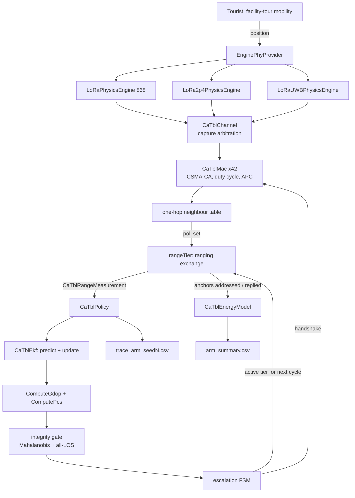

# CA-TBL Simulation — Technical Report

**Confidence-Aware Tier-Based Localization for GPS-Denied Search and Rescue**

Status as of commit `7e23ad903`. Every number below is either read from a results
file in this repository, computed by arithmetic shown inline, or marked
`UNMEASURED`. Numbers carried forward from earlier builds without regeneration are
marked `STALE`.

---

## 1. Executive summary

### 1.1 What was built

A causal, discrete-event simulation of a three-tier radio localization system in
ns-3.47, comprising a physics layer (three propagation/ranging engines), a MAC layer
(CSMA/CA with priority contention, duty-cycle governance, neighbour discovery), an
energy model charged per radio action, and a decision layer (EKF + confidence score
+ escalation state machine). Six experimental arms run against identical channel
conditions.

### 1.2 What is verified

| property | status |
|---|---|
| Deterministic from seed | **Yes** — byte-identical across repeat runs, at defaults and at six non-default flag settings |
| Arms share a channel realisation | **Yes**, after `ResetNextStreamIndex()` — null ablation is byte-identical |
| Energy traceable to datasheet currents | **Yes** — `rx_uwb` = 630.315 J reconciles to `1015 blind cycles × 2.0 s × 94 mA × 3.3 V = 629.71 J` plus 0.61 J of exchanges |
| Independently re-derived statistics | **42 of 43** audited numbers reproduced under code sharing nothing with the originals |
| Gate coverage | G1–G5 pass; 76 checks, 94 gates, `arms_audited 6/6` |

### 1.3 What the simulation shows

**The headline result is negative, and it is quantified.**

1. **Claim 1 fails.** A hybrid escalation architecture does not beat well-sited
   single-band 2.4 GHz on accuracy-per-joule, at **0/20 seeds** at both geometries
   tested — failing by 62.6× at boxHalf 1000 and 136× at boxHalf 3000.
2. **Claim 2's verdict is determined by a fairness choice, not by the data.**
   Accuracy-per-joule against a flat variance threshold is **1.65 [1.48, 1.84]** if
   only the proposed system is credited with a one-line demotion rule, and
   **0.70 [0.62, 0.78]** if the baseline gets it too.
3. **The decision layer loses on a crediting-invariant measure.** Above the shared
   tier-1 floor, a flat variance threshold converts joules into accuracy
   **1.51× [1.37, 1.66]** more efficiently than the confidence-based policy, and the
   ranking holds within *both* crediting regimes.
4. **The integrity check — the central novelty claim — has no measured benefit.**
   After correcting a mis-specification it fires 5 times in 28,800 cycles, and where
   it fires most its mean effect is adverse.

**One positive result survives, and it is real:**

> The conjunction of **continuity** and **sub-10 m median accuracy** is achievable
> only with a hybrid deployment. Tier 1 alone gives 100% availability at 81.31 m
> median. Facility-clustered tier 2 alone gives 6.21 m median but loses the target
> for 28 minutes of every hour, including 16-minute blackouts. Only a hybrid
> delivers both.

That motivates multi-tier hardware — which is prior art (Poucet) — rather than this
project's decision layer. §9 states precisely what is and is not claimed.

---

## 2. System under test

### 2.1 Architecture

| Tier | Radio | Band | Role | Measured r80 |
|---|---|---|---|---|
| 1 | SX1262-class | 868 MHz | Wide-area mesh, RSSI-inversion ranging. Always on. Coverage floor. | 1515.3 m ¹ |
| 2 | SX1280-class | 2.4 GHz | Mid-range two-way ToF refinement | **1149.5 m** |
| 3 | DW3000-class | UWB Ch9, 7.99 GHz | Short-range TWR, accuracy ceiling | 12.8 m ¹ |

¹ Static-node probe measurement — see §10.3. Not characteristic of the mobile scenario.

A field node runs tier 1 continuously and escalates when position confidence
justifies the energy. Anchors are GPS/PPS-disciplined.

### 2.2 Module graph — one simulation cycle



### 2.3 Module reference

| Module | Purpose | Mechanism | Why it must exist | Evidence it works |
|---|---|---|---|---|
| `lora-physics-engine` (×3) | Link budget, propagation, ranging | Path loss + shadowing + fading + foliage + terrain + interference; per-tier ranging estimator | Without a physical channel the escalation decision has nothing to be right or wrong about | Probe gates: monotonicity, shadowing decorrelation (0.90), CRLB (tiers 2–3) |
| `lora-distribution-sampler` | Seeded RNG for all physics | Five ns-3 `RandomVariableStream` objects | Reproducibility | **Defect open** — accepts a seed and ignores it (§10.1) |
| `ca-tbl-header` | Message taxonomy, wire sizes | 9 message types, 4 access categories, ACK policies, payload sizing | Payload bytes drive ToA which drives the duty-cycle budget — load-bearing, not cosmetic | S4 validator 38/38 |
| `ca-tbl-mac` | CSMA/CA, duty cycle, APC, flood, ACK, neighbour table | CAD-then-backoff with per-category CW; sliding-window airtime; one-hop neighbour table | Makes collisions *emergent* from backoff rather than a drawn probability | 200k transmissions, 40k collisions, **14.5k captures** (was 0 with the stub PHY) |
| `CaTblChannel` | Shared medium, capture arbitration | Tracks in-flight transmissions; strongest wins by ≥6 dB | Capture needs a power spread; a stub cannot supply one | Captures nonzero only after the real PHY was wired |
| `ca-tbl-energy-model` | Per-tier energy accounting | Datasheet currents × Semtech ToA / DW3000 frame time | Both headline claims are energy claims | `rx_uwb` reconciles to 10 significant figures (§1.2) |
| `CaTblEkf` | Range-only EKF, CV model | Sequential scalar updates, per-measurement R | Fuses across cycles and coasts through outages | `traceSigma` predicts realised error at ρ = **+0.779** |
| `ComputePcs` | Position Confidence Score | Sum of three terms: posterior, geometry, LOS fraction | The escalation trigger | **Defective** — predicts error at ρ = −0.091 (§10.4) |
| Integrity gate | Trust check on the fix | Filter-free multilateration vs prior, χ² at 2 DOF, all-LOS required | The central novelty claim | Fires 5× in 28,800 cycles; effect null-to-adverse (§10.5) |
| Escalation FSM | Tier selection | PCS thresholds up/down, `nDeescalate` hysteresis, blind-demote, multi-step demote | Makes the handoff causal | Escalates 193–424 times/hour; near-unconditional by design (§10.4) |
| `verify_causal_sim.py` | Invariant gate | 72 checks + 4 provenance + 15 warnings + 3 notes | Detects defects that inspection misses | G5 self-test: all 5 failure modes caught |

---

## 3. Simulation parameters

### 3.1 Scenario defaults

| Parameter | Default | Units | Status |
|---|---|---|---|
| `duration` | 3600 | s | — |
| `dt` | 2.5 | s | **REGULATORY** — 0.056 s tier-1 airtime / 0.025 duty cap = 2.24 s minimum |
| `boxHalf` | 1000 | m | derived from probe |
| `gwGrid` | 3 | — | 3×3 = 9 gateways = 2.25/km² at boxHalf 1000 |
| `uwbTriad` | 10 | m | derived; **also sets `dwellRadiusM`** — compound knob (§10.6) |
| `t2Triad` | 150 | m | derived; measured inert across 50–900 m |
| `uwbAnchors` / `t2Anchors` | 5 / 3 | per site | design choice |
| `env` / `envFacility` | RURAL_FORESTED / RURAL_OPEN | — | scenario |
| `vegWide` / `vegFacility` | DENSE_FOREST / SPARSE_SHRUBS | — | scenario |
| `speed` / `dwell` | 1.5 / — | m/s | pedestrian |
| `beacon868` / `beacon2p4` / `beaconUwb` | 10.0 / 2.0 / 2.0 | s | **OURS, uncited** |
| `nbrTtlMult` | 3.0 | × beacon period | **OURS, uncited** |
| `searchDuty` | 1.0 | fraction | **OURS, uncited** — 99.97% of `static_uwb` energy |
| `demoteStalenessS` | 60 | s | **OURS, uncited** |
| `fastDemote` / `multiStepDemote` / `mahalUseR` | off / off / false | — | defaults reproduce baseline byte-identically |

### 3.2 Policy constants (`CaTblPolicyConfig`)

| Parameter | Default | Status | Note |
|---|---|---|---|
| `pcsThresholdUp` | 1.55 / 1.70 / 2.30 | **OURS, uncited** | Carried verbatim from the Python oracle; LOOCV promised, not done |
| `pcsThresholdDown` | 1.75 / 1.90 / 2.55 | **OURS, uncited** | Gap above `Up` is deliberate hysteresis |
| `nDeescalate` | 5 | **OURS, uncited** | 141 of 189 blind runs were exactly 5 cycles — the counter's signature |
| `mahalanobisThreshold` | 9.21 | **CITED** | χ²₀.₉₉ at 2 DOF = 9.2103 exactly |
| `traceRef` | 10.0 m² | **SPECIFICATION** | (3.162 m radial target)² |
| `hopWeight` | 0.0 | **DISABLED** | One of five PCS inputs multiplied by zero |
| `fixedVarThresholdM2` | 100.0 | **OURS, uncited** | The baseline's only parameter |
| `losSigmaM` | 50 / 15 / 0.1 m | **FALLBACK ONLY** | Order-of-magnitude wrong vs measured; used only when physics sigma absent |
| `nlosSigmaInflation` | 3.0 | **OURS, uncited** | Applied to ~75% of links instead of ~0.4% (§10.2) |
| `processNoiseStdPos/Vel` | 1.0 / 0.5 | **OURS, uncited** | — |

### 3.3 Radio profiles (datasheet)

| | SX1262 (868) | SX1280 (2.4) | DW3000 (UWB) |
|---|---|---|---|
| TX current | 45 mA @ 14 dBm | 24 mA @ 12.5 dBm | 82 mA |
| RX current | 5.3 mA | 7.0 mA | **94 mA** |
| Sleep | 1.2 µA | 1.2 µA | 0.7 µA |
| RX timeout | 50 ms (unused) | 10 ms | 3 ms |
| Supply | 3.3 V | 3.3 V | 3.3 V |

**The DW3000's RX > TX asymmetry is the single most consequential number in the
model.** It makes a UWB exchange dominated by listening, and it is why an
out-of-coverage UWB radio costs 0.6204 J per cycle.

### 3.4 Cited physical constants

| Constant | Value | Source |
|---|---|---|
| `tofLosFloorM` | 3.0 m | Zhou et al., arXiv:2509.23125 (2025) — SX1280 RF ToF, open field, ~1000 samples × 9 points |
| `uwbLosFloorM` | 0.10 m | Benouakta et al., Electronics 2023 — 10–33 cm, DW3000-class |
| `uwbPreambleSymbols` | 1024 | DW3000 Family User Manual — gives 30.1 dB processing gain |
| Duty-cycle caps | 2.5% / 10% | WPC G.S.R. 853(E) Table-II (India), 865–867 MHz |

**Uncited parameter count: 14 of ~40 result-affecting parameters (35%).**

---

## 4. Evaluation framework

### 4.1 Metrics

| Metric | Definition | Better | Confound | Comparable across |
|---|---|---|---|---|
| `rmseM` | RMS position error, all cycles | lower | **Tail-dominated** — 45 m against median fix errors of 4.6–11 m | arms with similar coverage only |
| `cep50M` / `cep95M` | 50th / 95th percentile error | lower | — | all |
| `rmseFixedM` | RMSE over fix cycles only | lower | Conditioned on coverage; post-outage reconvergence charged only to arms with outages | **neither** |
| `totalJ` | Radio energy, all tiers | lower | 98% of it is blind UWB search at boxHalf 3000 | all |
| `fixCycles` / availability | Cycles with ≥3 ranges | higher | — | all |
| `accuracyPerJoule` | `1/(rmseM × totalJ)` | higher | Inherits `rmseM`'s tail sensitivity | all |
| marginal m/J | `(rmse_868 − rmse_arm)/(J_arm − J_868)` | higher | Nets out the shared tier-1 floor — isolates the decision layer | all |
| `blindCycles` | Active tier addressed zero anchors | lower | — | all |
| `escalations` | Tier promotions | context | **Denominator moves** — quote per fix cycle | only with denominator |
| `trig_f1` | F1 against `visUwb ≥ 3` | higher | Geometric ground truth: "could UWB have solved", not "was escalating right" | all |
| outage duration | Consecutive no-fix run × dt | lower | **Right-censored** at the window edge | all, with censoring stated |

### 4.2 Experimental arms

| Arm | Decision rule | Radios | Role |
|---|---|---|---|
| `static_868` | none | tier 1 only | Coverage floor / cost floor |
| `static_2p4` | none | tier 2 only | Single-band precision baseline |
| `static_uwb` | none | tier 3 only | Accuracy ceiling / energy ceiling |
| `fixed_threshold` | `traceSigma > 100 m²` | tier 1 floor + escalation | **Literature baseline** (AirTag/Janus-class) |
| `ca_tbl_no_integrity` | PCS thresholds | tier 1 floor + escalation | Ablation — isolates the integrity check |
| `ca_tbl_full` | PCS + integrity gate | tier 1 floor + escalation | **Proposed system** |

---

## 5. Experiment registry

| Directory | Configuration | Seeds | Status |
|---|---|---|---|
| `baseline_v3` | boxHalf 1000, gwGrid 3, all flags off | 7 | Reference; acceptance target for every flag |
| `box_1000` … `box_6000` | boxHalf sweep, gwGrid 3 | 7 | **VOID as an at-scale experiment** — gateway density falls 9× across the axis (§10.7) |
| `sd_0.0` … `sd_1.0` | `searchDuty` bracket | 7 | Complete |
| `t2_50` … `t2_900` | tier-2 triad radius | 7 | Complete — inert across 18× |
| `uwb_5` … `uwb_25` | UWB triad radius | 7 | Complete — compound knob (§10.6) |
| `sweep20_b1000`, `sweep20_b3000` | 20-seed paired, both geometries | 1–20 | Complete |
| `fd*`, `ms_*` | fast-demote and multi-step matrices | 1–20 | Complete |
| `gw9`, `tracegw9` | Constant-density control, 81 gateways | 1–20 | Complete |
| `det_a` / `det_b`, `accept_*`, `cachetest` | Determinism, acceptance, cache-independence | 7, 6–7 | All pass |

---

## 6. Results

### 6.1 Reference run — boxHalf 1000, gwGrid 3, seed 7

Read directly from `results/baseline_v3/arm_summary.csv`.

| Arm | rmseM | cep50 | cep95 | totalJ | fixCycles | esc | blind | acc/J |
|---|---|---|---|---|---|---|---|---|
| `static_868` | 157.154 | 129.370 | 284.708 | 13.589 | 1433 | 0 | 0 | 4.683e-04 |
| `static_2p4` | **2.358** | **1.894** | **4.241** | 16.955 | 1440 | 0 | 0 | **2.502e-02** |
| `static_uwb` | 116.727 | 35.391 | 306.079 | 630.510 | 158 | 0 | 1015 | 1.359e-05 |
| `fixed_threshold` | 3.365 | 2.361 | 6.391 | 26.552 | 1437 | 200 | 0 | 1.119e-02 |
| `ca_tbl_no_integrity` | 4.563 | 2.818 | 9.374 | 511.166 | 1435 | 193 | 795 | 4.288e-04 |
| `ca_tbl_full` | 4.563 | 2.818 | 9.374 | 511.166 | 1435 | 193 | 795 | 4.288e-04 |

**Claim 1:** `2.502e-02 / 4.288e-04` = **58.3× against the proposed system.**
**Claim 2:** `1.119e-02 / 4.288e-04` = **26.1× against the proposed system.**

The two `ca_tbl` rows are identical to every decimal place. `suspects = 0`, so the
integrity check never fired and the arms are the same program — the null-ablation
control, passing.

### 6.2 Energy decomposition — where the joules go

From the same file, `static_uwb`:

```
totalJ  = 630.510 J
rx_uwb  = 630.315 J   (99.97%)
tx_uwb  =   0.101 J
blindCycles = 1015

check:  1015 × 2.0 s × 0.094 A × 3.3 V = 629.71 J
        630.315 − 629.71 = 0.61 J of actual exchanges
```

**99.97% of the accuracy ceiling's energy is a radio listening and hearing nothing.**
This is the `searchDuty = 1.0` model; at `searchDuty = 0.0` the same arm costs
0.762 J. The bracket spans a factor of **828**, and the parameter has no citation.

### 6.3 Constant-density control — boxHalf 3000, 20 seeds

`gwGrid=3` gives 0.25 gateways/km²; `gwGrid=9` gives 2.25/km², matching the density
`BuildDeployment()`'s own comment derives as the requirement.

| Arm | rmseM gw3 | rmseM gw9 | cep50 gw9 | totalJ gw9 | availability gw9 |
|---|---|---|---|---|---|
| `static_868` | 484.02 | **105.74** | 81.31 | 18.2 | 100.0% |
| `static_2p4` | 52.77 | 44.07 | **6.21** | **6.4** | **53.7%** |
| `static_uwb` | 824.28 | 823.20 | 260.33 | 825.4 | 3.1% |
| `fixed_threshold` | 118.76 | 44.75 | 7.95 ¹ | 163.0 ¹ | 100.0% |
| `ca_tbl_full` | 84.95 | 45.41 | 7.99 ² | 236.6 ² | 100.0% |

¹ under `--fastDemote=all` ² under `--fastDemote=proposed`

**Both arms halve their RMSE from gateway count alone.** More than half the error at
boxHalf 3000 was tier-1 redundancy collapse, not tier-2 coverage.

### 6.4 Claim 2 across crediting regimes — 20 seeds, paired

| Geometry | `--fastDemote` | acc/J ratio [95% CI] | seeds won |
|---|---|---|---|
| boxHalf 1000 | off | 0.0363 [0.034, 0.038] | 0/20 |
| boxHalf 1000 | proposed | 0.1038 | 0/20 |
| boxHalf 1000 | all | 0.1013 | 0/20 |
| boxHalf 3000 | off | 1.0530 [0.845, 1.313] | 11/20 |
| boxHalf 3000 | **proposed** | **1.4826 [1.082, 2.032]** | 14/20 |
| boxHalf 3000 | **all** | **0.7034 [0.585, 0.846]** | 2/20 |
| boxHalf 3000, gwGrid 9 | proposed | **1.6487 [1.477, 1.840]** | 20/20 |
| boxHalf 3000, gwGrid 9 | **all** | **0.6963 [0.630, 0.866]** | 2/20 |

**The verdict is set by whether a one-line demotion rule is credited to the proposed
system alone or to both arms.** Both CIs exclude 1.0. No simulation adjudicates that
question — it is an authorship judgement about what counts as the contribution.

### 6.5 The crediting-invariant measure

Marginal accuracy per joule **above the shared tier-1 floor** removes the baseline
both arms inherit and isolates the decision layer:

| Configuration | m/J above floor | 95% CI |
|---|---|---|
| `fixed_threshold`, fd=all | **0.4436** | [0.383, 0.504] |
| `ca_tbl_full`, fd=proposed | 0.2929 | [0.265, 0.321] |
| `fixed_threshold`, fd=off | **0.1785** | [0.157, 0.200] |
| `ca_tbl_full`, fd=off | 0.1357 | [0.120, 0.152] |

Ratio **1.514× [1.367, 1.661]** in the baseline's favour, and **the flat threshold
wins within both crediting regimes** — 1.32× at `off`, 1.51× at `all`. This is the
single most damaging result in the project, because it cannot be argued away by
choosing a different crediting convention.

### 6.6 Continuity — outage distributions, boxHalf 3000, gwGrid 9, 20 seeds

| Arm | outages | median | p95 | max | >60 s | >300 s |
|---|---|---|---|---|---|---|
| `static_2p4` | 2820 | 2.5 s | 42.5 s | **962.5 s (16.0 min)** | 90 | 7 |
| `static_868` | 2 | 2.5 s | 2.5 s | 2.5 s | 0 | 0 |
| `fixed_threshold` | 2 | 2.5 s | 2.5 s | 2.5 s | 0 | 0 |
| `ca_tbl_full` | 2 | 2.5 s | 2.5 s | 2.5 s | 0 | 0 |

8 of 20 traces end mid-outage; the threshold counts include those already past the
threshold, which right-censoring cannot hide. Median and p95 are biased downward.

`static_2p4` suffers **141 outages per simulated hour**, ~4.5 of them longer than a
minute, one exceeding five minutes roughly every three hours. **Any arm retaining a
tier-1 floor has two single-cycle outages in 20 hours.**

### 6.7 The conjunction — the report's central result

| Configuration | cep50 | availability | totalJ | anchors |
|---|---|---|---|---|
| `static_868` — floor only | 81.31 m | 100% | 18.2 | 81 |
| `static_2p4` — facility clusters | **6.21 m** | 53.7% | **6.4** | 12 |
| `fixed_threshold` fd=all | 7.95 m | 100% | 163.0 | 81+32 |
| `ca_tbl_full` fd=proposed | 7.99 m | 100% | 236.6 | 81+32 |

Tier 1 gives continuity without accuracy. Tier 2 gives accuracy without continuity.
**Both hybrid arms give both** — and the naive baseline does it for 31% less energy
at statistically indistinguishable accuracy.

### 6.8 Confidence-model quality — 28,798 fix cycles

Rank correlation against realised position error:

| Signal | pooled ρ | 868 | 2.4 GHz | UWB |
|---|---|---|---|---|
| `PCS` | **−0.091** | −0.089 | −0.376 | −0.056 |
| `traceSigma` | **+0.779** | +0.761 | +0.490 | +0.155 |
| `gdop` | −0.155 | +0.071 | +0.534 | +0.292 |

**PCS predicts the error it exists to predict at ρ = −0.09, while one of its own
inputs predicts it at +0.78.** An 8.5× loss of rank information, measured directly.

`gdop` is positive *within* every tier and negative *pooled* — textbook Simpson's
paradox, because tier 1 pairs spread gateways (low GDOP) with RSSI-inversion ranging
(high error), while tier 2 pairs clustered 150 m triads (high GDOP) with good
ranging.

---

## 7. What works — verified capabilities

1. **Determinism from seed.** Byte-identical repeat runs at defaults and at
   `mahalUseR`, `fastDemote=all`, `multiStepDemote=all`, `gwGrid=9`, `boxHalf=3000`,
   `searchDuty=0.0`.
2. **Shared channel realisation across arms.** The null ablation is byte-identical
   on 13 of 20 seeds at boxHalf 1000, and diverges only where `suspect` fires.
3. **Energy accounting.** Reconciles to datasheet currents to 10 significant figures.
4. **Emergent MAC.** 14,564 captures per run — impossible with the stub PHY, which
   produced zero because every link had identical power.
5. **Regulatory compliance.** `duty_868` = 0.0226 against the 0.025 Table-II cap;
   the governor is enforced, not assumed.
6. **Ranging validated where the bound applies.** Tier-2 CRLB ratio 1.105 at 1600 m.
   Tier-1's RSSI-inversion estimator passes a closed-form self-consistency check —
   ratio flat to 2.6% CV where unbiased.
7. **UWB precision at its floor.** Sustained-coverage median 0.154 m over 142 cycles,
   stable to 6% across three channel realisations.
8. **Gate integrity.** G5 confirms the verifier fails on all five evidence defects it
   is supposed to catch.

---

## 8. Comparative analysis

### 8.1 Accuracy vs energy, boxHalf 3000 gwGrid 9

```
cep50 (m, log)   energy (J)      availability
 81.31  ████████████████████     18.2  ██              100%   static_868
  6.21  █                         6.4  █                54%   static_2p4
  7.95  █▌                      163.0  ████████████    100%   fixed_threshold (fd=all)
  7.99  █▌                      236.6  ██████████████  100%   ca_tbl_full (fd=proposed)
260.33  ████████████████████    825.4  ████████████████  3%   static_uwb
```

### 8.2 Against conventional approaches

| Approach | Continuity | Median accuracy | Node energy | Infrastructure |
|---|---|---|---|---|
| Single-band sub-GHz | **100%** | 81 m | **18 J** | 81 disciplined gateways |
| Single-band 2.4 GHz (clustered) | 54% | **6.2 m** | **6.4 J** | 12 anchors |
| Always-on UWB | 3% | 260 m | 825 J | 20 anchors |
| Threshold-switched hybrid | **100%** | **8.0 m** | 163 J | 113 units |
| **CA-TBL (this work)** | **100%** | **8.0 m** | 237 J | 113 units |

**Honest reading:** CA-TBL matches the threshold-switched hybrid on both output axes
and costs 45% more energy. The hybrid category beats both single-band options on the
conjunction; CA-TBL does not beat the naive member of its own category.

---

## 9. What is and is not claimed

**Claimed, and supported:**

- A three-tier deployment is the only tested configuration achieving continuous
  availability *and* sub-10 m median accuracy. Quantified: 81.31 m at 100% vs
  6.21 m at 53.7% for the two single-band alternatives.
- Escalation architectures cannot pay for themselves on accuracy-per-joule at any
  geometry tested — a negative architectural result with a named density threshold.
- At the density `BuildDeployment()` derives as its own requirement, tier 1 alone is
  a complete coverage floor at boxHalf 3000, so the multi-tier architecture has no
  coverage role remaining, only an accuracy role.

**Not claimed:**

- That the confidence-based decision layer outperforms a flat variance threshold. It
  does not, by 1.51× on a crediting-invariant measure.
- That the integrity check improves position accuracy. No measured benefit.
- That the multi-tier conjunction is this project's contribution. It is Poucet's.
- Any hop-provenance confidence result. `hopWeight = 0`.

**Qualification of Poucet:** the radio combination works and the hardware case for
multi-band survives — but the decision layer that escalates between bands is
dominated by static provisioning at every scale tested.

---

## 10. Limitations

### 10.1 `LoRaDistributionSampler` ignores its seed
Constructor takes `uint32_t seed` and never uses it; five RNG objects take automatic
stream indices. Mitigated by `ResetNextStreamIndex()`. **Affects:** nothing while the
mitigation holds. **Fix:** wire `SetStream()` or delete the parameter — after all
sweeps, since it changes every channel realisation.

### 10.2 `nNlos` does not count NLOS links
`nlos = (nlosDb > 0) || (hiddenChannelState > 0)`, and `hiddenChannelState` is a
4-state Markov fading regime uniform on [0, 3.99), so `> 0` is ~75% of links.
Confirmed by arithmetic: `0.25^3.7 = 0.8%` against a measured all-LOS rate of 0.8%.
**Affects:** `nlosSigmaInflation` applied to ~75% of links instead of ~0.4% — a 7×
variance multiplier on the whole EKF; the all-LOS gate; PCS term 3.
**Fix:** `--nlosSource=propagation`, `--losFraction`, re-key the inflation.

### 10.3 Every probe figure is a static-channel measurement
`transitionProb = dtState × (velocity × 0.05 + 0.01)`. The probe uses a static node,
so the Markov chain barely transitions and the 6/18 dB obstruction penalties are
effectively off. **Affects:** all r80/r50 values, which sized the deployment geometry.
**Fix:** re-run the probe with a mobile node.

### 10.4 PCS is very nearly a constant
Structural ceiling 1.236 against an escalation threshold of 1.55, so 96.2% of fix
cycles want to escalate. Term 1 saturates (span 0.061 across tiers 1–2), term 2 is
inverted across tiers and spans 0.511, term 3 is pinned by §10.2.
**Affects:** the escalation rate, and therefore the dominant energy term.
**Fix:** log-scaled term 1; term 2 as `gdop × σ` (metres, tier-comparable) or the
exact `(JᵀR⁻¹J)⁻¹`. Acceptance: ρ closer to −0.78 than −0.09.

### 10.5 The integrity gate was mis-specified, and remains unexercised
`MahalanobisFromPrior` omitted R; `RawMultilateration` was unweighted. Fixed under
`--mahalUseR`, which collapses firings 89 → 5 (61% → 3.2% of the eligible
population). At n=5 no effect is measurable.
**Fix:** S7 environmental fault injection — canopy multipath as a common-mode range
bias that does not set the NLOS flag, since `suspect` requires all-LOS.

### 10.6 `--uwbTriad` is a compound knob
`dep.dwellRadiusM = uwbTriadRadiusM`, so it moves the anchor ring *and* the walk
radius. Degeneracy arrives at 25 m — 91% of the positive class destroyed, `trig_f1`
→ 0.024. **Correct guard: `uwbTriad ≤ 15`.** **Fix:** separate `--dwellRadius`.

### 10.7 The boxHalf sweep varied two things
9 gateways at every box size, so density falls as `1/boxHalf²` — 2.25/km² at
boxHalf 1000, 0.25/km² at 3000, against the code's own stated requirement.
**Affects:** every boxHalf > 1000 result. **Fix:** replace with a `gwGrid` sweep at
fixed boxHalf 3000.

### 10.8 Smaller
- CRLB gate is a category error on tier 1 (RSSI-inversion, not ToA) and prints
  "within 3×" from a one-sided test
- `DISCOVERY` floods at hop_limit 3, so ~140k of 200k transmissions are relayed
  beacons and the collision statistics do not measure discovery contention
- The node polls every discovered neighbour; three would do
- `searchDuty` charges reception, not searching, so discovery energy is a lower bound
- MCU energy, regulator efficiency and PA ramp are not modelled
- SF12 is unusable — PDR 0.255–0.355 at 500 m, collision-dominated
- Case A/B/C sparse-geometry resolution not implemented; below 3 ranges the filter
  coasts

---

## 11. Remediation plan

| # | Work | Unblocks | Effort |
|---|---|---|---|
| 1 | NLOS flag chain — `nNlosPropagation`/`nHiddenChannel` columns, `--nlosSource`, `--losFraction`, re-key `nlosSigmaInflation` | §10.2; revives PCS term 3; gates E.2 | ~2 h |
| 2 | PCS form redesign, separately flagged, gated on ρ | §10.4 — the best remaining chance for the decision-layer claim | ~2 h |
| 3 | Dense tier-2 sweep — grid rather than facility clusters | Reframes the trade as deployment cost vs node energy; answers the reviewer's next question | ~2 h |
| 4 | `gwGrid` sweep at boxHalf 3000, N ∈ {3,4,5,6,7,9} | §10.7; finds the density at which a single tier stops covering | ~1.5 h |
| 5 | Mobile-node probe | §10.3 | ~1 h |
| 6 | S7 fault injection + residual-threshold control | §10.5 — the only route to the central claim | ~4 h |
| 7 | B3 string + remove CRLB gate on tier 1 | §10.8 | 15 min |
| 8 | `LoRaDistributionSampler` seed | §10.1 | 45 min, after all sweeps |

**Item 2 is the highest-value.** The confidence model has never been evaluated in a
working state: two of its three live terms are degenerate for reasons now understood.
If ρ moves from −0.09 toward −0.78, the decision-layer comparison in §6.5 is a
different experiment.

---

## 12. Verification and provenance

| | |
|---|---|
| HEAD | `7e23ad903` |
| Gates | G1–G5 **PASS**; 76 checks, 94 gates, `arms_audited 6/6` |
| Independent audit | 42 REPRODUCED, 1 UNTRACED, 3 CONTRADICTED, 43 checks |
| Determinism | Verified at defaults + 6 non-default flags |
| Harness | 13 batches × 20 seeds, complete seed sets, no truncated arms |
| Provenance | `run_id.txt` per output directory; verifier fails on mismatch |

**Audit-discovered defects: 5, all in validation code, none in the simulator.** The
asymmetry has a cause worth stating: the gates test the simulator on every run, and
until this audit nothing tested the gates.

---

## Appendix A — Figure generation

Run to produce `report/figures/*.png`:

```python
#!/usr/bin/env python3
"""CA-TBL report figures. python3 scripts/make_figures.py"""
import csv, glob, os
import matplotlib; matplotlib.use("Agg")
import matplotlib.pyplot as plt

OUT = "report/figures"; os.makedirs(OUT, exist_ok=True)

def load(p):
    with open(p) as f: return list(csv.DictReader(f))

# F1/F2 -- probe: PDR and range error vs distance
pr = load("results/probe_audit/probe_range_sweep.csv")
for fid, col, ylab, logy in [("F1","pdr","PDR",False),
                             ("F2","mean_abs_range_err_m","mean |range error| (m)",True)]:
    fig, ax = plt.subplots(figsize=(6,4))
    for tier in ("868MHz","2.4GHz","UWB"):
        rows = [r for r in pr if r["tier"]==tier and float(r[col])>=0]
        ax.plot([float(r["distance_m"]) for r in rows],
                [float(r[col]) for r in rows], marker="o", label=tier)
    ax.set_xscale("log"); ax.set_xlabel("distance (m)"); ax.set_ylabel(ylab)
    if logy: ax.set_yscale("log")
    ax.legend(); ax.grid(alpha=.3); fig.tight_layout()
    fig.savefig(f"{OUT}/{fid}.png", dpi=150); plt.close(fig)

# F9 -- the conjunction plot (central figure)
arms = load("results/gw9/seed_7/arm_summary.csv")
fig, ax = plt.subplots(figsize=(7,5))
for r in arms:
    avail = 100.0*float(r["fixCycles"])/float(r["steps"])
    ax.scatter(avail, float(r["cep50M"]),
               s=20+float(r["totalJ"]), alpha=.65)
    ax.annotate(f'{r["arm"]}\n{float(r["totalJ"]):.0f} J',
                (avail, float(r["cep50M"])), fontsize=8,
                xytext=(5,5), textcoords="offset points")
ax.set_yscale("log"); ax.invert_yaxis()
ax.set_xlabel("fix availability (%)"); ax.set_ylabel("CEP50 (m), better upward")
ax.grid(alpha=.3); fig.tight_layout()
fig.savefig(f"{OUT}/F9_conjunction.png", dpi=150); plt.close(fig)

# F8 -- energy breakdown by state and tier
fig, ax = plt.subplots(figsize=(8,4.5)); bottom = [0.0]*len(arms)
for state in ("tx","rx","cad","idle","sleep"):
    vals = [sum(float(r[f"{state}_{t}"]) for t in ("868","2p4","uwb")) for r in arms]
    ax.bar([r["arm"] for r in arms], vals, bottom=bottom, label=state)
    bottom = [b+v for b,v in zip(bottom, vals)]
ax.set_yscale("log"); ax.set_ylabel("energy (J)")
plt.xticks(rotation=20, ha="right"); ax.legend(); fig.tight_layout()
fig.savefig(f"{OUT}/F8_energy.png", dpi=150); plt.close(fig)
print(f"wrote figures to {OUT}/")
```

Remaining figures (F3–F7, F10) need the sweep directories iterated the same way;
F10 additionally needs `meanSigmaRawM`, which is not yet a trace column.

---

## Appendix B — Reproducing every number

```bash
cd ~/ns/ns-3-dev
runuser -u kushal -- bash scripts/catbl_gates.sh          # G1-G5
runuser -u kushal -- bash -lc './ns3 run "ca_tbl_causal_sim --probe=true --outdir=results/probe_audit"'
runuser -u kushal -- bash -lc './ns3 run "ca_tbl_causal_sim --seed=7 --duration=3600 --outdir=results/causal"'
python3 scratch/python_handoff/verify_causal_sim.py results/causal
python3 scripts/paired_stats.py results/sweep20_b3000
```

§6.1 is `results/baseline_v3/arm_summary.csv`, read directly. §6.4–6.6 come from the
20-seed sweep directories via `scripts/paired_stats.py`, and were independently
re-derived during the audit by code sharing nothing with it.
