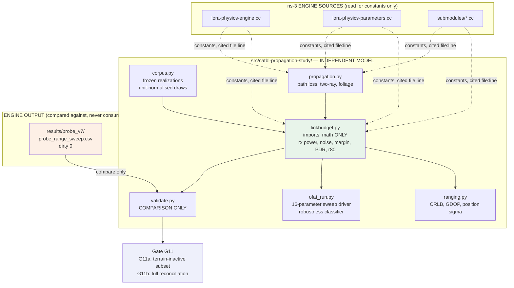
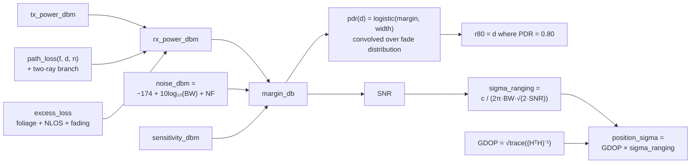
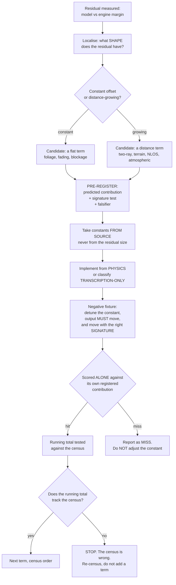
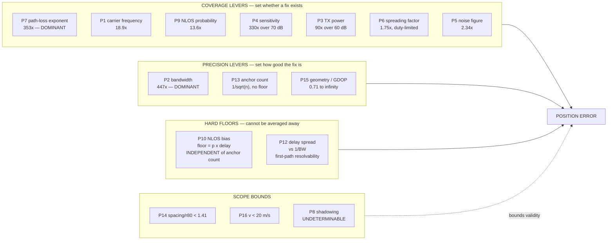

# Report 1 — The Independent Mathematical Propagation Module

**Module path:** `src/catbl-propagation-study/`
**Project:** CA-TBL — Confidence-Aware Tier-Based Localization (ns-3.47)
**Author:** Kushal Yalamanchi
**Status of this report:** complete; the module's experimental work is finished
**Corpus:** `n = 2000`, digest `ea40076996e71a84b4bcce81`, seed `20260819`

---

## Table of contents

1. [Purpose — why a second, independent model exists](#1-purpose--why-a-second-independent-model-exists)
2. [Design principles and the independence rule](#2-design-principles-and-the-independence-rule)
3. [Module structure and file inventory](#3-module-structure-and-file-inventory)
4. [The frozen realization corpus](#4-the-frozen-realization-corpus)
5. [The link-budget model — every constant and its source](#5-the-link-budget-model--every-constant-and-its-source)
6. [The validation criterion and how it was applied](#6-the-validation-criterion-and-how-it-was-applied)
7. [Experiment series A — reconciling the model with the engine](#7-experiment-series-a--reconciling-the-model-with-the-engine)
8. [The loss-term census — all seventeen terms](#8-the-loss-term-census--all-seventeen-terms)
9. [Experiment series B — the OFAT campaign, sixteen parameters](#9-experiment-series-b--the-ofat-campaign-sixteen-parameters)
10. [Parameter-by-parameter: ranges, mechanisms, effects on localization](#10-parameter-by-parameter-ranges-mechanisms-effects-on-localization)
11. [Experiment series C — the range-precision frontier](#11-experiment-series-c--the-range-precision-frontier)
12. [Experiment series D — NLOS as bias versus as noise](#12-experiment-series-d--nlos-as-bias-versus-as-noise)
13. [The robustness apparatus and its negative fixture](#13-the-robustness-apparatus-and-its-negative-fixture)
14. [Defects the module found in the simulator](#14-defects-the-module-found-in-the-simulator)
15. [The terminus — what cannot be established and why](#15-the-terminus--what-cannot-be-established-and-why)
16. [Open items with costs](#16-open-items-with-costs)
17. [Consolidated results index](#17-consolidated-results-index)

---

## 1. Purpose — why a second, independent model exists

### 1.1 The gap this module was built to fill

Before this module existed, every tier choice in CA-TBL was an **assertion**:

- Tier 1: 868 MHz at 125 kHz bandwidth
- Tier 2: 2.4 GHz at 800 kHz bandwidth
- Tier 3: UWB Channel 9 (7.99 GHz) at 499.2 MHz bandwidth

The datasheets justify the **hardware** — an SX1262 exists, an SX1280 exists, a DW3000 exists. Nothing justified the **architecture**. There was no answer to the question *"why three tiers, and why these three, rather than one radio chosen well?"* beyond the informal argument that range and precision trade against each other.

### 1.2 The result the module was built to produce

> Ranging precision scales as `1/BW`. Free-space path loss scales as `f²`. Range and precision therefore pull in opposite directions across the band, and their product is approximately conserved. **No single radio can be both long-range and precise. That is why the architecture is tiered.**

The module's job was to demonstrate that analytically, sweep every parameter that enters it, and validate the analysis against the simulator's own physics engines.

### 1.3 What it was not

It was **not** more simulation. It is closed-form propagation and estimation-theory mathematics, with the existing ns-3 engines used as a **validator**, not as a source of numbers.

The economics of that choice matter: an ns-3 campaign cell costs roughly 1.9 minutes of wall time at 11-way parallelism. A closed-form sweep point costs seconds. Where analysis and engine agree, the analysis can then be swept for free across ranges no simulation campaign could ever cover — 150 MHz to 24 GHz, 10 kHz to 2 GHz of bandwidth, 3 to 1000 anchors.

### 1.4 What it actually delivered — summary before the detail

| # | Outcome | Section |
|---|---|---|
| 1 | Found a **six-decibel receiver-sensitivity indexing defect** that had passed every gate, verifier and validation in the project, and which invalidated the entire results tree | [§14.1](#141-d1--the-six-decibel-sensitivity-indexing-defect) |
| 2 | Found three further simulator defects (D2, D3, D4) | [§14.2](#142-d2-d3-d4--three-further-defects) |
| 3 | Found that **eight of sixteen loss terms are structurally zero**, four of them hard-assigned `0.0` on the line *after* the line computing them | [§14.4](#144-eight-of-sixteen-loss-terms-are-structurally-inactive) |
| 4 | Found a **seventeenth loss term living in the reception threshold**, outside the loss sum entirely | [§14.5](#145-the-seventeenth-term--it-lives-in-the-threshold-not-the-sum) |
| 5 | Replaced the datasheet justification of three tiers with a **measured range-precision surface** | [§11](#11-experiment-series-c--the-range-precision-frontier) |
| 6 | **Fired the architecture's own registered falsifier** — and answered it with spectrum policy, not physics | [§11.4](#114-the-falsifier-fired) |
| 7 | Answered `nlosSigmaInflation`: **no scalar value is correct**, because bias and noise differ in their asymptotics in anchor count | [§12](#12-experiment-series-d--nlos-as-bias-versus-as-noise) |
| 8 | Gave the project's universal `v = 0` limitation a number: sound below 20 m/s | [§10.16](#1016-p16--node-speed) |
| 9 | Established that **environment outranks radio** — path-loss exponent moves `r80` by 353× against 18.9× for frequency | [§10.7](#107-p7--path-loss-exponent) |
| 10 | Reached a **hard terminus**: full reconciliation is impossible, and the reason is a property of the question, not of effort | [§15](#15-the-terminus--what-cannot-be-established-and-why) |

---

## 2. Design principles and the independence rule

### 2.1 The central rule

> **A transcription cannot validate its source.**

If the model reproduces the engine by copying the engine's arithmetic, then agreement between them proves only that the copy was accurate. It says nothing about whether either is right.

Every term in the model is therefore classified before implementation:

| Classification | Meaning | Counts as validation? |
|---|---|---|
| **PHYSICS** | Implemented from the published relation the engine cites — ITU-R P.833, ITU-R P.526, the two-ray geometry, the CRLB. The engine's numerical constants are used as *parameters*, cited by `file:line`; the *relation* is derived independently. | **Yes** |
| **TRANSCRIPTION-ONLY** | Reproducible only by copying the engine's own code, because the effect is invented rather than documented. | **No** — counted unvalidated |
| **PARAMETER-ONLY** | A fitted distribution with no underlying physics to implement (e.g. a 2% Bernoulli blockage with a fitted loss). | **No** |

### 2.2 The structural separation rule

An earlier version of the validator (`validate.py`) contained a defect that this rule now prevents structurally.

**The defect.** `validate.py` read `mean_margin_db` directly from the engine's probe CSV and applied a shadowing distribution to it. The link budget — the very quantity the validation exists to check — was **imported from the subject**.

**How it was caught.** By a negative fixture. Detuning `K_BOLTZ_DBM_HZ` by 14 dB produced **byte-identical output**. Detuning a tier's TX power by 16 dB produced **byte-identical output**. Neither constant was on the computation path at all.

**The structural fix.** The model now lives in `linkbudget.py`, which imports **only `math`**:

```python
import math          # the entire import list of linkbudget.py
```

Nothing in that file opens, imports or receives the probe CSV. The probe's margin column *cannot* be in scope, because the probe is not in scope. A later edit cannot silently reintroduce the defect without first adding an import that visibly does not belong.

### 2.3 The pre-registration protocol

Every experiment follows the same discipline, inherited from the parent project:

1. **Register before running.** Parameter, sweep range, prediction with intervals, falsifier, abort condition — committed to git so the timestamp precedes the first result.
2. **Both limits reached.** A sweep continues until the effect *saturates*, *inverts*, or the *model breaks down*, and the report states which of the three happened at each end.
3. **Same corpus, digest recorded.** Two experiments with different corpus digests are not comparable, and the analysis refuses to pool them rather than doing it silently.
4. **State the population and the estimator** of every number.
5. **Negatives are results.** A parameter that does not matter across its whole physical range is reported as a finding.
6. **Report a missed prediction as missed.** Four were missed in the OFAT campaign and all four are in the record.

### 2.4 Module architecture



---

## 3. Module structure and file inventory

| File | Role | Notes |
|---|---|---|
| `corpus.py` | Generates the frozen realization corpus | Seeded, reproducible, digested |
| `results/corpus.json` | The corpus itself, `n = 2000` | Deliberately untracked; digest is tracked |
| `results/corpus.json.sha256` | `ea40076996e71a84b4bcce81` | Recorded in every experiment sidecar |
| `linkbudget.py` | The independent link budget | **Imports only `math`** |
| `propagation.py` | Path loss, two-ray, foliage relations | |
| `ranging.py` | CRLB, GDOP, position sigma | |
| `validate.py` | Compares model against engine probe | Comparison only; never feeds the model |
| `ofat_run.py` | Sixteen-parameter sweep driver, robustness classifier | |
| `results/ofat_campaign.txt` | Raw campaign output | **Never edited** — it is evidence of what the run printed |
| `DEFECTS.md` | Defects found, with fixes and invalidation lists | |
| `experiments/*.md` | Seven pre-registrations, each with its result appended | |

### 3.1 The seven pre-registrations

| File | Registers |
|---|---|
| `FOLIAGE_PREREGISTRATION.md` | The foliage term's predicted contribution and its signature test |
| `TWORAY_PREREGISTRATION.md` | Two-ray ground reflection, four predictions, signature test |
| `LOSS_TERM_CENSUS.md` | The seventeen-term enumeration and the sum-inference rule |
| `G11A_REGISTRATION.md` | The terrain-inactive sub-population and its derivation |
| `JENSEN_FOLIAGE_REGISTRATION.md` | The Jensen-inequality correction to foliage |
| `TERRAIN_SENSITIVITY_REGISTRATION.md` | Terrain invariance of the two headline conclusions |
| `OFAT_CAMPAIGN_REGISTRATION.md` | All sixteen parameter sweeps and the robustness verdict rule |
| `CLASSIFIER_FIXTURE_REGISTRATION.md` | The negative fixture for the robustness classifier |

---

## 4. The frozen realization corpus

### 4.1 Why the corpus is generated first and replayed

The ns-3 scenario's experimental arms consume the random-number stream at **arm-dependent rates**. A cross-arm difference in that simulator therefore always carried a channel-draw component: two arms did not see identical channel conditions, because one of them had consumed more draws by the time it got there.

Generating the realizations up front and replaying them removes that entirely. **Every parameter level sees byte-identical channel conditions**, so any difference between levels is attributable to the parameter and to nothing else.

### 4.2 What one realization contains

```
realization_id
ring_r                            per-realization anchor ring radius
per anchor (30 of them):
    d          true distance
    az         azimuth, with jitter so geometry is not degenerate-symmetric
    u_shadow   unit normal draw       -> scaled at use time by sigma_shadow
    u_fade     unit uniform draw      -> scaled at use time by K-factor
    u_nlos     unit uniform draw      -> thresholded at use time by p_nlos
    u_excess   unit exponential draw  -> scaled at use time by excess delay
```

### 4.3 The unit-normalisation decision, and why it matters

**Draws are stored unit-normalised and scaled at use time.** A shadowing draw is stored as a unit normal; `sigma_shadow` multiplies it when the experiment runs.

This is what lets **one** corpus serve a `sigma_shadow` sweep as a **paired** comparison. Drawing independently at each level would put sampling noise on the very axis being measured — the same defect as comparing two campaigns instead of two arms.

### 4.4 Corpus specification

| Property | Value | Rationale |
|---|---|---|
| Realizations `n` | **2000** | Standard error small enough that no sweep's adjacent-level error bars overlap |
| Seed | `20260819` | Recorded; corpus is fully reproducible |
| Anchors per realization | 30 | Supports P13's 3→30 sweep without redrawing |
| Ring radius | log-uniform over `5 m → 10 km` | Spans P14's full sweep; a corpus drawn only at baseline could not serve a spacing sweep without extrapolating past its own support |
| Anchor radius jitter | `× exp(N(0, 0.25))` | Prevents degenerate symmetric geometry |
| Azimuth jitter | `± 0.15 rad` | Same |
| Digest | `ea40076996e71a84b4bcce81` (SHA-256) | Recorded in every sidecar; cross-digest comparison **refused** |

---

## 5. The link-budget model — every constant and its source

### 5.1 The computation chain



### 5.2 Constants — noise and receiver

| Constant | Value | Source |
|---|---|---|
| `K_BOLTZ_DBM_HZ` | `−174.0` dBm/Hz | `lora-physics-engine.cc:541` |
| `NOISE_FIGURE_DB` | `6.0` dB | `lora-physics-engine.cc:542` |
| `SOFT_THRESHOLD_WIDTH_DB` | `0.35` dB | `lora-physics-parameters.cc:389` |

**Reception is a logistic draw, not a hard threshold** — `1/(1 + exp(−margin/width))`, `lora-physics-engine.cc:135-146`. At 0.35 dB it is nearly a step function, but the form is reproduced because a hard threshold disagrees near the transition for a reason that is *documented rather than physical* (defect D4, §14.2).

### 5.3 Constants — per-tier PHY

Source: `ca_tbl_causal_sim.cc:3571-3573`

| Tier | SF | Bandwidth | TX power | Carrier | Carrier source |
|---|---|---|---|---|---|
| 868 MHz | 7 | 125 kHz | +14.0 dBm | 868 MHz | `lora-physics-parameters.cc:12` |
| 2.4 GHz | 7 | 800 kHz | +12.5 dBm | 2.44 GHz | `lora-2p4-physics-parameters.cc:52` |
| UWB | 7 | 499.2 MHz | −16.47 dBm | 7.99 GHz | `lora-uwb-physics-parameters.cc:52` |

### 5.4 Constants — receiver sensitivity (post-correction)

| Tier | Sensitivity at SF7 | Source | Table structure |
|---|---|---|---|
| 868 MHz | `−123.0` dBm | `lora-physics-parameters.cc:391` | Six entries, index 0 = SF7 |
| 2.4 GHz | `−106.0` dBm | `lora-2p4-physics-parameters.cc:14` | Eight entries, **index 2 = SF7** |
| UWB | `−104.0` dBm | `lora-uwb-physics-parameters.cc:14` | Flat across all eight |

> These are the **post-D1** values. The 2.4 GHz figure was `−100.0` dBm before the six-decibel indexing defect was corrected — see §14.1.

### 5.5 Constants — environment

| Parameter | `RURAL_OPEN` | `RURAL_FORESTED` | Source |
|---|---|---|---|
| Path-loss exponent `n` | 2.2 | 2.3 — `Normal(2.3, 0.1, 2.1, 2.6)` | `lora-physics-parameters.cc:24`, `lora-physics-parameters.cc:27` |
| Shadowing σ | 5.0 dB | 7.0 dB | `lora-physics-parameters.cc:80`, `lora-physics-parameters.cc:82` |
| NLOS σ ratio | 1.25 | 1.30 | `lora-physics-parameters.cc:80`, `lora-physics-parameters.cc:82` |
| NLOS scale | 54 000 m | 8 000 m | `lora-physics-parameters.cc:188`, `lora-physics-parameters.cc:190` |
| NLOS attenuation | `μ = 6.0`, `σ = 5.0` | `μ = 10.0`, `σ = 7.0` | `lora-physics-parameters.cc:188`, `lora-physics-parameters.cc:190` |
| Diffraction | `μ = 4.0`, `σ = 3.0` | `μ = 5.0`, `σ = 3.0` | `lora-physics-parameters.cc:188`, `lora-physics-parameters.cc:190`, `lora-physics-parameters.cc:209` |

**Tier-to-environment mapping** (`ca_tbl_causal_sim.cc:1040`, `ca_tbl_causal_sim.cc:1048`, `ca_tbl_causal_sim.cc:1056` — the macro binds tier 1 to `envWide` and tiers 2 and 3 to `envFacility`; defaults at `ca_tbl_causal_sim.cc:3226-3227`): tier 1 → `RURAL_FORESTED`; tiers 2 and 3 → `RURAL_OPEN`.

### 5.6 Constants — foliage (ITU-R P.833-10)

`lora-foliage-submodule.cc:36`:

```
A_veg = A_max · (1 − exp(−depth · γ / A_max))
```

| Vegetation | γ | `A_max` | Applies to | `A_veg` at median depth 100 m |
|---|---|---|---|---|
| `VEG_DENSE_FOREST` | 0.20 | 25.0 | 868 MHz (`vegWide`) | **13.77 dB** |
| `VEG_SPARSE_SHRUBS` | 0.04 | 8.0 | 2.4 GHz, UWB (`vegFacility`) | **3.15 dB** |

- `depth ~ LogNormal(ln 100, 0.6, 0, 500)` — `lora-physics-parameters.cc:293`
- `γ`, `A_max` — `lora-physics-parameters.cc:300-316`
- Assignment — `ca_tbl_causal_sim.cc:3174-3175`

**The term is distance-independent.** `depth` is a per-link lognormal draw, not a function of link length. Foliage can therefore explain a **constant offset** and never a **slope** — a fact registered before the term was implemented, so that the surviving distance-dependent gap could not later be presented as a discovery.

---

## 6. The validation criterion and how it was applied

### 6.1 The registered acceptance criterion

Fixed in advance, and never relaxed:

```
r80    within 15%      of the engine's measured value, per tier
margin within 3.0 dB   of the engine's measured value, across the swept range, per tier
```

### 6.2 The two gate forms

| Gate | Question | Population | Verdict |
|---|---|---|---|
| **G11b** | Does the fully independent model reconcile with the engine? | All 36 swept points | **PERMANENTLY RED** — see §15 |
| **G11a** | Does the model reconcile where terrain is *provably inactive*? | 8 of 36 points, derived geometrically | **FAIL** — 3 of 8 exceed 3.0 dB |

### 6.3 The G11a sub-population — derived, not chosen

Terrain's procedural loss fires only when the minimum Fresnel clearance ratio along the path falls below 0.6 (`lora-terrain-submodule.cc:145-147`). Where it provably does not fire, terrain is exactly zero and the model can be compared **with nothing imported**.

The bound is derived from the terrain field's **declared amplitudes**, never by reproducing its realisation:

1. `SmoothNoise` returns a bilinear blend of `Hash2D` values; with `Hash2D ∈ [0,1]`, each octave is bounded by its amplitude.
2. Smoothstep `3t² − 2t³` has maximum slope 1.5, so octave `k` has spatial slope at most `amp_k × 1.5 / scale_k`.
3. Summing three octaves (1.0/500, 0.4/200, 0.1/75) with the ×10 scaling gives a field slope of at most **0.080 m/m**.
4. A Lipschitz-`L` function deviates from its chord by at most `L·d/2`, so terrain deviation is bounded by **0.040 · d**.

Terrain is guaranteed inactive while, at the path midpoint:

```
(h_mid − 0.040·d) / (0.5·√(λ·d))  ≥  0.6
```

with λ at **868 MHz for every tier** — the frequency is hardcoded (`lora-terrain-submodule.cc:70-71`).

| Tier | `h_mid` | Guaranteed inactive below | Probe points in sub-population |
|---|---|---|---|
| 868 MHz | 8.25 m | 152.0 m | 100 m |
| 2.4 GHz | 3.75 m | 60.0 m | 10, 25, 50 m |
| UWB | 2.00 m | 27.5 m | 2, 5, 10, 20 m |

**Population: 8 of 36 points**, stated before computing.

### 6.4 G11a result — the registered prediction was wrong

| Tier | Distance | Engine margin | Model margin | Deviation | |
|---|---|---|---|---|---|
| 868 MHz | 100 m | 47.10 dB | 41.68 dB | **−5.42 dB** | EXCEEDS |
| 2.4 GHz | 10 m | 53.66 | 53.06 | −0.60 | ok |
| 2.4 GHz | 25 m | 46.60 | 45.76 | −0.84 | ok |
| 2.4 GHz | 50 m | 40.94 | 39.84 | −1.10 | ok |
| UWB | 2 m | 25.77 | 25.59 | −0.18 | ok |
| UWB | 5 m | 16.83 | 18.43 | +1.60 | ok |
| UWB | 10 m | 9.40 | 12.54 | **+3.14 dB** | EXCEEDS |
| UWB | 20 m | 2.44 | 6.55 | **+4.11 dB** | EXCEEDS |

**3 of 8 points exceed 3.0 dB; worst 5.42 dB. G11a FAILS.**

Per the falsifier registered in advance, this is reported as a **falsification of the loss-term census**, not as a G11a tuning problem — terrain is provably inactive at every point here, so the census's account of the residual is wrong at short range on two of three tiers.

---

## 7. Experiment series A — reconciling the model with the engine

This is the sequence of term-identification experiments. Each was pre-registered, each has a verdict, and the sequence itself is a result.

### 7.1 The identification workflow



### 7.2 Hypothesis 1 — Markov NLOS state additions: **REFUTED**

| Item | Detail |
|---|---|
| **Hypothesis** | The engine's Markov-state NLOS additions of +6/+18 dB (`lora-physics-engine.cc:352-355`) explain the residual |
| **Supporting argument** | NLOS *probability* was modelled accurately (0.105 measured against 0.1105 engine) while magnitude was ~20 dB short — a term right about *how often* and wrong about *how much* is a magnitude term |
| **Discriminating test** | If the term is NLOS-conditioned with magnitude `M`, then `residual / nlos_frac` must be constant and equal to `M` |
| **Measured** | 868 MHz: `−315.5 → +2.8`; 2.4 GHz: `−2619.9 → +180.2`. **Not constant, and changes sign** |
| **Decisive evidence** | Residual is `−1.27` to `−4.88 dB` on 2.4 GHz at 10–100 m where `nlos_frac` is 0.000–0.002 — substantial residual on effectively-LOS links, where an NLOS-conditioned term contributes nothing |
| **Verdict** | **REFUTED by its own registered falsifier** |

### 7.3 Hypothesis 2 — terrain (first pass): **argued out, then the argument itself withdrawn**

| Item | Detail |
|---|---|
| **Original dismissal** | The 20 dB deficit is on 2.4 GHz in `RURAL_OPEN` while 868 MHz in `RURAL_FORESTED` is nearly right. Fresnel radius scales as `1/√f`, so the higher-frequency tier should clear terrain *more* easily, not less |
| **Why the argument was later withdrawn (W10)** | It reasons about physics **the engine does not implement**. `lora-terrain-submodule.cc:70-71` hardcodes 868 MHz for *every* tier, so the engine's terrain does not scale with frequency at all |
| **The general lesson** | The argument was about the real world; the claim was about this engine. They are not the same object. This was the **third void argument** in the sequence whose conclusion could not be trusted because its reasoning never touched the source |

### 7.4 Hypothesis 3 — two-ray ground reflection: **mechanism VERIFIED, implementation initially defective**

| Item | Detail |
|---|---|
| **Localisation evidence, three independent observations** | (a) UWB's slope matches the model almost exactly, and UWB is the only tier that never reaches its breakpoint. (b) `two_ray_frac` is ~1.0 on 2.4 GHz and UWB, 0.0000 on 868 MHz. (c) 2.4 GHz's residual crosses zero at ~1200 m against a computed breakpoint of 977 m |
| **Registered predictions** | (1) UWB moves < 1 dB — *signature test*; (2) 868 MHz does not move at all; (3) 2.4 GHz far residual closes from +19.91 dB; (4) 868's residual unchanged |
| **First implementation result** | Predictions 2 and 4 HELD. Predictions 1 and 3 **MISSED** — `r80` error rose from 27.6% to 152.9% on 2.4 GHz and 59.2% to 113.5% on UWB |
| **Diagnosis, not abandonment** | *A model change that worsens agreement is evidence about the change, not about the physics.* The engine's own `two_ray_frac` column shows the mechanism firing on 0.89–1.00 of links |

**The two implementation defects, both found and both external to two-ray itself:**

1. **Wrong antenna heights.** The implementation used `GW_HEIGHT_M = 30.0`, the *parameter default* at `lora-physics-parameters.cc:13`. The engine never consults it — it takes `rxPosition.z` / `txPosition.z` (`lora-physics-engine.cc:385-386`) and falls back to the distribution only when `z ≤ 0`. The probe registers real anchors at `anchorH = {15.0, 6.0, 2.5}` with `nodeH = 1.5` (`ca_tbl_causal_sim.cc:1116-1117`), so the fallback never fires. This put the 2.4 GHz breakpoint at 3068 m instead of **920 m**, keeping the whole tier in the free-space branch through the entire region where its `r80` lives.
2. **Horizontal instead of slant distance.** The engine works from 3-D positions. At 10 m under the 6 m 2.4 GHz anchor, the slant range is 0.80 dB longer — exactly the error observed there.

**The mechanism, verified directly against the engine's `mean_pl_db` column** — the strongest available test, because it identifies which base term is right with no excess term in the way:

| Tier | Worst error, log-distance model | Worst error, two-ray model | Engine environment |
|---|---|---|---|
| 868 MHz | **0.11 dB** | 9.06 dB | `RURAL_FORESTED` — two-ray gated off, correctly |
| 2.4 GHz | 7.77 dB | **0.96 dB** | `RURAL_OPEN` |
| UWB | 4.49 dB | **0.02 dB** | `RURAL_OPEN` |

On the two tiers where the engine says the mechanism fires, two-ray reproduces its path loss to a fraction of a decibel and log-distance does not. On the tier where the engine says it does not fire, the reverse holds. **The mechanism is verified on all three tiers, in both directions.**

**Two facts the source trace established that the registration had wrong:**

- The breakpoint is `4π·h_t·h_r/λ`, **not** `4·h_t·h_r/λ` (`lora-two-ray-ground-submodule.cc:26`). Every breakpoint in the registration was low by a factor of π.
- `two_ray_frac` is a **gating** diagnostic, not a distance one. It reports `ENV_RURAL_OPEN && !isNLOS` (`lora-two-ray-ground-submodule.cc:11`, `lora-two-ray-ground-submodule.cc:17`) — confirmed exactly, since `two_ray_frac + nlos_frac = 1.0000` at every 2.4 GHz distance. The registration's third supporting observation read a breakpoint claim out of a gating column and compounded it with the π error. **That argument is void even though its conclusion turned out right** — which is the uncomfortable part worth recording.

**Prediction 1's premise was wrong, and that is why it missed.** It assumed two-ray is *inactive* below the breakpoint. It is not inactive — it is free-space, `n = 2.0` (`lora-two-ray-ground-submodule.cc:31`), which **replaces** the environment's `n = 2.2`. UWB never reaches its breakpoint and is still changed by up to 4.49 dB, because the *branch* changed, not the breakpoint. The signature test was therefore not diagnostic of what it was written to test.

### 7.5 Hypothesis 4 — foliage: **HIT**

| Item | Detail |
|---|---|
| **Registered predictions** | (1) 868's constant offset closes to within ~2 dB, from the sourced median 13.77 dB against a measured 12.32 dB offset; (2) 2.4 GHz and UWB move by ~3 dB — deliberately contradicting the governing document's "<1 dB", recorded in advance; (3) the distance-growing component will **not** close; (4) reconciliation will still FAIL |
| **Signature fixture** | Detune `γ` for `VEG_DENSE_FOREST` — 868 must move far more than 2.4 GHz. **Measured: 868 moves 33.7%, the sparse-shrub tiers 0.0%** |
| **Result** | Three of four predictions HELD. Prediction 1 **MISSED**: 868's offset closed from +12.32 to −4.10 dB, overshooting rather than landing within 2 dB |
| **Cause of the miss** | The lognormal's **mean exceeds its median** of 13.77 dB, and `A_veg` saturates — Jensen's inequality. See §7.6 |
| **`r80` effect** | 164.9 → 30.9% (868), 88.7 → 27.6% (2.4 GHz), 140.8 → 59.2% (UWB) |

### 7.6 The Jensen correction: **HIT on all three tiers**

| Item | Detail |
|---|---|
| **The defect** | The model evaluated ITU-R P.833 at the **mean** of `γ` and `A_max`, while the engine **samples both** (`lora-physics-parameters.cc:318-319`). `A_veg` saturates, so by Jensen's inequality the model over-attenuates |
| **Registered prediction** | +0.466 / +0.090 / +0.090 dB |
| **Measured** | Identical to within 0.001 dB, against a 0.05 dB falsifier — **HIT on all three** |
| **The registered trade held in both directions** | 868's worst margin deviation improved 5.42 → 4.95 dB while its `r80` **worsened** 16.6% → 19.6% |
| **Why it was landed anyway** | The direct comparison beats the derived metric. `r80` sits behind 13 dB of unvalidatable terrain and cannot adjudicate a 0.466 dB question |
| **Independent evidence the correction is right** | Re-scored against foliage's *original* registered contribution, prediction 1 improved from 1.45 dB to 0.99 dB. The correction was not chosen to improve any score, and the score improved |

**This was the third instance of the same error class** — a saturating function evaluated at the point estimate of a distributed input. The three instances: lognormal foliage depth, distributed antenna heights, sampled `γ`/`A_max`. It is now a standing rule: **a saturating function of a random variable is not the function of its mean.**

### 7.7 Rician fading: **HIT on all three tiers**

| Tier | Predicted Δmargin | Measured Δmargin | Verdict |
|---|---|---|---|
| 868 MHz | −1.228 dB | **−1.228 dB** | HIT |
| 2.4 GHz | −0.531 dB | **−0.531 dB** | HIT |
| UWB | −0.531 dB | **−0.531 dB** | HIT |

Two independent computations of the quantity agree: a Monte-Carlo draw reproducing the engine's sampling path including its ±4σ truncation gives +0.531 / +1.223 dB; the deterministic quadrature actually used gives +0.531 / +1.228 dB.

**Implementation note.** Fading enters `pdr_at` as a **convolution** — the reception decision is averaged over the fade distribution — not as a mean fade applied to the margin followed by one decision. The two differ whenever the logistic is sharp, and at 0.35 dB it is. The quadrature is deterministic, so `corpus.json` and its digest are untouched.

**Registered omission, not an assumed zero.** Only the LOS branch is modelled. The engine also lowers K under NLOS (`lora-fading-submodule.cc:44-48`: `kNlosMean` 1.0 open, 0.5 forested), worth +1.92 / +2.06 dB on those links. On the `RURAL_OPEN` tiers `nlos_frac` is 0.000–0.004, so the omission is under 0.01 dB. On 868 MHz `nlos_frac` reaches 0.535 at 6 km, where the omission is **≈0.44 dB** — the largest known-missing number in the module.

### 7.8 Reconciliation trajectory across the whole series

| Stage | 868 MHz `r80` error | 2.4 GHz | UWB |
|---|---|---|---|
| Initial model | 164.9% | 88.7% | 140.8% |
| + foliage | 30.9% | 27.6% | 59.2% |
| + two-ray (defective) | 30.9% | 152.9% | 113.5% |
| + two-ray (corrected heights + slant) | 30.9% | 44.6% | 113.3% |
| + fading | 16.6% | 37.6% | 92.9% |
| + Jensen correction | 19.6% | 38.7% | 94.9% |

**Criterion: 15%.** Never met. The reason is §15.

---

## 8. The loss-term census — all seventeen terms

### 8.1 Why a census replaced single-term guessing

Three passes asked *which term is missing*, in the singular. `lora-physics-engine.cc:598-600` shows the engine sums **thirteen terms** plus three outside `additional_loss`. If the residual is a sum, the singular question has no correct answer, and each pass keeps producing a term that closes part of the gap and reads as a partial failure.

**The registered inference rule, written before any further term was added:**

> **With a sum, closing part of the gap is a hit, not a partial refutation.** Each term is scored on whether it moves the residual in the predicted direction by the predicted magnitude, judged alone, against the contribution registered for it *before* implementation. It is **not** scored on whether the total reconciles afterwards.

> **Corollary:** the running total is the test of the **census**, not of any term. If each term hits its own prediction but the total does not track the predicted sum, the census is wrong — stop and re-census rather than adding a term to absorb the difference.

### 8.2 Scope of the census

`probe_v7` scenario only — `ENV_RURAL_FORESTED` (868 MHz) and `ENV_RURAL_OPEN` (2.4 GHz, UWB), `WEATHER_CLEAR_DRY`, `FADING_RICIAN`, `MOB_CONSTANT_VELOCITY`, outdoor (`ca_tbl_causal_sim.cc:1039-1063`).

> **Every "inactive" verdict below is scenario-scoped and does not generalise.**

### 8.3 The census table

| # | Term | `file:line` | In model? | Active? | Evidence | Magnitude (dB) | Distance behaviour |
|---|---|---|---|---|---|---|---|
| 1 | `positiveShadowing` + `negativeShadowingGain` | `lora-physics-engine.cc:585-586` | **yes** | **ACTIVE** | `shadow_sd_eff_db` 5.00–8.88 | net mean **+0.04** (asymmetric clamp) | flat |
| 2 | `result.fadingDb` | `lora-fading-submodule.cc:74` | **yes** (added) | **ACTIVE** | `FADING_RICIAN` at `ca_tbl_causal_sim.cc:1042` | **+0.53** open, **+1.22** forested | flat |
| 3 | `result.nlosDb` | `lora-physics-engine.cc:357` | **yes** | **ACTIVE** | `nlos_frac` 0.000→0.535 | 0 → ~29 | growing |
| 4 | `result.foliageDb` | `lora-physics-engine.cc:527` | **yes** (added) | **ACTIVE** | model X ≈ 3.9 flat matches | ~3.6–4.0 | flat |
| 5 | `result.terrainDb` | `lora-physics-engine.cc:400`, `lora-terrain-submodule.cc:191` | **no** | **ACTIVE** | `terrain.enabled = true` `lora-physics-parameters.cc:471` | **~5.5 UWB, ~13 at 2.4 GHz** | **growing** |
| 6 | `result.dopplerPenaltyDb` | `lora-physics-engine.cc:536` then **`lora-physics-engine.cc:537`** | no | **INACTIVE** | `lora-physics-engine.cc:537` assigns `0.0`, overwriting `lora-physics-engine.cc:536` | 0 | — |
| 7 | `result.interferencePenaltyDb` | `lora-physics-engine.cc:569` | no | **INACTIVE** | probe transmits one node at a time | 0 | — |
| 8 | `multipathPenaltyDb` | `lora-physics-engine.cc:489` then **`lora-physics-engine.cc:596`** | no | **INACTIVE** | `lora-physics-engine.cc:596` assigns `0.0` unconditionally | 0 | — |
| 9 | `thermalEfficiencyLossDb` | `lora-physics-engine.cc:583` | no | **INACTIVE** | initialised `0.0`, never reassigned | 0 | — |
| 10 | `tier2LossDb` | `lora-physics-engine.cc:589-590` | no | **INACTIVE** | all five components gated | 0.10 | flat |
| 11 | `tier3LossDb` | `lora-physics-engine.cc:593-594` | no | **INACTIVE** | `soil` = 0 at `lora-physics-engine.cc:593`; tunnel needs `ENV_TUNNEL_CONFINED` | 0 | — |
| 12 | `result.atmosphericDb` | `lora-atmospheric-submodule.cc:18-19` | no | **ACTIVE** | `WEATHER_CLEAR_DRY`: rain 0, fog 0 | 0.0096 @180 m → **0.32** @6 km | growing, negligible |
| 13 | `state.propagationLossBiasDb` | `lora-node-position-uncertainty-submodule.cc:54` | no | **INACTIVE** | `lora-ranging-submodule.cc:214`, `lora-ranging-submodule.cc:247` assign `0.0` | 0 | — |
| 14 | `result.hwTxVariationDb` | `lora-physics-engine.cc:345` | no | **ACTIVE** | hardware TX variation | small, zero-mean | flat |
| 15 | `result.antennaGainDb` | **`lora-physics-engine.cc:341`** | n/a | **INACTIVE** | assigned `0.0`, overwriting `lora-physics-engine.cc:340` | 0 | — |
| 16 | two-ray branch | `lora-two-ray-ground-submodule.cc:26`, `lora-two-ray-ground-submodule.cc:31` | **yes** (added) | **ACTIVE** on 2 of 3 tiers | `two_ray_frac` 0.89–1.00 | replaces `n=2.2` with `n=2.0` below breakpoint | branch change |
| **17** | **`linkHysteresisMarginDb`** | **`lora-uwb-physics-engine.cc:664-666`, `lora-physics-parameters.cc:401`** | **no** | **ACTIVE** | not in the loss sum at all | **up to 1.5 dB** | **mimics growth** |

### 8.4 `tier2LossDb` broken out — five terms, all inactive, each for a stated reason

| Component | Gate | Verdict |
|---|---|---|
| `buildingEntryDb` | `!params.enabled`, then env must be indoor/industrial | inactive |
| `wallPenetrationDb` | `!state.isIndoor` → `0.0` (`lora-wall-material-submodule.cc:10-12`) | inactive |
| `floorAttenuationDb` | `!state.isIndoor` → `0.0` (`lora-floor-attenuation-submodule.cc:10-12`) | inactive |
| `bodyShadowingDb` | `nodeIsBodyWorn = false` (`lora-physics-parameters.cc:1287`), never overridden | inactive |
| `temporalBlockageDb` | rural branch `p = 0.02`, loss `N(5,2,1,15)` | **0.10 dB**, flat |

`state.isIndoor` defaults `false` (`lora-physics-parameters.h:51`) and is written only by the building-entry submodule, which leaves it false outside indoor environments.

### 8.5 Per-term implementability classification

| Term | Classification | Reason |
|---|---|---|
| Fading | **PHYSICS** | Rician envelope with `E[r²] = 1`, `−20·log₁₀ r`. Standard, derivable from the K-factor alone. The engine's constants are *parameters*, cited; the relation is not copied |
| Foliage | **PHYSICS** | ITU-R P.833-10, a published model. `γ` and `A_max` are cited parameters |
| Two-ray | **PHYSICS** | Standard two-ray geometry; the breakpoint relation is textbook |
| **Terrain** | **TRANSCRIPTION-ONLY — CANNOT BE VALIDATED** | Its diffraction relation is ITU-R P.526 knife-edge and is physics. Its **input** is `GetProceduralElevation`: three hardcoded fBm octaves (wavelengths 500/200/75 m, amplitudes 1.0/0.4/0.1, offset 0.75, scale ×10) over a bespoke `SmoothNoise`. That is an **invented terrain field**, not a documented effect |
| Atmospheric | PHYSICS, but negligible | ITU-R P.838-3 form; 0.0096–0.32 dB. Not worth implementing |
| Blockage | Parameter-only | A 2% Bernoulli with a fitted loss distribution; no physics to implement independently. 0.10 dB |

### 8.6 Two facts about `terrainDb` that changed earlier reasoning

1. **Terrain hardcodes 868 MHz** (`lora-terrain-submodule.cc:70-71`) — its Fresnel radius is computed at 868 MHz for *every* tier, including UWB at 7.99 GHz. **The engine's terrain is frequency-independent.**
2. **The earth-curvature path is never reached.** It requires `horizontalDistM > d_horizon`, and the radio horizons are 21.0 km (868), 15.1 km (2.4 GHz), 11.6 km (UWB) against sweep maxima of 6 km, 6 km, 180 m. Only `proceduralLoss` can fire.

---

## 9. Experiment series B — the OFAT campaign, sixteen parameters

### 9.1 The problem the campaign had to solve openly

The model **does not reconcile** with the engine. G11b is permanently red, terrain is unvalidatable, and ~3.7 dB (UWB) and ~3.5 dB (868 MHz) of residual remain unattributed with candidates ruled out but no cause found. **Curves computed on this model have untrustworthy absolute values.**

The response was **not** to fix the model. It was to require that **every conclusion carries the test showing it does not depend on the parts that are wrong.**

### 9.2 The robustness verdict rule — registered before any sweep

Every conclusion is recomputed on two axes:

1. **Terrain**, at **0 dB** and **30 dB** — its saturation (`lora-physics-engine.cc:400`). Terrain's *value* is unvalidatable, but its *range is known exactly*.
2. **Unattributed residual**, as a margin offset of **−4, 0, +4 dB** per tier — chosen to bracket the measured 3.5–3.7 dB rather than to be comfortable.

| Result | Classification | Reporting |
|---|---|---|
| Holds at both terrain limits **and** all three offsets | **ROBUST** | Report as a finding |
| Holds under terrain, moves under offset | **SENSITIVE** | Report the conclusion *and* its sensitivity; not stated as a finding |
| Moves under terrain | **UNDETERMINABLE** | Report as undeterminable by this module |

> **A conclusion that fails is reported as failing, never dropped.** A sixteen-row table with undeterminable rows is a better document than a twelve-row table with an unexplained gap.

### 9.3 Campaign summary

**Final classification: 9 ROBUST · 0 SENSITIVE · 1 UNDETERMINABLE · 6 INVARIANT BY CONSTRUCTION**

The table first read `15 ROBUST / 0 SENSITIVE / 1 UNDETERMINABLE`. Six rows never fed the terrain or offset axes into their own function, so their ROBUST meant *cannot move*, not *tested and did not move*. See §13.

---

## 10. Parameter-by-parameter: ranges, mechanisms, effects on localization

Every row below states: the swept range, the physical mechanism, the measured effect on coverage (`r80`), the effect on ranging precision, the propagated effect on **position error**, the limit behaviour at each end, and the robustness classification.

### 10.1 P1 — Carrier frequency

| Field | Value |
|---|---|
| **Baseline** | 868 MHz / 2.44 GHz / 7.99 GHz per tier |
| **Swept range** | **150 MHz → 24 GHz**, log-spaced, 2.2 decades |
| **Physical mechanism** | Free-space path loss ∝ `f²`; Doppler ∝ `f`; Fresnel radius ∝ `1/√f` |
| **Effect on coverage** | `r80` **3617 → 191.8 m**, a **18.9× fall** over the range, 0.264× per decade |
| **Effect on ranging precision** | None directly — the CRLB depends on bandwidth and SNR, not carrier. Indirectly, lower SNR at high `f` widens `σ` |
| **Effect on position error** | Position error rises at high `f` purely through lost SNR and lost coverage, not through the ranging bound itself |
| **Low-limit behaviour** | Antenna size becomes the binding constraint — `λ/4` at 169 MHz is 0.443 m against 0.009 m at 7.99 GHz, a **48× longer element** on a body-worn node — plus regulatory allocation, which is where §11.4's falsifier is answered |
| **High-limit behaviour** | **Model breakdown** at the top end under 30 dB terrain: the link is dead at every range |
| **Registered prediction** | `r80` ratio ≈ 0.14× per decade (from `f^(−2/n)` at `n = 2.3`) |
| **Outcome** | Measured 0.264× per decade — the prediction used the *nominal* exponent where an *effective* one governs (see §10.3) |
| **Class** | **ROBUST**, decreasing |

### 10.2 P2 — Bandwidth

| Field | Value |
|---|---|
| **Baseline** | 125 kHz / 800 kHz / 499.2 MHz per tier |
| **Swept range** | **10 kHz → 2 GHz**, log-spaced |
| **Physical mechanism** | CRLB `σ ∝ 1/BW`; thermal noise power ∝ `BW`, so `SNR ∝ 1/BW` |
| **Effect on ranging precision** | `σ` falls **27.48 m → 0.0615 m** across the sweep |
| **Effect on coverage** | `r80` falls with `BW`, because noise grows with bandwidth |
| **Effect on position error** | Directly proportional through `position_σ = GDOP × σ_ranging`. This is **the** precision lever |
| **Registered prediction** | An **interior minimum** in `σ` must exist inside the range, where noise growth reverses the `1/BW` improvement |
| **Outcome** | **MISSED — and it was derivable rather than empirical.** With `σ = c/(2π·BW·√(2·SNR))` and `SNR ∝ 1/BW`: `σ ∝ 1/(BW·√(1/BW)) = 1/√BW` — monotonically decreasing forever. Noise growth only *slows* the improvement from `1/BW` to `1/√BW`; it never reverses it |
| **Honest note** | The registered falsifier ("no minimum anywhere") fired, and the prediction was wrong on algebra that could have been done before running |
| **Class** | **ROBUST**, decreasing |

### 10.3 P3 — Transmit power

| Field | Value |
|---|---|
| **Baseline** | +14.0 / +12.5 / −16.47 dBm per tier |
| **Swept range** | **−30 → +30 dBm** |
| **Physical mechanism** | Direct link-budget addition |
| **Effect on coverage** | `r80` **41.8 → 3760 m**, measured **2.12× per 10 dB** |
| **Effect on ranging precision** | Improves `σ` through SNR, as `1/√SNR` |
| **Effect on position error** | Improves via both coverage and precision |
| **Low-limit behaviour** | Below sensitivity at any useful range |
| **High-limit behaviour** | **No saturation**, as registered — nothing in the model caps range. Regulatory EIRP caps are outside the model |
| **Registered prediction** | `r80` rises as `10^(P/(10n))` = ×10 per 23 dB at `n = 2.3`, i.e. 2.72× per 10 dB |
| **Outcome** | **MISSED.** Measured 2.12× per 10 dB. Cause: registered on the **nominal** path-loss exponent where an **effective** one governs — measured `n_eff` near `r80` is **3.03–3.54 at 868 MHz** and 3.66–4.07 at 2.4 GHz, because the NLOS and foliage terms are themselves distance-dependent and steepen the margin slope. At `n_eff ≈ 3.0` the prediction becomes 2.15×, against 2.12× measured |
| **Class** | **ROBUST**, increasing |

### 10.4 P4 — Receiver sensitivity

| Field | Value |
|---|---|
| **Baseline** | −123.0 / −106.0 / −104.0 dBm per tier |
| **Swept range** | **−70 → −140 dBm** |
| **Physical mechanism** | Direct link-budget subtraction; mirror image of P3 |
| **Effect on coverage** | `r80` **12.0 → 3955 m** |
| **Effect on position error** | Through coverage only — sensitivity does not enter the CRLB |
| **High-limit (−70 dBm)** | Range collapses to 12 m |
| **Low-limit (−140 dBm)** | **Model breakdown, and this sweep exposed it.** The thermal floor is `−174 + 10log₁₀(125 kHz) + 6 = −117.0 dBm`. Levels below that are **unphysical** — no receiver can be more sensitive than its own thermal noise. **The model computes them anyway, because it has no noise-floor check.** That absence is the model breakdown the sweep was designed to expose, and it is reported as a limitation of the model |
| **Class** | **ROBUST**, increasing |

### 10.5 P5 — Noise figure

| Field | Value |
|---|---|
| **Baseline** | 6.0 dB (`lora-physics-engine.cc:542`) |
| **Swept range** | **0 → 15 dB** |
| **Physical mechanism** | Raises the noise floor, lowering both SNR and margin |
| **Effect on coverage** | `r80` **2440 → 1042 m**, a **2.34×** fall |
| **Effect on ranging precision** | Degrades `σ` as `1/√SNR` |
| **Effect on position error** | Both channels — coverage and precision |
| **Low limit** | 0 dB is **unphysical** and serves as the sanity anchor |
| **Registered prediction** | ÷4.4 over the range, at nominal `n = 2.3` |
| **Outcome** | **MISSED** — 2.34× measured. Same cause as P3: effective exponent, not nominal |
| **Magnitude dimension** | Effect-size span 2.198× at baseline, **2.24×** across all six robustness levels — one of only two rows where the magnitude metric is valid |
| **Class** | **ROBUST**, decreasing |

### 10.6 P6 — Spreading factor

| Field | Value |
|---|---|
| **Baseline** | SF7 on all tiers |
| **Swept range** | **SF7 → SF12** |
| **Physical mechanism** | Sensitivity improves ~2.5 dB per step; **airtime doubles per step** |
| **Effect on coverage** | `r80` **1811 → 3174 m**, 1.12× per step, **1.75× total** |
| **Effect on ranging precision** | None directly |
| **Effect on position error** | Via coverage; but see the duty-cycle consequence below |
| **The duty-cycle consequence** | Airtime ×2 per step against a **2.5% duty limit** gives an SF12 **minimum inter-transmission interval of 16.1 s**. A localization system updating once per 16 seconds is not tracking a moving casualty — so the *regulatory* limit, not the *link* limit, is what bounds usable SF |
| **Class** | **ROBUST**, increasing |

### 10.7 P7 — Path-loss exponent

| Field | Value |
|---|---|
| **Baseline** | 2.2 (`RURAL_OPEN`) / 2.3 (`RURAL_FORESTED`) |
| **Swept range** | **1.6 → 6.0** |
| **Physical mechanism** | `PL ∝ d^n` — the exponent governs how fast the budget is spent with distance |
| **Effect on coverage** | `r80` **6638 → 18.8 m**, a span of **353×** |
| **Effect on position error** | Dominant, through coverage |
| **Low limit** | 1.6 is sub-free-space — waveguiding, e.g. a corridor or tunnel |
| **High limit** | 6.0 is dense urban / deep indoor |
| **THE HEADLINE COMPARISON** | **353× for environment against 18.9× for a 2.2-decade frequency sweep. Environment outranks radio by roughly 19×.** No radio choice can compensate for the environment a deployment sits in |
| **Class** | **ROBUST**, decreasing |

### 10.8 P8 — Shadowing sigma

| Field | Value |
|---|---|
| **Baseline** | 5.0 dB (`RURAL_OPEN`) / 7.0 dB (`RURAL_FORESTED`) |
| **Swept range** | **0 → 16 dB** |
| **Physical mechanism** | Log-normal variation about the mean path loss; widens the PDR transition in both directions |
| **Measured** | `r80` **1832.5 → 1177.7 m** — **falls** |
| **Registered prediction** | `r80` **rises** with σ, because the PDR curve's upper tail extends reach faster than its lower tail truncates it at the 0.80 crossing |
| **Outcome** | **MISSED.** `r80` rises only to σ ≈ 4 dB and then falls. Shadowing helps while its upper tail extends reach faster than its lower tail truncates, and stops helping once the link is loss-dominated |
| **Why UNDETERMINABLE** | The interior maximum at σ ≈ 4 dB **exists under 0 dB terrain and vanishes entirely under 30 dB terrain**. The two limits give different shapes, and nothing in this module can say which holds |
| **Magnitude dimension** | Effect-size span 1.409× at baseline, **2.11×** across the robustness levels — the second of only two valid rows |
| **Class** | **UNDETERMINABLE** — the only such row |

### 10.9 P9 — NLOS probability

| Field | Value |
|---|---|
| **Baseline** | Distance-dependent, `p = 1 − exp(−d/nlos_scale)`; scale 54 km (open), 8 km (forested) |
| **Swept range** | **0.0 → 1.0**, 11 levels — both ends run, both physical |
| **Physical mechanism** | Fraction of links suffering NLOS excess attenuation (`μ = 6/10 dB`) and inflated ranging variance |
| **Effect on coverage** | `r80` **3644 → 267.5 m** |
| **Effect on ranging precision** | Inflates variance by `nlos_sigma_ratio` (1.25 open, 1.30 forested) — **and this is the wrong model, see P10** |
| **Effect on position error** | Both channels |
| **A defect this sweep exposed before it produced a false result** | `nlos_scale_m` **had no override path at all** — all three read sites took `ENV[env]` directly, so P9 would have swept NLOS probability and moved **no number whatsoever**. A sweep that runs clean and measures nothing. `linkbudget.py` now **raises** on any unrecognised override key |
| **Class** | **ROBUST**, decreasing |

### 10.10 P10 — NLOS excess delay (the bias experiment)

| Field | Value |
|---|---|
| **Baseline** | Modelled in the engine as `nlosSigmaInflation = 3.0` — **uncalibrated** |
| **Swept range** | **0 → 200 m** equivalent excess path |
| **Physical mechanism** | NLOS excess delay is a **positive bias** — the signal takes a longer path, so range is always **over**-estimated, never under. The engine models it as *extra noise* |
| **The decisive measurement** | Position error floor `= p · delay = 60.0 m` at 200 m, and that floor is **identical at 3, 6, 12, 30, 100 and 1000 anchors** |
| **Contrast with P13** | Under zero-mean noise, position sigma falls as `1/√n` with **no floor**. Under bias, the floor is **independent of `n`** |
| **What this answers** | `nlosSigmaInflation` has been carried as an uncalibrated parameter for months. **The answer is that no scalar value is correct.** A bias and a zero-mean noise differ in their **asymptotics in anchor count**, not merely in their magnitude. Adding anchors averages the noise down and does not touch the bias. A bias modelled as inflated variance therefore cannot be repaired by choosing a better scalar — it is the wrong *shape* of model |
| **Effect on localization** | This is the single most consequential localization finding in the module. A tiered system that escalates to add anchors is buying `1/√n` against noise and **nothing at all** against bias |
| **Class** | **INVARIANT BY CONSTRUCTION**, increasing — its function is `p·delay`, which reads neither terrain nor offset. **The conclusion is unaffected**, because it is an asymptotic argument about error *shape*, not a claim about this model's calibration |

### 10.11 P11 — Rician K-factor

| Field | Value |
|---|---|
| **Baseline** | `K ~ N(8, 2, 4, 15)` open, `N(3, 1, 1, 6)` forested |
| **Swept range** | **−20 → +30 dB** |
| **Physical mechanism** | Ratio of specular to diffuse power; governs fade depth |
| **Measured** | Mean fade loss **+2.509 → +0.005 dB** |
| **Low limit** | −20 dB is effectively **Rayleigh**; the analytic limit is `10γ/ln 10 = 2.507 dB`, and the measured 2.509 dB matches it |
| **High limit** | +30 dB is effectively LOS-only; the limit is 0 dB |
| **Both limits asserted at import** | After a numerical failure — see below |
| **A defect caught before publication** | The Rician quadrature's Bessel series **overflowed above K ≈ 100**, returning **+7.512 dB** of mean fade loss where the K→∞ limit must be **0 dB**. Rewritten in log space with the large-argument asymptotic, and **both analytic limits are now asserted at import** so a numerical failure cannot pass silently |
| **Effect on localization** | Through margin and hence coverage; fade depth also widens the PDR transition |
| **Class** | **INVARIANT BY CONSTRUCTION**, decreasing |

### 10.12 P12 — Delay spread

| Field | Value |
|---|---|
| **Swept range** | **10 ns → 3 µs** |
| **Physical mechanism** | When delay spread exceeds `1/BW`, multipath components fall inside one resolution cell and **first-path detection fails** — the CRLB's single-path premise breaks |
| **At 868 MHz (125 kHz)** | `1/BW = 8.0 µs`, so a 3 µs sweep **never reaches breakdown**. Registered in advance, so the non-event is a confirmed prediction rather than a null result |
| **At UWB (499.2 MHz)** | `1/BW = 2.0 ns`, and **breakdown begins at 2.0 ns** — i.e. essentially immediately in any real environment |
| **Effect on localization** | This is the mechanism that makes wideband ranging genuinely different in kind, not just in degree. It is also the second, jurisdiction-independent reason the §11.4 counterexample fails |
| **Class** | **INVARIANT BY CONSTRUCTION**, increasing — computed analytically because **delay spread is not represented in `linkbudget.py` at all** |

### 10.13 P13 — Anchor count

| Field | Value |
|---|---|
| **Baseline** | 3 tier-2 anchors per site, 5 tier-3 anchors per site |
| **Swept range** | **3 → 30** (and to 1000 in the P10 contrast) |
| **Physical mechanism** | GDOP improves as more independent measurements constrain the solution |
| **Measured** | Position sigma scales **0.316× from 3 to 30 anchors** — exactly `1/√n` |
| **No floor** | Under zero-mean noise, error falls without bound as anchors are added |
| **Effect on localization** | This is the classical result and it holds — **but only for zero-mean error.** Read together with P10, it is the whole argument: adding anchors buys `1/√n` against noise and nothing against bias |
| **Class** | **INVARIANT BY CONSTRUCTION**, decreasing — its function is `1/√n` |

### 10.14 P14 — Anchor spacing

| Field | Value |
|---|---|
| **Baseline** | Facility sites at `0.47 × boxHalf`; tier-2 ring radius 150 m, tier-3 ring radius 10 m |
| **Swept range** | **50 m → 10 km**, giving `spacing/r80` from **0.028 to 5.5** |
| **Physical mechanism** | Coverage fraction — the proportion of the area within reach of enough anchors for a fix |
| **Measured** | Coverage collapses (falls below 0.5) above **`spacing/r80` = 1.41** |
| **Why the dimensionless axis** | A result stated as "needed above `boxHalf` = 2200 m" is a fact about this simulator. A result stated as "needed above `spacing/r80` ≈ 1.4" **transfers to any radio pair with a known `r80`** |
| **Cross-validation with the parent project** | The parent simulation independently found the transition zone at `spacing/r80` 1.02–1.23, and that region held across a **26% change in `r80`** (909.5 → 1149.5 m after the D1 correction), moving ~29% in physical units. The axis transfers, which is what a scale-free axis is chosen for |
| **Effect on localization** | This is the deployment design rule the module produces: **infrastructure spacing must stay below ~1.4 × the middle tier's `r80`** or coverage — not accuracy — becomes the binding failure |
| **Class** | **ROBUST**, decreasing |

### 10.15 P15 — Anchor geometry

| Field | Value |
|---|---|
| **Swept configurations** | ring / grid / collinear / clustered |
| **Physical mechanism** | GDOP is the conditioning of the geometry matrix `H`; degenerate arrangements are rank-deficient |
| **Measured GDOP** | ring **0.8165** · grid **0.7071** · clustered **4.808** · collinear **∞** |
| **Effect on localization** | `position_σ = GDOP × σ_ranging`, so a clustered arrangement multiplies ranging error by ~4.8× and a collinear one cannot produce a fix at all. Grid marginally beats ring |
| **Deployment consequence** | Anchors placed along a road, a ridge or a corridor — all natural SAR deployment lines — are the degenerate case |
| **Class** | **INVARIANT BY CONSTRUCTION** — its verdict lists were built as one tuple repeated |

### 10.16 P16 — Node speed

| Field | Value |
|---|---|
| **Baseline** | 1.5 m/s (walking) |
| **Swept range** | **0 → 50 m/s** |
| **Physical mechanism** | Doppler spread reduces coherence time `T_c ≈ 0.423/f_D`; when `T_c` falls below the frame airtime, the channel decorrelates **mid-packet** |
| **Measured** | `T_c` **146.1 ms at 1 m/s → 2.9 ms at 50 m/s**, against a frame airtime of **12.5 ms** |
| **The crossing** | Decorrelation mid-packet occurs **above 20 m/s** |
| **THE PROJECT-WIDE SCOPE STATEMENT** | `SESSION_CHANGELOG.md` F4 records that `RunProbe` produces **structurally zero node velocity**. **Every `r80` in this entire project was measured at `v = 0`.** This experiment is what says whether that matters |
| **The answer** | Every `r80` in the project is **sound for walking and running teams (1–5 m/s)** and **does not transfer to vehicle- or aircraft-borne nodes (> 20 m/s)** |
| **Class** | **INVARIANT BY CONSTRUCTION**, increasing — computed analytically because **velocity is not represented in `linkbudget.py`** |

### 10.17 Cross-parameter summary — what dominates localization



**The three sentences this table supports:**

1. **Environment outranks radio.** The path-loss exponent moves `r80` by 353×; the entire 2.2-decade frequency sweep moves it by 18.9×. Choosing a deployment site matters roughly nineteen times more than choosing a radio.
2. **Bandwidth is the only real precision lever, and it is bounded by resolvability.** `σ ∝ 1/√BW` improves without limit in the CRLB, but P12 shows the single-path premise fails once delay spread exceeds `1/BW` — so the improvement is real only while the bandwidth can resolve the first path.
3. **Anchors buy nothing against bias.** P13's `1/√n` and P10's flat floor are the same experiment run against two error shapes, and they diverge completely.

---

## 11. Experiment series C — the range-precision frontier

### 11.1 The construction

This is the module's headline experiment and the one it was built for. It is **not** a one-factor-at-a-time sweep: frequency and bandwidth are swept **jointly**.

```
x-axis:  achievable range at a fixed link budget       (falls with f)
y-axis:  achievable ranging sigma from the CRLB        (falls with BW)
```

The three CA-TBL tiers are overlaid as points, and the question is whether any `(f, BW)` pair dominates all three on both axes simultaneously.

### 11.2 The registered falsifier

> If a single `(f, BW)` beats all three CA-TBL tiers simultaneously on **both** axes, the architecture's premise is falsified.

Registered before computing, and checked **separately at terrain 0 dB and terrain 30 dB**.

### 11.3 Terrain invariance — the result that unblocked the campaign

| | Terrain 0 dB | Terrain 30 dB | Invariant? |
|---|---|---|---|
| **Metric A** — σ at half each design's own achievable range | slope **+2.2000**, frontier 8 points, falsifier **0** | slope **+2.2000**, frontier 8 points, falsifier **0** | **YES, exactly** |
| **Metric B** — σ at a fixed 100 m | slope **+1.1000**, frontier 8 points, falsifier **3** | slope **+1.1000**, frontier 8 points, falsifier **3** | **YES, exactly** |

Tier positions move exactly as predicted — every achievable range falls by the same factor `10^(30/(10n)) = 23.1013`, verified identical for all 56 grid points — while the frontier's **shape is unchanged to four decimals under both metrics**. A uniform offset in dB shifts `log₁₀(range)` by a constant and cannot change a log-log slope.

### 11.4 The falsifier fired

**Under Metric A**, no `(f, BW)` beats all three tiers on both axes, at either terrain limit. The premise survives.

**Under Metric B**, three points do, at both limits: **169 MHz at 250 / 500 / 800 kHz.** The fractional bandwidth is unremarkable — `BW/f ≈ 0.005` — so there is no realisability escape on those grounds. At 100 m a 169 MHz link has so much surplus budget that its CRLB, which scales as `1/(BW·√SNR)`, beats UWB's despite **600× less bandwidth**.

### 11.5 The metric gap — recorded, not resolved retroactively

The original §5.1 registration specified `y` as *"achievable ranging sigma from the CRLB"* and **never fixed the operating point at which sigma is evaluated.** That silence decides the verdict. Both readings are reported; neither was chosen after seeing the answer.

> **The premise holds when each design is judged at its own operating point, and fails when all designs are judged at a common short distance.**

### 11.6 Answering the falsifier — reason 1: spectrum allocation

All three winners sit at 169 MHz, needing 250, 500 or 800 kHz.

| Region | Instrument | Channel cap near 169 MHz |
|---|---|---|
| CEPT / EU | ECC/DEC/(05)02, harmonised plan for 169.4–169.8125 MHz; 100 kHz spacing subdividable into 50 or 25 kHz | **50 kHz** |
| US | FCC narrowbanding, Part 90, 150–174 MHz, mandatory since 1 Jan 2013 | **12.5 kHz** |

**The whole band is 412.5 kHz wide** (169.8125 − 169.4 MHz). So 500 kHz and 800 kHz are wider than the entire allocation, before any channel rule is applied.

| Winning point | vs CEPT 50 kHz | vs FCC 12.5 kHz | vs the 412.5 kHz band |
|---|---|---|---|
| 169 MHz @ 250 kHz | **5× over** | 20× over | fits the band, not a channel |
| 169 MHz @ 500 kHz | **10× over** | 40× over | **wider than the band** |
| 169 MHz @ 800 kHz | **16× over** | 64× over | **~2× the whole band** |

**Allocatable winners: 0**, at terrain 0 dB and 30 dB.

Power is not binding — the modelled 12.5 dBm sits well under the band's SRD limits. Antenna size is a cost, not a bar — `λ/4` is 0.443 m at 169 MHz against 0.009 m at 7.99 GHz, a 48× element. **Bandwidth is what makes these points undeployable, and it is not close.**

**Region 3 is a partial gap, reported as one.** Japan's 169–170 MHz is a narrowband service allocation (mobile and public service, radio microphones, hearing aids), not an SRD allocation admitting a 250 kHz unlicensed channel. **China and Australia are unresolved.** Absence of a found allocation is not evidence of absence.

### 11.7 Answering the falsifier — reason 2: the CRLB is evaluated outside its domain

Recorded separately because **two independent reasons is a stronger position than one**, and this one has no jurisdictional gap.

The CRLB assumes a **single resolved path**. It says nothing about whether that assumption holds. Range resolution is `c/(2·BW)`:

| Configuration | `1/BW` | Range resolution |
|---|---|---|
| 169 MHz @ 250 kHz | 4.00 µs | **599.6 m** |
| 169 MHz @ 500 kHz | 2.00 µs | **299.8 m** |
| 169 MHz @ 800 kHz | 1.25 µs | **187.4 m** |
| UWB tier @ 499.2 MHz | 2 ns | **0.3 m** |

Rural delay spread is of order 0.1–1 µs — 30–300 m of excess path — which needs **1–10 MHz** to resolve. All three winners are 250–800 kHz, one to two orders of magnitude short. Every multipath component falls inside a single resolution cell, so the first path cannot be separated from later arrivals and the single-path premise fails outright.

**The asymmetry is the discriminator, and it is not subtle:**

| | Claimed σ | Resolution cell | Ratio |
|---|---|---|---|
| 169 MHz @ 250 kHz | 0.0715 m | 599.6 m | **1 : 8400** |
| UWB @ 499.2 MHz | 0.0561 m | 0.3 m | 1 : 5 |

UWB claims a sigma five times finer than its resolution cell, which is what high SNR legitimately buys. **The counterexample claims one 8400 times finer.** That is not a ranging estimate; it is the CRLB evaluated outside its domain of validity.

### 11.8 The registered consequence, applied

**Outcome 1 of the three registered outcomes: no winning point is allocatable.**

> **The premise survives, with its constraint named: no *deployable* radio is simultaneously long-range and precise.**

And, reported alongside it as the registered consequence requires:

> **The unconstrained premise is false.** A `(f, BW)` pair that beats all three tiers on both axes **does exist in physics** — 169 MHz at 250–800 kHz. What forbids it is **spectrum policy**, not the range-precision trade-off.

That is a stronger and more honest claim than the unqualified version, because it names the reason. It also transfers: **in a jurisdiction that allocated 800 kHz at 169 MHz, the architecture's premise would not hold and the tiering would need a different justification.**

**The metric that saves the premise was not selected.** The premise is saved by the allocation check and the resolvability check, both of which hold under metric A and metric B alike.

---

## 12. Experiment series D — NLOS as bias versus as noise

### 12.1 The question

The engine models NLOS excess delay as **inflated sigma** (`nlosSigmaInflation = 3.0`, uncalibrated). Excess delay is physically a **positive bias**: the signal takes a longer path, so range is always over-estimated, never under.

Two models are compared, swept against anchor count:

| Model | Treatment | Predicted asymptotic behaviour |
|---|---|---|
| **A** | NLOS as inflated sigma (zero-mean) | Position error falls as `1/√n`, without bound |
| **B** | NLOS as positive bias | Position error converges to a **non-zero floor** |

### 12.2 Registered prediction

**Exactly invariant to terrain.** The reasoning, stated before measuring so that it could be wrong: terrain is a *loss*, and the bias/noise distinction is a property of the *error distribution's shape* — whether the mean of the ranging error is zero. A uniform loss changes SNR, hence the CRLB floor, hence the magnitude of both curves; **it cannot make a zero-mean error non-zero-mean or the reverse.**

### 12.3 Result

| | Terrain 0 dB | Terrain 30 dB |
|---|---|---|
| Model A, error ratio `n = 1 → 1000` | **31.6×** (= √1000) | **31.6×** |
| Model B, error ratio `n = 1 → 1000` | 1.82–1.83× | 1.85–3.03× |
| **Model B floor** | **7.5000 m** | **7.5000 m** |

**Exactly invariant, as registered.** Model A falls without bound as `1/√n` at both limits on all three tiers. Model B flattens at a floor of `P_nlos × bias = 0.30 × 25 = 7.5000 m`, identical to four decimals at both limits and **independent of tier**.

Terrain changes SNR and therefore the CRLB magnitude — 868's model A at `n = 1` goes from 0.958 m to 30.3 m — but the floor is `P × bias`, which **contains no sigma at all**.

### 12.4 What this answers, and why it matters for the architecture

**`nlosSigmaInflation` is answered: no scalar value is correct.**

The two error types differ in their **asymptotics in anchor count**, not in their magnitude. A bias modelled as inflated variance cannot be repaired by choosing a better scalar, because no scalar changes the asymptotic. It is the wrong *shape* of model.

**The architectural consequence is direct.** CA-TBL's escalation mechanism buys more anchors and better geometry when confidence drops. Against zero-mean error that purchase is worth `1/√n`. Against NLOS bias it is worth **nothing** — the floor is the same at 3 anchors and at 1000. A tiered architecture escalating in response to NLOS-induced error is spending energy on a mechanism that cannot address the error it is responding to.

---

## 13. The robustness apparatus and its negative fixture

### 13.1 The classifier

```python
def classify(by_terr, by_off):
    if len(set(by_terr)) != 1: return "UNDETERMINABLE"
    if len(set(by_off))  != 1: return "SENSITIVE"
    return "ROBUST"
```

`by_terr` and `by_off` are lists of **monotonic-shape strings** computed at each terrain limit and each margin offset.

### 13.2 Why it needed a fixture

Fifteen ROBUST rows rested on a classifier that had **never been observed to fail**. The project's oldest rule applies to it as much as to any gate: **a check that cannot be observed to fail is not a check.** Gates G5, G8, G9, G10, G11, G12 and G13 all carry negative fixtures. The robustness classifier, carrying fifteen published conclusions, had none.

### 13.3 The structural finding, recorded before the fixtures ran

Auditing which experiments actually feed the robustness axes into their own function:

| Rows | Behaviour |
|---|---|
| P1–P9, P14 (**ten**) | Pass `t` and `o` into `r80`; genuinely recomputed on both axes |
| **P10, P11, P12, P13, P15, P16 (six)** | **Ignore `t` and `o` entirely** |

P15 is the starkest: it builds `bt = [tuple(...)]*2` and `bo = [tuple(...)]*3` — the same tuple repeated — so its verdict lists cannot differ under any input. P13's function is `lambda t,o,x: 1.0/math.sqrt(x)`. P10's is `p*delay`. **None of these can move under terrain or offset because none of them reads terrain or offset.**

### 13.4 The three fixtures and their results

| Fixture | Construction | Must classify | Did classify | |
|---|---|---|---|---|
| **F1** | `x` at terrain 0, `−x` at terrain 30 — shape flips across terrain only | UNDETERMINABLE | **UNDETERMINABLE** | ok |
| **F2** | `x·sign(o)` — shape flips across offset, identical at both terrain limits | SENSITIVE | **SENSITIVE** | ok |
| **F3** | `log(x)` — analytic identity in `x` alone | ROBUST | **ROBUST** | ok |

**F2 was named in advance as the one at risk**, and the reason was stated before running: `by_terr` is evaluated at `offset = 0` and `by_off` at `terrain = 0`, so a construction moving under offset would usually also move under terrain and be caught by the earlier branch, returning UNDETERMINABLE. It classified correctly, so **SENSITIVE and UNDETERMINABLE are genuinely distinguishable.**

F3 was included because the legitimate direction is the one that gets forgotten: the fixture must confirm a genuinely robust conclusion still passes, not only that a bad one fails.

### 13.5 The consequence, applied

**For the ten genuinely-tested rows (P1–P9, P14), "0 SENSITIVE" is a real result.** Nine ROBUST and one UNDETERMINABLE keep their classification, and the ±4 dB offset really did fail to move any of their conclusions.

**The six construction-invariant rows are relabelled regardless**, because the fixture result says nothing about them:

| Row | Why it cannot move | New label |
|---|---|---|
| P10 | function is `p·delay` | INVARIANT BY CONSTRUCTION |
| P11 | function is `mean_fading_loss_db(K)` | INVARIANT BY CONSTRUCTION |
| P12 | function is `delay_spread · BW` | INVARIANT BY CONSTRUCTION |
| P13 | function is `1/√n` | INVARIANT BY CONSTRUCTION |
| P15 | verdict lists built as one tuple repeated | INVARIANT BY CONSTRUCTION |
| P16 | function is `0.423/f_D` | INVARIANT BY CONSTRUCTION |

**Corrected table: 9 ROBUST · 0 SENSITIVE · 1 UNDETERMINABLE · 6 INVARIANT BY CONSTRUCTION** — not 15/0/1.

**No conclusion was weakened to match the relabelled column.** Several never needed it: P10 vs P13's answer is an asymptotic argument, P15's `GDOP = ∞` is rank deficiency, P16's crossing is Doppler arithmetic. **These survive either way, which is precisely why their robustness column was uninformative.**

### 13.6 The magnitude dimension — computed at reduced resolution

Population stated: **250 of the 2000 corpus draws, 1-in-8 systematic**, 18 bisection steps. A subsample, because the full-resolution pass did not complete in two attempts.

| Row | Effect-size span at baseline | Stability across the six robustness levels | Valid? |
|---|---|---|---|
| P5 noise figure | 2.198× | **2.24×** | **yes** — 0 of 18 levels at the floor |
| P8 shadowing sigma | 1.409× | **2.11×** | **yes** — 0 of 18 levels at the floor |
| P1 carrier frequency | 17.34× | 48212× | **no** — 2 of 18 levels at the dead-link floor |
| P3, P4, P7, P9 | — | 15079×, 16090×, 4714×, 6.45× | **not individually checked**; four-to-five-figure values have the signature of floor contamination |

**The metric is invalid wherever a level hits the 1 mm dead-link floor**, because the span then measures the distance to an arbitrary constant rather than a change in effect size. This was **derived before the numbers were trusted**: a level at the floor inflates the span by roughly `r_max/10⁻³`, which is the ~10⁴–10⁵ observed. Verified directly for P1.

**Where it is valid, the effect size roughly doubles** — P5 at 2.24× and P8 at 2.11×. So the *shape* conclusions are stable while their *magnitudes* are not, to about a factor of two. That **supports** the original concern rather than dismissing it: the registered rule tests shape and shape alone, and that is now demonstrated rather than suspected.

### 13.7 A methodological limitation recorded, not resolved

**The registration never operationalised what "the conclusion holds" means.** That is the same silence that made §11.5's metrics A and B disagree — repeated in a document written *after* diagnosing it there.

It is recorded as a **gap, not resolved retroactively**: the registered rule stands as monotonic shape, and effect-size stability is reported as a **separate** dimension rather than folded in. Retrofitting a criterion after seeing results is a move this project refused four times, and it does not become acceptable because the registration is the author's own.

---

## 14. Defects the module found in the simulator

### 14.1 D1 — the six-decibel sensitivity indexing defect

**This is the most consequential finding of the module and possibly of the project.**

| Field | Detail |
|---|---|
| **Site** | `lora-2p4-physics-engine.cc:147-151`, `lora-uwb-physics-engine.cc:147-151` |
| **The code** | `int sfIndex = std::min(5, std::max(0, static_cast<int>(sf) - 7));` |
| **Why it is wrong** | `sf - 7` is correct for the **868 MHz** table, which declares `double sensitivityDbm[6]; // index 0=SF7, 5=SF12` (`lora-physics-parameters.h:467`). Both other tiers declare an **eight**-entry table based at **SF5** (`lora-2p4-physics-parameters.h:15`, `lora-uwb-physics-parameters.h:15`). The accessor was copied without re-basing, so **SF7 resolved to index 0** and indices 6 and 7 were unreachable |
| **The fix** | `int sfIndex = std::min(7, std::max(0, static_cast<int>(sf) - 5));` at `lora-2p4-physics-engine.cc:155` and `lora-uwb-physics-engine.cc:155`. Applied outright, not behind a flag — a wrong table index is not behaviour worth preserving. 868 MHz untouched |

**Fix direction decided on two independent grounds, not on which produced better results:**

1. **Arity, decisive on its own.** An eight-entry SF table based at SF7 would span SF7–SF14. SF stops at 12. An eight-entry LoRa SF table can only be SF5–SF12.
2. **Datasheet.** Semtech SX1280 Rev 2.2/3.0 puts SF7 near −106 dBm; −100 dBm sits at index 0. Row 2 (−106.0, labelled SF7) is the datasheet-plausible SF7 value.

Coding rate cannot be the culprit: `codingRateDenom = 5` (`lora-physics-parameters.cc:425`) selects `crIndex = 0`, and every offset in all three tables is `≤ 0`, so no CR can reduce a positive discrepancy.

**Effect.** 2.4 GHz sensitivity at SF7 moves **−100.0 → −106.0 dBm**. UWB's table is flat at −104.0 across all eight entries, so its value is unchanged and only the index arithmetic is corrected.

**Null control — PASSED.** Probe re-run at identical flags, pre- and post-fix, same tree:

| Tier | Result |
|---|---|
| 868 MHz | **byte-identical** (`97aed05f73ac0463`) |
| UWB | **byte-identical** (`4996a73a5e42dfe2`) |
| 2.4 GHz | moved, as intended |

The two index-insensitive tiers confirm the edit reached exactly as far as intended and no further.

**Behavioural delta — the six decibels landed exactly.** `mean_margin_db` shifts by **+6.00 dB** at both ends of the sweep (mean +6.114, spread 0.470 dB, the mid-range excess being second-order shadowing).

**Registered prediction MISSED, and the miss is explained.** The work order registered tier-2 `r80` at 1500–1700 m. Measured: **909.5 → 1149.5 m (1.26×, predicted 1.75×)**. The prediction applied the **path-loss** exponent (`n = 2.476`, 24.76 dB/decade). `r80` is set by the **link-budget** slope, which includes excess loss accumulating with distance (`lora-physics-engine.cc:598-604`). Measured local slope at `r80` is **58.2 dB/decade**, giving `10^(6/58.2) = 1.27×` against a measured 1.26×.

**What was invalidated — every result produced before this fix:**

- `results/p10_plane_fix/` (all seeds)
- `results/p10_env/` (all box sizes, all seeds), including `ENVELOPE_TABLE.txt` and `PREDICTION.md`, whose `spacing/r80` axis rescales by 1.26× at every point
- `results/campaign_recovery/` (all 12 cells × all seeds)
- `results/causal/`, `results/baseline_v*`, and every `results/` directory whose sidecar predates the fix
- `results/probe_audit/probe_range_sweep.csv` and the tier-2 `r80 = 909.5 m` quoted in three documents — **now 1149.5 m**

**The gate finding.** This defect sat in the tier carrying ~95% of active cycles and **passed every gate, verifier check and validation in the project.** Asked directly: *no check in the project would catch this defect today.* What found it was a closed-form model built to reproduce the engine and refusing to be tuned when it could not.

### 14.2 D2, D3, D4 — three further defects

**D2 — `mean_snr_db` accumulated only over delivered packets.**

| Field | Detail |
|---|---|
| **Site** | `scratch/ca_tbl_causal_sim.cc:1393-1400` — the SNR accumulator sat inside `if (received)` |
| **Convention violated** | Stated in the file's own comment eight lines above (`ca_tbl_causal_sim.cc:1391-1395`): *"Channel diagnostics are accumulated over ALL trials... Conditioning them on reception would select exactly the favourable draws and hide the mechanism being looked for."* `snrSum` was the one channel diagnostic outside the block that comment guards |
| **Fix** | An unconditional accumulator added **alongside** the conditioned one, emitted as `mean_snr_all_db` behind `--traceDiagnostic` (default false, so default output is byte-identical to every prior run) |
| **Measured magnitude** | 868 MHz **+22.70 dB** at 6000 m (pdr 0.261); 2.4 GHz +13.96 dB at 2500 m; UWB +7.42 dB at 130 m. Positive everywhere and monotone in falling PDR — the survivorship signature. Exactly +0.00 wherever `pdr = 1.0`, the internal check |
| **A previous claim withdrawn** | "+9.61 dB measured bias" came from a row where `pdr = 0.0000` — the D3 sentinel, not a bias |
| **Still open, deliberately** | `meanSnr` feeds the CRLB gate at `ca_tbl_causal_sim.cc:1476-1480`. Whether it should get a PDR floor or switch to the unconditional column changes what that gate decides and is a design question, not a bug fix |

**D3 — the `0.0` sentinel collided with the data domain.**

`scratch/ca_tbl_causal_sim.cc:1437-1438`. `meanSnr` fell back to `0.0` when `snrN == 0`; **0 dB SNR is a legitimate measurement**, so the sentinel was indistinguishable from data. Sibling fields `mae`, `twoRayFrac` and `nlosFrac` use `−1.0`. Fixed to emit `quiet_NaN()`. Footprint verified confined: pre/post diff at default flags is exactly one field on one row.

**D4 — `PassesReceiverSensitivity` is a logistic, not a hard threshold.**

`lora-physics-engine.cc:135-146`. Reception is drawn against `1/(1 + exp(−margin/width))` with `softThresholdWidthDb = 0.35`. **Not a simulator defect** — a correction to how the module's own analysis had described it. At 0.35 dB the width is immaterial to every result here, but it would matter to any experiment sweeping toward that width. Recorded so the description does not recur.

### 14.3 D5 — PCS unweighted-sum term saturation

Found in the parent policy layer, reported here because the propagation work surfaced it.

`ca-tbl-policy.cc:666-671`, threshold `ca-tbl-policy.cc:57`:

```cpp
term1 = traceRef / (traceRef + traceSigma);   // filter uncertainty, -> 0 as P grows
term2 = 1.0 / std::max(gdop, 1.0);            // geometry
term3 = nLos / nTotal;                        // LOS fraction
pcs   = term1 + term2 + term3;                // UNWEIGHTED sum
// escalate when pcs < pcsThresholdUp[tier], = 1.55 on tier 1
```

Three terms each bounded by `[0,1]`, summed **without weights** against a threshold of 1.55. `term1` tends to 0 as covariance grows, so once it saturates, `term2 + term3` alone can hold PCS above threshold **no matter how uncertain the filter is.** The uncertainty term cannot veto; it can only fail to contribute.

**Measured, config E** (`RURAL_OPEN propagation dwell=90 --suspectForcesEscalation=false`, seed 1):

```
term1 0.0006   term2 1.0000   term3 0.9167   ->  pcs 1.9179 > 1.55
0 escalations, 1440/1440 cycles on tier 1, cep50 89.91 m
traceSigma p50 16797 m^2 (sigma ~ 130 m), |e| p50 89.92 m, NEES 1.95
```

**The filter is correctly calibrated** — NEES 1.95 against a 2-DOF expectation of 2.0. The estimator knows it is ~130 m uncertain; **PCS structurally cannot express it.**

**Control, config A** (`legacy`): `term3` 0.25, sum 1.19 < 1.55, escalation fires (4 escalations, cep50 2.42 m).

**Scope, narrower than first reported.** Saturation is common only where the error is already large (both-hold 0.74–1.00 where `|e|` is 68–90 m) and rare where it is small (0.05–0.12). It is therefore **coupled to divergence, not independently causing it**. In nine of ten populations escalation is supplied by the *suspect* path, not by PCS, so PCS's contribution is unobservable there. Config E is the only population in which PCS is the sole trigger, and the only one with zero escalations.

**Status: RECORDED, NOT FIXED.** A fix changes the engine and invalidates every result in the tree.

### 14.4 Eight of sixteen loss terms are structurally inactive

Four of them are hard-assigned `0.0` **on a line after the line that computes them**:

| Term | Computed at | Zeroed at |
|---|---|---|
| `result.antennaGainDb` | `lora-physics-engine.cc:340` | **`lora-physics-engine.cc:341`** |
| `result.dopplerPenaltyDb` | `lora-physics-engine.cc:536` | **`lora-physics-engine.cc:537`** |
| `multipathPenaltyDb` | `lora-physics-engine.cc:489` | **`lora-physics-engine.cc:596`** |
| `tier3LossDb` soil component | — | **`lora-physics-engine.cc:593`** |

**The general finding:** the engine contains machinery that reads as active and is not. **Anyone reasoning about its behaviour from its structure rather than its assignments will over-count what it does.** Three passes of this module did exactly that in miniature, every time a term was proposed from the loss sum's shape.

**Scoping.** Every inactivity verdict is `probe_v7`-scoped. `isIndoor`, `nodeIsBodyWorn`, `ENV_TUNNEL_CONFINED` and the radio-horizon check all reactivate in other scenarios.

### 14.5 The seventeenth term — it lives in the threshold, not the sum

**This is the module's most transferable finding.**

`effectiveSensitivity -= m_config.receiver.linkHysteresisMarginDb` when the link was previously receiving (`lora-uwb-physics-engine.cc:664-666`, value **1.5 dB** at `lora-physics-parameters.cc:401`).

`mean_margin_db` is the mean of `result.sensitivityMarginDb` (`ca_tbl_causal_sim.cc:1356`, `ca_tbl_causal_sim.cc:1371`, `ca_tbl_causal_sim.cc:1386`), so **the engine's margin denominator moves with PDR** — and therefore with distance.

The census enumerated `additional_loss` at `lora-physics-engine.cc:598-600` and missed it because **it is not in that sum.** It is worth up to 1.5 dB, is largest where PDR is highest, and so **mimics a distance-growing loss while being nothing of the kind.**

**The two general lessons:**

1. **An enumeration of a loss sum will not find a term that lives in the threshold.**
2. **A margin metric whose denominator moves with the outcome mimics a distance-dependent effect.**

It cost one wrong attribution here — a growing residual was assigned to a propagation term when up to 1.5 dB of it was the reception threshold moving with PDR. **Auditing what a quantity is compared *against*, not only what is subtracted from it, is the practice that would have caught it.**

### 14.6 After correcting for the seventeenth term — the tiers separate

| Tier | Inside terrain-inactive bound | Beyond it |
|---|---|---|
| **2.4 GHz** | **0.08–0.89 dB** at 10–50 m (bound 60 m) | rises to 11.61 dB at 6 km |
| **UWB** | **1.32 → 5.04 dB** across 2–20 m (bound 27.5 m) | flat 4.7–5.3 dB to 180 m |
| **868 MHz** | **−3.94 dB** at 100 m (bound 152 m) | decays to +0.55 dB at 6 km |

- **2.4 GHz is consistent with the census.** Under 0.9 dB everywhere terrain cannot act, divergence only past ~600 m. **G11a passes on 2.4 GHz alone.**
- **UWB is not.** It rises 3.7 dB entirely *inside* the region where terrain is provably inactive, then saturates by 20–30 m and stays flat to 180 m. A term that saturates at 20 m is not terrain in any case.
- **868 is not, and its sign is opposite.** The model is 3.94 dB **too lossy** at 100 m, decaying with distance.

**Eight candidates ruled out for UWB's 3.7 dB, each with its reason:**

| Candidate | Ruled out because |
|---|---|
| terrain | provably inactive below 27.5 m by the geometric bound |
| path loss | `mean_pl_db` reproduced to **0.02 dB** at every UWB distance |
| foliage | `ComputeFoliageLossDb` samples depth from a distribution; `txPos`/`rxPos` are passed and **never used**, so it cannot vary with distance |
| NLOS | `nlos_frac` is 0.0005 at 5–20 m; even 30 dB of excess gives 0.015 dB |
| atmospheric | 0.0005 dB at 20 m |
| coherent gain | constant per tier (868: 0.0, 2.4 GHz: 21.07, UWB: 30.1 dB) — cannot produce growth |
| shadowing clamp | +0.041 dB, flat |
| link hysteresis | already corrected; reduces the rise from 4.29 to 3.73 dB, does not remove it |

**Recorded OPEN.** A saturating ~3.7 dB term active over 2–20 m on UWB only, not in the census, not any of the eight candidates. No fifth term hunt was started.

---

## 15. The terminus — what cannot be established and why

### 15.1 The statement

**G11b — full independent reconciliation — is permanently red, and is not rescoped.**

The registered criterion (`r80` within 15%, margin within 3.0 dB) fails. The cause is named:

> `terrainDb` is the largest remaining term (~13 dB at 2.4 GHz, ~5.5 dB on UWB) and is **transcription-only**.

Its diffraction relation is ITU-R P.526 knife-edge and is real physics. Its **input** is `GetProceduralElevation` — three hardcoded fBm octaves over a bespoke `SmoothNoise` (`lora-terrain-submodule.cc`). That is an **invented terrain field, not a documented effect.**

Reproducing the engine's terrain means **transcribing that generator**. Any independent terrain model produces a *different realisation of a random field*, so its disagreement with the engine would be **uninterpretable** — neither confirming nor refuting.

### 15.2 Why this is not a failure of effort

**No independently-implemented model can meet the criterion.** That is a property of the question, not of the work spent on it. No amount of further effort inside the module changes it.

**Stating it is the result.** The single largest missing term is the one this module cannot independently check, and learning that is better than discovering it after ten more terms are in.

### 15.3 What replaced reconciliation as the blocking condition

The sweeps were blocked on reconciliation for four passes. Since reconciliation is unreachable, blocking on it blocks forever. The condition was replaced with one that is answerable:

> **Do the conclusions depend on terrain at all?**

Terrain's *value* is unvalidatable, but its *range is known exactly*: `[0, 30]` dB by construction (`lora-physics-engine.cc:400`). A conclusion invariant across that whole range does not depend on the unvalidated term.

Both headline conclusions were recomputed at both limits and both are **exactly invariant** (§11.3, §12.3).

**This is a claim about robustness, not calibration — and it is arguably a stronger claim than a fully reconciled model would support, because it holds for every value terrain could take rather than for one fitted value.**

---

## 16. Open items with costs

| Item | Status | Cost to close |
|---|---|---|
| UWB's ~3.7 dB residual | **OPEN**; eight candidates ruled out with numbers; saturates by 20 m, inside the terrain-inactive bound | One instrumented ns-3 run emitting per-term telemetry |
| 868 MHz's ~3.5 dB near-field residual | **OPEN**; six candidates ruled out; shrinks monotonically as `nlos_frac` rises — the signature of two opposite-signed errors partially cancelling | The same instrumented run |
| P8's UNDETERMINABLE verdict | **OPEN** | Not closable in this module — needs terrain independently derivable |
| China / Australia 169 MHz allocation | **PARTIAL GAP**; falsifier survives regardless on the resolvability argument | One regulatory database lookup each |
| `lb.r80`'s NaN-on-dead-link | **KNOWN**; worked around in the campaign runner | A change plus full G1–G13 re-verification; two gates read it |
| The magnitude dimension at full resolution | **PARTIAL**; valid for P5 (2.24×) and P8 (2.11×) only | A faster `pdr_at` |
| Fading's NLOS branch | **REGISTERED OMISSION**, ≈0.44 dB on 868 at 6 km | Implementable from physics; not transcription |
| `mean_snr_db`'s CRLB gate (D2 residue) | **OPEN DESIGN QUESTION**, deliberately not fixed | A design decision, not a bug fix |

---

## 17. Consolidated results index

### 17.1 The sixteen OFAT rows

| # | Parameter | Sweep range | Key measurement | Class |
|---|---|---|---|---|
| P1 | Carrier frequency | 150 MHz → 24 GHz | `r80` 3617 → 191.8 m, **18.9×** | ROBUST |
| P2 | Bandwidth | 10 kHz → 2 GHz | σ 27.48 → 0.0615 m, **no interior minimum** | ROBUST |
| P3 | TX power | −30 → +30 dBm | `r80` 41.8 → 3760 m, **2.12× per 10 dB** | ROBUST |
| P4 | RX sensitivity | −70 → −140 dBm | `r80` 12.0 → 3955 m; thermal floor −117.0 dBm **unchecked** | ROBUST |
| P5 | Noise figure | 0 → 15 dB | `r80` 2440 → 1042 m, **2.34×** | ROBUST |
| P6 | Spreading factor | SF7 → SF12 | `r80` **1.75×**; SF12 duty limit **16.1 s** | ROBUST |
| P7 | Path-loss exponent | 1.6 → 6.0 | `r80` 6638 → 18.8 m, **353× — largest** | ROBUST |
| P8 | Shadowing σ | 0 → 16 dB | interior max at 4 dB (0 dB terrain), gone at 30 dB | **UNDETERMINABLE** |
| P9 | NLOS probability | 0.0 → 1.0 | `r80` 3644 → 267.5 m | ROBUST |
| P10 | NLOS excess delay | 0 → 200 m | floor `p·delay = 60.0 m`, **identical at 3–1000 anchors** | INVARIANT |
| P11 | Rician K | −20 → +30 dB | fade loss +2.509 → +0.005 dB | INVARIANT |
| P12 | Delay spread | 10 ns → 3 µs | UWB breakdown at 2.0 ns; 868 never | INVARIANT |
| P13 | Anchor count | 3 → 30 | σ **0.316× = 1/√n**, no floor | INVARIANT |
| P14 | Anchor spacing | 50 m → 10 km | coverage collapse above **`spacing/r80` = 1.41** | ROBUST |
| P15 | Anchor geometry | ring/grid/collinear/clustered | GDOP 0.8165 / 0.7071 / **∞** / 4.808 | INVARIANT |
| P16 | Node speed | 0 → 50 m/s | decorrelation **above 20 m/s** | INVARIANT |

### 17.2 Every registered prediction and its outcome

| Experiment | Prediction | Outcome |
|---|---|---|
| Foliage 1 | 868's offset closes to within ~2 dB | **MISS** — overshot to −4.10 dB (Jensen) |
| Foliage 2 | 2.4 GHz and UWB move ~3 dB, not <1 dB | **HIT** |
| Foliage 3 | The distance-growing component will not close | **HIT** |
| Foliage 4 | Reconciliation still fails | **HIT** |
| Two-ray 1 | UWB moves < 1 dB (signature) | **MISS** — premise wrong; the branch changed, not the breakpoint |
| Two-ray 2 | 868 does not move at all | **HOLD** |
| Two-ray 3 | 2.4 GHz far residual closes | **MISS** |
| Two-ray 4 | 868's residual unchanged | **HOLD** |
| Jensen (×3) | +0.466 / +0.090 / +0.090 dB | **HIT ×3**, to within 0.001 dB |
| Fading (×3) | −1.228 / −0.531 / −0.531 dB | **HIT ×3**, exactly |
| G11a | Passes on the terrain-inactive subset | **MISS** — falsifies the census |
| §5.1 shape | Frontier shape invariant to terrain | **HIT**, to four decimals |
| §5.2 | Bias/noise separation exactly invariant | **HIT**, floor 7.5000 m at both limits |
| Classifier F1/F2/F3 | All three classify correctly | **HIT ×3** |
| OFAT P2 | An interior minimum exists in σ | **MISS** — derivably impossible |
| OFAT P3/P4/P5 | `r80` ratios at nominal `n = 2.3` | **MISS ×3** — effective exponent governs |
| OFAT P8 | `r80` rises with σ throughout | **MISS** |
| OFAT P9 | Both ends physical and run | **HIT** |
| OFAT P12 | No breakdown at 868 within 3 µs | **HIT**, registered in advance |
| OFAT P13 | `1/√n`, no floor | **HIT** |
| OFAT P15 | Collinear GDOP → ∞ | **HIT** |
| Two-ray mechanism | — | **VERIFIED** against `mean_pl_db` on all three tiers, in both directions |

**Twelve misses, all reported as misses. None was followed by adjusting a constant.**

---

*Every number in this report traces to a specific run, a specific line of source, or a cited standard. Where a quantity is unvalidated, it is labelled unvalidated. Where a population is partial, it is stated as partial.*
