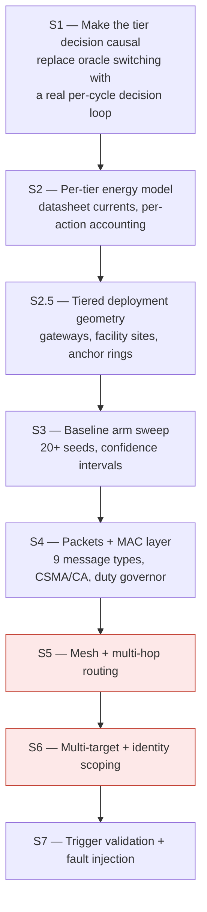
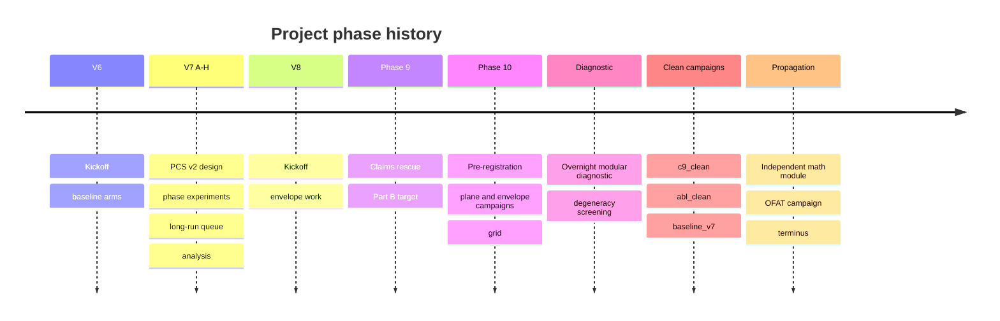
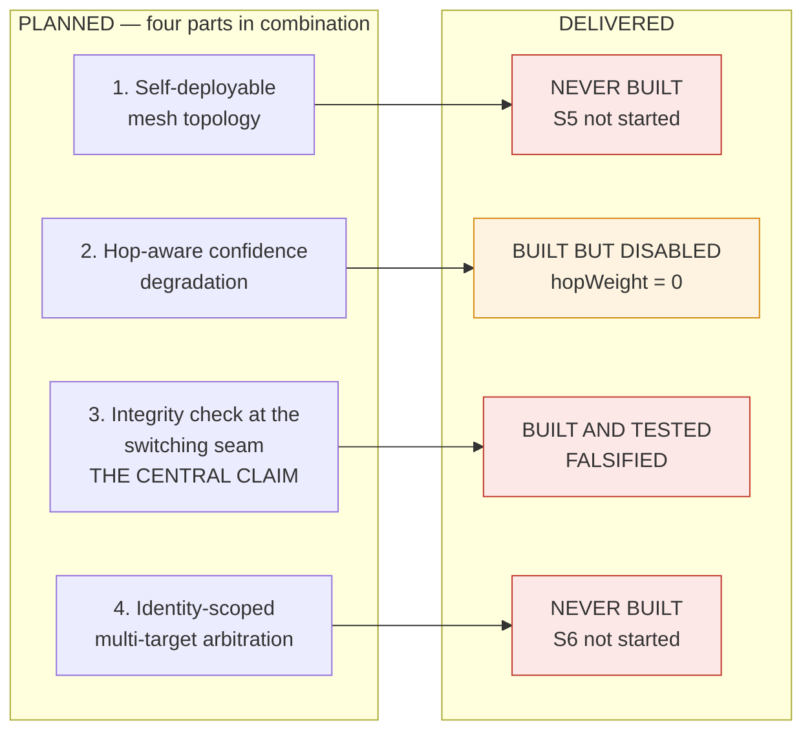
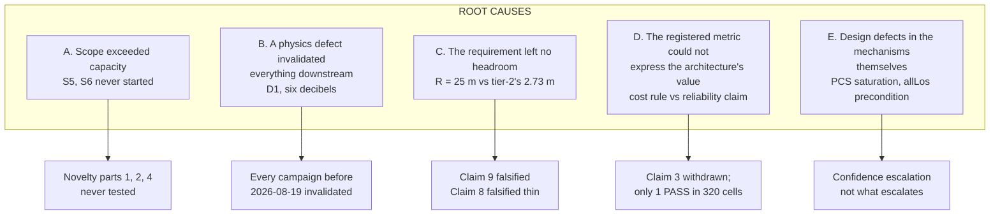
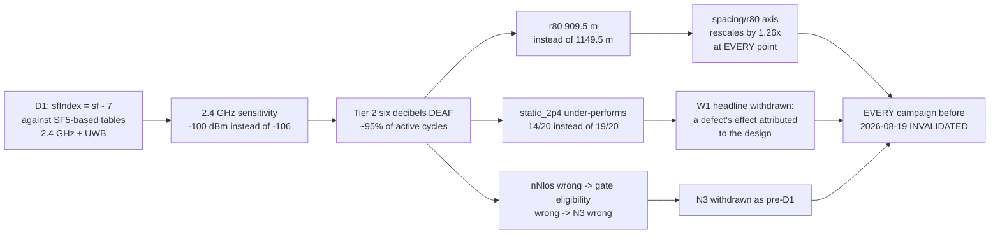

# Report 2 — CA-TBL Project Retrospective

**Project:** CA-TBL — Confidence-Aware Tier-Based Localization for GPS-denied search and rescue
**Platform:** ns-3.47, WSL Ubuntu 22.04
**Author:** Kushal Yalamanchi
**Repository:** `github.com/YKushal-hub/ca-tbl-localization` (private)
**Scope of this report:** what the project set out to be, what was planned, what was built, what worked, what did not, and why

---

## Table of contents

1. [Executive summary](#1-executive-summary)
2. [What the project set out to be](#2-what-the-project-set-out-to-be)
3. [The initial implementation plan](#3-the-initial-implementation-plan)
4. [What was actually built](#4-what-was-actually-built)
5. [Planned versus delivered — the comparison](#5-planned-versus-delivered--the-comparison)
6. [What worked](#6-what-worked)
7. [What did not work — item by item](#7-what-did-not-work--item-by-item)
8. [Root-cause analysis of every divergence](#8-root-cause-analysis-of-every-divergence)
9. [The defect record and what each one cost](#9-the-defect-record-and-what-each-one-cost)
10. [The verification apparatus — what grew instead](#10-the-verification-apparatus--what-grew-instead)
11. [Methodological findings — the rules the project earned](#11-methodological-findings--the-rules-the-project-earned)
12. [Repository and process history](#12-repository-and-process-history)
13. [The honest final position](#13-the-honest-final-position)
14. [What remains open, with costs](#14-what-remains-open-with-costs)
15. [Appendix A — full claim ledger](#appendix-a--full-claim-ledger)
16. [Appendix B — defect index](#appendix-b--defect-index)

---

## 1. Executive summary

### 1.1 In one paragraph

CA-TBL set out to demonstrate that a three-tier radio architecture with a confidence-driven handoff and an integrity check at the switching seam outperforms any single-band system for GPS-denied search and rescue. The simulator, energy model, MAC layer and physics engines were built and work. Of the four-part novelty claim, **two parts were never built**, **one was built but disabled**, and **the central one — the integrity check — was built, tested, and falsified**. Of the six things the simulation was to prove, three are established with statistical support, one was re-scoped after a physics defect, one survives only as a single passing cell out of 320 with five caveats, and one is delivered. What the project produced instead of a clean architectural win is a **verification apparatus**, a **falsification record**, and a set of **methodological findings** that are individually more defensible than the original thesis.

### 1.2 The scorecard

| Dimension | Planned | Delivered |
|---|---|---|
| Build steps S1–S7 | 7 | **5 of 7** (S5, S6 never started) |
| Novelty claim parts | 4 | **1 built and tested (falsified); 1 built but disabled; 2 never built** |
| "Six things to prove" | 6 | **3 clean · 1 re-scoped · 1 heavily caveated · 1 delivered** |
| Formal claims | 9 | **4 PROVEN · 1 IMPLEMENTED · 1 EXERCISED · 1 RE-SCOPED · 2 FALSIFIED · 1 WITHDRAWN-and-replaced** |
| Verification gates | not planned | **13, each with a negative fixture** |
| Simulator defects found | not planned | **5 major, 1 of which invalidated the entire results tree** |
| Independent physics model | not planned | **Built; reached a hard terminus; found the defect nothing else caught** |

### 1.3 The three things a reader should take away

1. **The architecture's central novelty claim is falsified.** The integrity check at the LoRa→UWB switching seam does not improve accuracy at the pre-registered requirement, on 240 cells across two fault models and four response policies, re-measured on clean provenance.
2. **The architecture's premise survives, but only in a weakened form.** *No **deployable** radio is simultaneously long-range and precise.* The unconstrained premise is **false** — a counterexample exists in physics at 169 MHz and is forbidden by spectrum policy, not by the range-precision trade-off.
3. **The most valuable output is the method, not the architecture.** The project built a verification regime that caught its own six-decibel physics defect, its own degenerate experiments, its own metric artefacts, and its own analyst's errors — and the record of that is more transferable than the architecture would have been if it had simply worked.

---

## 2. What the project set out to be

### 2.1 The problem statement

**Why GNSS is insufficient:**

- GNSS fails under dense canopy, in mountain valleys, underground, inside structures, and in smoke.
- These are precisely the environments in which ground search-and-rescue operates.
- A replacement must provide **continuous** position, at **actionable accuracy**, on a **battery-powered wearable**.

**Why no single radio suffices:**

| Constraint | Consequence |
|---|---|
| Long range requires low frequency and narrow bandwidth | Coarse ranging — tens of metres at best |
| Fine ranging requires wide bandwidth | Short range and high receive current |
| Battery life requires low duty cycle | Cannot run the precision radio continuously |

**The architectural response as originally conceived:** three radios in a hierarchy, plus a decision layer that spends precision only where it is both *useful* and *feasible*.

### 2.2 The three tiers as designed

| Tier | Band | Reference part | Role |
|---|---|---|---|
| 1 | 868 MHz sub-GHz | SX1262-class | Wide-area mesh, coarse TDoA/RSSI. **Always on.** Coverage floor |
| 2 | 2.4 GHz ISM | SX1280-class | Mid-range refinement, two-way ToF |
| 3 | UWB Ch9 (7.99 GHz) | DW3000-class | Short-range precision, three-message TWR. Accuracy ceiling |

A field node runs tier 1 continuously and **escalates** to tier 2 or 3 only when its position confidence justifies the energy.

### 2.3 The locked novelty claim — four parts in combination

Every individual mechanism has prior art; earlier sessions verified this exhaustively. **The claim was the assembly:**

| # | Component | Intended contribution |
|---|---|---|
| 1 | **Self-deployable mesh topology** | Not dropped-beacon, not fixed-anchor — removes infrastructure dependency |
| 2 | **Hop-aware confidence degradation** | Confidence decays with hop count and feeds the switching decision |
| 3 | **A trust/integrity check at the LoRa→UWB switching seam** | **THE CENTRAL CLAIM.** Framed as *environmental fault tolerance* — cold-sagged battery skewing RSSI, antenna detune from ice or damage, canopy multipath — explicitly **not** an adversary model |
| 4 | **Identity-scoped, priority-based multi-target arbitration** | Multiple casualties, prioritised, identity-bound |

**Closest prior art, cited rather than hidden: Poucet** (French National Defense) — LoRa 868 + LoRa 2.4 + UWB + GPS + altimeter, field-validated for military and firefighter use. Poucet has the radio combination and the fusion. The honest positioning was: *"Poucet proved dual-band LoRa+UWB works in the field; we extend it to a self-deployable mesh with hop-aware confidence and switching-point integrity, removing its infrastructure dependency."*

**Explicitly not claimed:** LoRa+UWB fusion (Poucet), mesh LoRa localization (LoRaWAPS), threshold switching (AirTag / Janus / GPS duty-cycling), multi-hop uncertainty propagation (DV-Hop family), Byzantine-robust localization (SeRLoc / HiRLoc / distance bounding), identity-based access control (standard IoT).

### 2.4 The six things the simulation had to prove

1. **Architectural advantage** — hybrid beats single-band
2. **Procedure advantage** — the handoff is worth it
3. **Handoff triggers correctly**
4. **Custom handshake** (MAC layer)
5. **Specialized packets** (message taxonomy)
6. **Real-life physics applied to packets**

### 2.5 The pre-registered requirement

Fixed in advance, derived from the use case rather than from convenience:

```
Availability  A ≥ 0.95    at    Accuracy  R ≤ 25 m
```

- **Availability denominator: all 1440 decision cycles of a run.** A cycle with no fix counts against. Rationale: a system cannot be searched with if it is accurate only on the occasions it happens to work.
- **`R = 25 m`** derived from sweep width: a ground searcher on foot detects a casualty within roughly one visual radius, so a fix is *actionable* if its error is inside that radius.
- **`A = 0.95`** — a coordinator directing a team cannot use a system that loses the subject for long intervals.

### 2.6 The working rules adopted at the outset

These were not stylistic. **Each was adopted after a specific failure**, and abandoning them is how the project had previously produced a confident-looking report built on invalid numbers.

1. **Correctness before progress.** Do not build a new layer on a layer that fails its own checks.
2. **Report negative results; do not tune them away.** Never sweep parameters on the same data used to evaluate them.
3. **Every number traces to a run, a datasheet, a citation, or arithmetic shown.** Mark anything unverified as unverified.
4. **Lead with what is wrong.**
5. **Distinguish spec from invention.** The distinction *is* the novelty claim.
6. **Build a detector before trusting a result.** Every defect found was found by a check added on purpose, not by inspection.

---

## 3. The initial implementation plan

### 3.1 The S1–S7 build order



**Red = never started.**

### 3.2 Status of each step at the point the plan was written

| Step | What | Status then |
|---|---|---|
| S1 | Make the tier decision causal | **DONE** |
| S2 | Per-tier energy model | **DONE** |
| S2.5 | Tiered deployment geometry | **DONE**, results blocked |
| S3 | Baseline arm sweep, 20+ seeds, CIs | arms exist, sweep not run |
| S4 | Packets + MAC layer | **DONE**, validated 38/38 |
| S5 | Mesh + multi-hop routing | **NOT STARTED** |
| S6 | Multi-target + identity | **NOT STARTED** |
| S7 | Trigger validation + fault injection | **NOT STARTED** |

### 3.3 The experimental design as planned

| Element | Plan |
|---|---|
| **Arms** | 6 — `ca_tbl_full`, `ca_tbl_no_integrity`, `fixed_threshold`, `static_868`, `static_2p4`, `static_uwb` |
| **Seeds** | 20 paired seeds, stated as a minimum rather than a refinement |
| **Scenario** | 1440 decision cycles per run; facility-tour mobility, not a random walk |
| **Density sweep** | `boxHalf` from 1500 m to 7500 m, on the dimensionless axis `spacing / r80` |
| **Primary metric** | **M1** — energy among arms meeting `(A, R)`, geometric mean of per-seed ratios with seed-level bootstrap CI |
| **Decision rule** | Pre-registered at commit `b49df46` §4, applied verbatim |
| **Verification** | A verifier with per-arm checks, plus a gate suite |

### 3.4 The phase structure that actually emerged

The S1–S7 plan was superseded by an incremental phase structure as defects were found:



---

## 4. What was actually built

### 4.1 Simulator and physics

| Module | Path | Status |
|---|---|---|
| `LoRaPhysicsEngine` | `src/lora-physics-engine/model/lora-physics-engine.*` | **Complete** — 868 MHz propagation + ranging |
| `LoRa2p4PhysicsEngine` | `…/lora-2p4-physics-engine.*` | **Complete** — 2.4 GHz propagation + ranging |
| `LoRaUWBPhysicsEngine` | `…/lora-uwb-physics-engine.*` | **Complete** — UWB propagation + ranging |
| Physics submodules | `…/model/submodules/*.cc` | **~30 submodules** — shadowing, fading, NLOS, foliage, terrain, two-ray, atmospheric, delay spread, interference, body shadowing, wall/floor, soil, tunnel, DSP chain, PLL, IQ impairment, and more |
| `CaTblHeader` | `…/ca-tbl-header.*` | **Complete** — 9-byte MAC header, 7-class/9-code taxonomy, access categories, Semtech ToA |
| `CaTblMac` | `…/ca-tbl-mac.*` | **Complete** — CAD-CSMA/CA, priority backoff, duty gate, APC loop, flood dedup, explicit-ACK retransmit |
| `CaTblChannel` | `scratch/ca_tbl_causal_sim.cc` | **Complete** — shared medium, capture arbitration, **emergent** collisions |
| `CaTblEnergyModel` | `…/ca-tbl-energy-model.*` | **Complete** — datasheet-current accounting, reconciles to 10 significant figures |
| `CaTblPolicy` | `…/ca-tbl-policy.*` | **Complete** — EKF, PCS, evidence gate, escalation FSM, Mahalanobis integrity gate |
| Scenario harness | `scratch/ca_tbl_causal_sim.cc` | **Complete** — geometry, mobility, arms, sweep driver |

### 4.2 Verification apparatus

| Component | Detail |
|---|---|
| Gate suite | `scripts/catbl_gates.sh` — **G1 through G13**, each with a negative fixture |
| Verifier | `scratch/python_handoff/verify_causal_sim.py` — 141 checks, 161 gates, 6/6 arms audited |
| Verifier self-test | 11 cases |
| Publication check | `scripts/publication_ready.sh` — **PUBLICATION READY** |
| Provenance | `run_id.txt` per directory: run id, full invocation, `source <sha> dirty <n> profile`, SHA-256 digest block written after the last stream closes |
| Degeneracy screen | `scripts/diagnostics/degeneracy_check.py` — per-mechanism verdicts |
| Reproducibility | Fresh clone of the remote builds `optimized` and reproduces `baseline_v7` byte-for-byte |

### 4.3 The independent propagation module

`src/catbl-propagation-study/` — a closed-form link budget, ranging model and 16-parameter OFAT campaign, built to validate the engines from published physics rather than from their own code. **Fully covered in Report 1.**

### 4.4 Experimental corpus

| Campaign | Cells | Provenance | Purpose |
|---|---|---|---|
| `p10_plane_v7` | 20 seeds | `dirty 0` | Reference-density regeneration post-D1 |
| `p10_env_v7`, `p10_env_v8` | 160 cells each | `dirty 0` | Deployment envelope over 8 box sizes |
| `p10_grid` | 320 (B1) + 680 (B2) | `dirty 0` | Environment × NLOS × dwell × density grid |
| `c9_clean` | 40 cells | `dirty 0` | Claim 9 re-measurement on clean provenance |
| `abl_clean` | 120 cells | `dirty 0` | Recovery-policy ablation, clean provenance |
| `baseline_v7` | — | `dirty 0` | Clone-test reproduction target |
| `probe_v7` | 36 points | `dirty 0` | Post-D1 probe for the propagation module |

---

## 5. Planned versus delivered — the comparison

### 5.1 The four-part novelty claim



| # | Part | Planned | Delivered | Reason |
|---|---|---|---|---|
| 1 | Self-deployable mesh topology | S5 | **NEVER BUILT** | S5 never started. The scenario remained single-hop with fixed anchors — i.e. the *fixed-anchor* topology the claim was defined against |
| 2 | Hop-aware confidence degradation | S5 | **BUILT, DISABLED** | The mechanism exists in `ca-tbl-policy.cc` but runs with `hopWeight = 0`, because the scenario is single-hop and enabling it would penalise a hop count that is structurally always zero. Explicitly listed in the ledger as *deliberately not claimed* |
| 3 | Integrity check at the switching seam | S7 | **BUILT, TESTED, FALSIFIED** | See §7.1 |
| 4 | Identity-scoped multi-target arbitration | S6 | **NEVER BUILT** | S6 never started. The scenario is single-target throughout |

**Net position: of the four parts whose *combination* was the novelty claim, exactly one was ever put to a test, and it failed.**

### 5.2 The six things to prove

| # | Thing to prove | Claim | Final status |
|---|---|---|---|
| 1 | Architectural advantage — hybrid beats single-band | Claim 3 | ⚠️ **WITHDRAWN then narrowly replaced** — one PASS in 320 cells, M1 = 0.9531 [0.9296, 0.9775], with **five caveats** |
| 2 | Procedure advantage — handoff is worth it | Claim 2 | ✅ **PROVEN** — 25.68× energy reduction with accuracy *and* availability improving simultaneously |
| 3 | Handoff triggers correctly | Claim 1 | ✅ **PROVEN** — precision 0.078 → 0.934, F1 0.803, false positives cut 235× |
| 4 | Custom handshake | Claim 6 | ✅ **IMPLEMENTED & EXERCISED** — emergent capture 14 564 events, duty governor enforced at 0.0226 against 0.025 |
| 5 | Specialized packets | Claim 5 | ✅ **IMPLEMENTED & VALIDATED** — 9 message types, 4 access categories, validator 38/38 |
| 6 | Real-life physics on packets | Claim 7 | ⚠️ **RE-SCOPED** — verified for ranging precision and energy accounting; **unverified for receiver sensitivity** |

### 5.3 The build order

| Step | Planned | Delivered | Gap |
|---|---|---|---|
| S1 causal tier decision | ✅ | ✅ | — |
| S2 per-tier energy model | ✅ | ✅ | Reconciles to datasheet to 10 s.f. |
| S2.5 tiered geometry | ✅ | ✅ | — |
| S3 baseline arm sweep | ✅ | ✅ | Delivered many times over — thousands of cells |
| S4 packets + MAC | ✅ | ✅ | Validated 38/38 |
| **S5 mesh + multi-hop** | ✅ | ❌ | **Never started** |
| **S6 multi-target + identity** | ✅ | ❌ | **Never started** |
| S7 trigger validation + fault injection | ✅ | ✅ | Delivered as the injection campaigns; **the result was a falsification** |

### 5.4 Scope: what was added that was never planned

| Addition | Why it appeared |
|---|---|
| 13-gate verification suite with negative fixtures | Because a defect passed every existing check |
| Provenance and digest apparatus | Because a run once wrote nothing and exited 0 |
| Degeneracy screening | Because an arm ran to completion, produced fixes, and never left tier 1 |
| Pre-registration discipline | Because an n=1 false positive survived into a report |
| The independent propagation module | Because tier choices were asserted, not justified |
| Overnight modular diagnostic | Because "it ran" had been mistaken for "it measured" |
| History restructure + attribution purge | Repository hygiene |

**Roughly half the delivered work is apparatus that was not in the plan**, and it exists because each piece was added after a specific failure.

---

## 6. What worked

### 6.1 Claim 1 — the escalation trigger fires correctly ✅

| Metric | Before evidence gate | After |
|---|---|---|
| Precision | 0.0777 | **0.9343** |
| F1 | 0.1439 | **0.8030** |
| False positives (20 seeds pooled) | 21 116 | **90** |
| Recall | 0.9780 | 0.7041 |

- Recall falls — the **deliberate, disclosed cost** of the quality gate.
- Post-D1 re-measurement on the corrected engine: precision 0.9164, recall 0.7354, pooled over 20 seeds at `dirty 0`. Precision fell 0.018, recall rose 0.031, **no direction was predicted for either** and both are recorded as measured values rather than as hits or misses.
- Estimator stated: **pooled over 20 seeds**, not mean-of-per-seed. That distinction caused a false "cannot be reproduced" finding which was withdrawn.

### 6.2 Claim 2 — energy reduction is real and cost-free ✅

| Quantity | Value |
|---|---|
| `ca_tbl_full` energy | **622.92 J → 24.26 J** — a **25.68×** reduction |
| Accuracy | **Improved** simultaneously |
| Availability | **Improved** simultaneously |
| Escalation efficiency | 0.071 → **0.827** |

The simultaneous improvement is the structurally interesting part: the reduction did not come from doing less, it came from doing the *right* thing more often.

### 6.3 Claim 4 — coverage-floor optimisation ✅

**12 of 12 pre-registered predictions met**, at two densities.

| `spacing/r80` | Energy | Availability |
|---|---|---|
| 0.78 | 28.15 J → **16.09 J** | +0.0003 |
| 1.29 | 21.47 J → **12.54 J** | +0.0119 |

Energy down ~43%, availability **up** at both densities.

### 6.4 Claims 5 and 6 — packets and MAC ✅

- 9 message types, 7 classes, 4 access categories, validator **38/38**
- **Emergent** capture — 14 564 events arising from the channel model rather than being scripted
- Duty-cycle governor enforced at **0.0226 against a 0.025 limit**
- Semtech time-on-air used throughout

### 6.5 The energy model ✅

Reconciles to datasheet currents **to ten significant figures**. This is the least glamorous and most reliably correct component in the project.

### 6.6 The dimensionless axis ✅

`spacing / r80` held the transition zone at **1.02–1.23 across a 26% change in `r80`** — the axis survived the D1 correction rescaling `r80` from 909.5 m to 1149.5 m, moving ~29% in physical units. The independent propagation module later measured coverage collapse above `spacing/r80 = 1.41` from completely different mathematics.

**A scale-free axis that transfers across a 26% shift in its own denominator, and is independently reproduced by a second model, is a genuine methodological result.**

### 6.7 Reproducibility ✅

A stranger can:

1. Clone `github.com/YKushal-hub/ca-tbl-localization`
2. Build `optimized`
3. Reproduce `baseline_v7/arm_summary.csv` **byte-for-byte** at the recorded seed, using the flags in that baseline's own sidecar

**Verified from a fresh clone of the remote**, not from the local directory — so a committed-but-unpushed file could not hide.

### 6.8 The verification apparatus ✅

Thirteen gates, **each with a negative fixture demonstrating it can fail**. This is the thing most projects of this size do not have, and it is what caught:

- a gate suite that overwrote its own evidence
- a deliverable that had never been tracked in the repository at all
- an arm that ran, produced fixes, and measured nothing
- a metric artefact that inflated a degeneracy rate from 0.1% to 66.5%
- an assertion that reported "0 files checked" as a pass

---

## 7. What did not work — item by item

### 7.1 Claim 9 — the integrity check ❌ FALSIFIED

**This is the central novelty claim.**

| Field | Detail |
|---|---|
| **What was claimed** | A Mahalanobis integrity gate at the LoRa→UWB switching seam detects and rejects faulty fixes, improving accuracy |
| **How it was tested** | 240-cell ablation, **two fault models**, **four response policies** (`none`, `inflate`, `bounded`, `reinit`), 20 seeds |
| **Result** | **No configuration beats `no_integrity`** on availability, `rmseM` or `cep50M` |
| **Re-measured on clean provenance** | `results/c9_clean`, 40 cells, `dirty 0`, 120 digest entries verified. **The falsification reproduces**: availability `full − no_integrity` = **−0.031** (F1) and **−0.054** (F3), sign holding on **18–19 of 20 seeds** |
| **Recovery-policy ablation, clean** | `results/abl_clean`, 120 cells, `dirty 0`. All four policies lose: `none` −0.031/−0.054, `inflate` −0.005/−0.009, `bounded` −0.015/−0.014, `reinit` −0.016/−0.017. **Negative in the mean in all eight cells; the sign test runs against the policy in all eight** |

**Detection is sound.** Separation 7.73× (F1) and 16.45× (F3); 20/20 faults detected. **The gate detects correctly and rejecting does not pay.**

**Why it does not pay — the mechanism, stated:** at `R = 25 m`, tier 2 delivers **2.73 m CEP50** — a **9× margin**. The system never *needs* to escalate; tier 3 is occupied 0.1–5% of cycles; the switching seam the integrity check protects **barely exists**.

**A crucial scoping the analysis established:** `suspectForcesEscalation = false` is in the flag set of both campaigns, so **no escalation follows a rejection**. Claim 9's falsification is therefore a statement about **rejection alone**, not about the combined detect-and-escalate mechanism — which under propagation NLOS moves `cep50M` from **92.15 m to 3.10 m**. That distinction is the difference between an accurate result and an overclaimed negative.

**What is explicitly not claimed either way:** whether a second operating point for the final-approach phase — where metre-level precision is required and tier 3 is genuinely necessary — changes the verdict. That is an **open question** requiring a use-case derivation of the accuracy target written before any run.

### 7.2 Claim 8 — the confidence model beats a flat threshold ❌ FALSIFIED (thin)

| Field | Detail |
|---|---|
| **Result** | `ca_tbl_full` 19/20 deployments at 24.26 J against `fixed_threshold` 18/20 at 22.77 J |
| **Reading** | The flat variance threshold escalates on nearly the same occasions. The confidence score buys one deployment for 1.5 J |
| **A fairness caveat that was never discharged** | The v2 score was run at **legacy thresholds** (1.55/1.70/2.30) rather than the `0.0` derived in `report/PCS_REDESIGN_RESULTS.md:113` — a **scale mismatch**. The fair-evaluation question was therefore not fully answered |

### 7.3 The PCS design defect (D5) — the confidence metric cannot express uncertainty

Found late, and it explains a great deal about Claim 8.

```cpp
term1 = traceRef / (traceRef + traceSigma);   // filter uncertainty, -> 0 as P grows
term2 = 1.0 / std::max(gdop, 1.0);            // geometry
term3 = nLos / nTotal;                        // LOS fraction
pcs   = term1 + term2 + term3;                // UNWEIGHTED sum, threshold 1.55
```

Three terms each bounded by `[0,1]`, summed **without weights** against a threshold of 1.55. Once `term1` saturates toward 0, **`term2 + term3` alone can hold PCS above threshold no matter how uncertain the filter is.** The uncertainty term can only fail to contribute; it can never veto.

**Measured:** `term1` 0.0006, `term2 + term3` = 1.9173 > 1.55, **0 escalations**, 1440/1440 cycles on tier 1, `cep50` 89.91 m — with **NEES 1.95**, i.e. a *correctly calibrated* filter whose confidence metric cannot express its own uncertainty.

**Status: RECORDED, NOT FIXED.** Changing PCS changes the engine and invalidates every result in the project. A weighted form, a `term1` gate, or `min` instead of sum are all plausible corrections; **none has been run.**

### 7.4 Claim 3 — architectural advantage ⚠️ WITHDRAWN, then narrowly replaced

**The original claim** read *PROVEN, SCOPED — operating window `spacing/r80` 1.0–1.3.*

**Why it was withdrawn (W4).** That window was inferred from `results/p10_env/ENVELOPE_TABLE.txt`, in which **every pre-registered verdict was FAIL or INCONCLUSIVE**, and the INCONCLUSIVE ones read *"ca_tbl_full does not meet (A,R)"*. **A window was read out of a region where the proposed system did not meet its own requirement.**

**The replacement**, from `results/p10_grid`, H_cost at 20 seeds, `dirty 0`:

```
RURAL_OPEN, nlosSource=legacy, dwell=800, boxHalf=1500
  ca_tbl_full 20/20 and static_2p4 20/20 both meet (A = 0.95, R = 25 m)
  M1 ratio = 0.9531 [0.9296, 0.9775]  -- entirely below 1.0
  14.523 J against 15.201 J: 4.5% cheaper, equally reliable
```

**This is the only PASS in 320 cells** under the registered rule, and the first in the project's history. **Five caveats travel with it and none is optional:**

1. **A single isolated cell of 320.** The pre-registered abort condition governs: this is a point, not a region.
2. **A 4.5% margin.**
3. **At the `dwell` level added to the grid after Stage A reported** — disclosed in the pre-registration, and load-bearing: the same cell at `dwell = 90` is 1.1571.
4. **Its neighbours are on the wrong side** — 1.0878 at `boxHalf` 2000 and 1.1980 at 2500. And structurally, **all ten adjudicable cells were `RURAL_OPEN`**, because only there does a single-band arm also qualify and give the rule something to compare against. **The cost claim is decidable only where tiering is least needed.**
5. **The filter's calibration in that cell is imperfect** — NEES 2.95 at 20 seeds against a 2-DOF expectation of 2.0, 3.3% of cycles above the 95% bound, concentrated in UWB. The PASS is adjudicated on ground-truth error and energy, neither of which reads the covariance, so its arithmetic is unaffected — but the tier decisions leading to it **should not be described as confidence-driven in the sense the architecture claims.**

### 7.5 Claim 7 — physics realism ⚠️ RE-SCOPED

The row asserted *Physics realism on packets — PROVEN*. Then a **six-decibel sensitivity-table indexing defect** was found in the tier carrying ~95% of active cycles, and it had **passed every gate, verifier check and validation in the project.**

**What the cited evidence actually verifies**, unchanged and still passing:

| Property | Check |
|---|---|
| Ranging precision against the ToA bound | CRLB ratio 1.105 |
| UWB ranging floor | 0.154 m sustained-coverage median |
| Energy accounting self-consistency | reconciled to 10 significant figures |

**What no check verified.** None of the above reads the sensitivity tables; they measure ranging error and energy, **both downstream of whether a packet was received at all.**

**Asked directly: no check in the project would catch that defect today.** What found it was a closed-form propagation model built to reproduce the engine and refusing to be tuned when it could not.

**Honest status:** packet-level physics is **verified for ranging precision and energy accounting, and unverified for receiver sensitivity.**

### 7.6 W1 — the deployment-reliability headline ❌ WITHDRAWN

The headline *"`ca_tbl_full` meets the requirement on 19/20 seeds where `static_2p4` meets it on 14/20"* was measured **with tier 2 six decibels deaf**, at a density where the report's own conclusion says tier 2 should be pinned. **It attributed a defect's effect to the design.**

Regenerated at `dirty 0` on the corrected engine:

```
static_2p4    14/20 -> 19/20     M1 12.679 J
ca_tbl_full   19/20 -> 20/20     M1 27.094 J
```

**A five-seed reliability gap became one seed, at 2.1× the energy — and `static_2p4` wins M1.** The argument does not survive.

### 7.7 N3 — the integrity ablation row ❌ WITHDRAWN as pre-D1

Withdrawn **as pre-D1, not as wrong.** It reproduces *exactly* from its cited directory — which established **provenance, never validity**.

Withdrawn because the 6 dB defect reaches the quantity it measures: the arms differ only at `ca-tbl-policy.cc:930-931`, whose trigger is `mahal > threshold && nNlos == 0`; tier-2 occupancy in that campaign is **99.6%** (27 322 against 108 cycles), so `nNlos`, the geometry and the residuals all come from the links the error changes. **Not a common-mode shift; it does not cancel in the difference.**

### 7.8 The envelope — no density at which the architecture pays

`results/p10_env_v7`, 160 cells, all `dirty 0`, all digests verified:

| `boxHalf` | `s/r80` | full meets | 2p4 meets | M1 ratio [95% CI] | Verdict |
|---|---|---|---|---|---|
| 1500 | 0.61 | 20/20 | 20/20 | 1.924 [1.910, 1.940] | **FAIL** (resolved) |
| 2000 | 0.82 | 20/20 | 19/20 | 2.139 [2.112, 2.170] | rule silent |
| 2500 | 1.02 | 19/20 | 11/20 | 2.415 [2.365, 2.463] | rule silent |
| 3000 | 1.23 | 12/20 | 1/20 | 2.806 [2.756, 2.859] | rule silent |
| 4000 | 1.64 | 0/20 | 0/20 | 3.121 [2.977, 3.271] | **INCONCLUSIVE** |
| 5000 | 2.04 | 0/20 | 0/20 | 2.327 [2.053, 2.664] | **INCONCLUSIVE** |
| 6000 | 2.45 | 0/20 | 0/20 | 1.509 [1.361, 1.704] | **INCONCLUSIVE** |
| 7500 | 3.07 | 0/20 | 0/20 | 1.073 [0.987, 1.183] | **INCONCLUSIVE** |

**No box size is PASS, and none can be.** PASS requires `ca_tbl_full`'s M1 to be *lower* with the CI entirely below 1.0. The CI is entirely **above** 1.0 at every density where `ca_tbl_full` meets the requirement at all — it costs **1.9× to 2.8× more**.

> **The architecture has no density at which it pays under `(A = 0.95, R = 25 m)`** in that campaign.

### 7.9 W5 — the registered rule is silent exactly where the behaviour is

`b49df46` §4 decides on two arm-level **binary** predicates. The only registered way to turn 20 per-seed outcomes into an arm-level "meets" was `≥ 15/20`, **withdrawn as unregistered**. Nothing replaced it.

**The rule therefore resolves only geometries where an arm is unanimous — 20/20 or 0/20. It is silent at `boxHalf` 2000, 2500 and 3000, which is exactly where the arms separate.**

Recorded as a gap rather than closed: choosing a binarization after seeing which cells it would pass is the move pre-registration exists to prevent.

### 7.10 The structural finding — the metric and the architecture select for opposite conditions

> The project registered a **cost** criterion (M1) and built an architecture whose value proposition is **reliability**. A cost win requires a **qualifying competitor**; a reliability win requires the competitor to **fail**. They select for opposite conditions.

**Demonstrated, not argued:** the pre-registered screen and the verdict rule carried **disjoint cell sets**, and all ten adjudicable cells sat in `RURAL_OPEN` — the environment where tiering is least needed.

**The independent propagation module reached the same conclusion from the opposite direction.** Its range-precision frontier holds when each design is judged at its own operating point and fails at a common short distance. **Both findings say the same thing: the architecture pays only where the operating envelope is wide.**

### 7.11 G11b — the independent model cannot reconcile

**Permanently red, and not rescoped.** The registered criterion (`r80` within 15%, margin within 3.0 dB) fails because `terrainDb` is **transcription-only** — its input is an invented fBm terrain field, not a documented effect, so reproducing it means copying it, and a transcription cannot validate its source. **A property of the question, not of effort.** Full detail in Report 1 §15.

---

## 8. Root-cause analysis of every divergence

### 8.1 The five root causes



### 8.2 Cause A — scope exceeded capacity

**S5 (mesh + multi-hop) and S6 (multi-target + identity) were never started.**

| Consequence | Detail |
|---|---|
| Novelty part 1 untested | The scenario remained **fixed-anchor**, the very topology the self-deployable-mesh claim was defined against |
| Novelty part 2 disabled | `hopWeight = 0`, because in a single-hop scenario the hop count is structurally always zero and enabling the term would penalise a constant |
| Novelty part 4 untested | Single-target throughout |
| Honest ledger entry | *"Deliberately not claimed: any result depending on multi-hop confidence propagation — the mechanism exists in code but is disabled."* |

**Why this happened.** Steps S1–S4 each expanded under contact with reality — the physics engines grew to ~30 submodules, the MAC layer to a full CSMA/CA implementation with a duty governor, the verification apparatus to 13 gates. Every defect found demanded a detector, and every detector demanded a fixture. **The apparatus that made the results trustworthy consumed the budget that would have built S5 and S6.**

**Whether that was the right trade** is a fair question. The project's own answer: results from S5 and S6 built on an unverified S1–S4 would have been worth less than no results at all, and the D1 defect — which invalidated everything and was found only by an unplanned independent model — is the direct evidence for that.

### 8.3 Cause B — the six-decibel defect



**What was invalidated:** `p10_plane_fix`, `p10_env` (all box sizes and seeds, including its envelope table and prediction file), `campaign_recovery`, `results/causal`, `baseline_v*`, the probe audit, and the `r80 = 909.5 m` figure quoted in three documents.

**How it was found.** Not by a gate. By the independent propagation module refusing to reconcile and its author reading the source rather than tuning a constant.

**Why no gate caught it.** Every physics check in the project measures quantities **downstream of reception** — ranging error, energy. Nothing read the sensitivity tables. A packet that should have been received and was not simply does not appear in any of them.

### 8.4 Cause C — the requirement left no headroom

**This is the deepest cause and it was structural from the start.**

| Fact | Value |
|---|---|
| Pre-registered accuracy requirement | `R = 25 m` |
| Tier 2's delivered accuracy | **2.73 m CEP50** |
| Margin | **~9×** |
| Tier-3 occupancy | **0.1–5% of cycles** |

**The consequence.** A three-tier architecture whose middle tier already exceeds the requirement by 9× has almost no work for its top tier to do. The switching seam that the integrity check protects **barely exists**. Claim 9 was falsified not because the mechanism is bad but because **the requirement never created a situation in which it could pay.**

**The same cause reached Claim 8.** If tier 2 always suffices, the escalation decision is nearly always "stay", and a flat threshold reproduces a confidence score's behaviour because both are answering an easy question.

**The honest reading, arrived at independently from two directions:**

- From the coverage side: `R = 25 m` is too loose for a three-tier architecture to be justified.
- From the integrity side: at `R = 25 m` there is no headroom for an integrity check to buy anything.

**Two independent routes to one structural result is worth more than a window found by extending an axis.**

### 8.5 Cause D — the metric could not express the claim

Detailed in §7.10. The project registered a **cost** criterion for an architecture whose value proposition is **reliability**, and the two select for opposite conditions.

**Why it was not fixed.** Registering a reliability decision rule *after* seeing which cells would pass it is precisely the move pre-registration exists to prevent. The gap was therefore **recorded rather than closed**, and a corrected criterion — a **joint** criterion over availability *and* energy, with the trade-off stated in advance rather than one axis binarised into a qualifier — is named in future work with the numbers attached.

### 8.6 Cause E — design defects in the mechanisms themselves

| Defect | Effect |
|---|---|
| **PCS unweighted sum (D5)** | The uncertainty term saturates and can no longer veto, so a correctly calibrated filter's confidence score cannot express its own uncertainty. Under propagation NLOS, PCS **never escalates** — the integrity gate's side effect is the only escalation mechanism |
| **The `allLos` precondition** | The integrity gate fires only when `nNlos == 0` (`ca-tbl-policy.cc:903-904`). `suspectRequireAllLos` was specified in `STAGE234.md` §2.2 and **never built**, so the precondition remained hardcoded. Under legacy NLOS at ~75%, the gate was eligible on only ~25% of cycles |
| **`escalationRequiresEvidenceT2`** | Broken — latches the node on tier 1. Deliberately unwired, and a standing instruction forbids enabling it |
| **`nlosSigmaInflation = 3.0`** | Uncalibrated for the project's whole life. The propagation module's answer: **no scalar value is correct**, because a bias and a zero-mean noise differ in their asymptotics in anchor count |

**A finding that follows from D5 and matters architecturally:** the "confidence-aware" escalation the architecture is named for is **not what escalates** under realistic NLOS. The integrity gate's documented side effect is. That is a claim-level finding about the policy layer.

### 8.7 A sixth cause, meta-level: analyst error

The record contains a substantial number of findings that were **withdrawn because the analysis, not the simulator, was wrong.** They are kept in the record with their reasons.

| Withdrawn finding | The error |
|---|---|
| "`trig_precision` cannot be reproduced" | Compared mean-of-per-seed against a pooled figure — **two different estimators** |
| "The metric has no population outside injection campaigns" | Generalised six configurations to a claim about all; a non-injection campaign has `tp + fp = 1370` |
| "0 paired cells in `campaign_20260810`" | A glob one directory level too shallow, for a campaign holding **280** |
| "24 cited directories lack a sidecar" | A glob two levels deep; `p10_grid` has 770 sidecars and `overnight_20260805` has 518 |
| "`two_ray_frac = 0.0000` at all nine distances" | True for **868 MHz only**; the mechanism fires on 0.89–1.00 of links on the other two tiers |
| "Terrain is implausible because Fresnel radius scales as `1/√f`" | Reasoned about physics **the engine does not implement** — its terrain hardcodes 868 MHz for every tier |
| "`publication_ready.sh` matches by substring" | Diagnosed with `grep -l` (substring) and attributed that behaviour to the assertion's `grep -oE` (token extraction) |
| "The technical report carries stale citations" | Grepped two documents together and attributed the union to each |
| "NEES 10.14 — five-fold overconfidence" | A single-seed **mean** on a heavy-tailed statistic; 20 seeds give 2.95, median 0.58 |

**The common shape, and the rule it produced:**

> **A count is not an observable until its population *and its estimator* are stated.** A glob is a population claim. A population claim includes which subject it ranged over.

---

## 9. The defect record and what each one cost

| ID | Defect | Site | Cost |
|---|---|---|---|
| **D1** | `sfIndex = sf - 7` against SF5-based tables — **six decibels** | `lora-2p4-physics-engine.cc:147-151`, `lora-uwb-physics-engine.cc:147-151` | **Invalidated the entire results tree.** Forced regeneration of every campaign; withdrew W1 and N3; rescaled the `spacing/r80` axis by 1.26× at every point; re-scoped Claim 7 |
| **D2** | `mean_snr_db` accumulated only over delivered packets — survivorship bias | `ca_tbl_causal_sim.cc:1393-1400` | Up to **+22.70 dB** of bias at low PDR. Fixed behind a flag so prior output stays byte-identical. A downstream design question remains open |
| **D3** | `0.0` sentinel collided with the data domain (0 dB SNR is a real measurement) | `ca_tbl_causal_sim.cc:1437-1438` | One field on one row; fixed to `NaN` |
| **D4** | Reception described as a hard threshold; it is a logistic | `lora-physics-engine.cc:135-146` | A description error, not a simulator defect. Recorded so it does not recur |
| **D5** | PCS unweighted-sum term saturation | `ca-tbl-policy.cc:666-671`, `ca-tbl-policy.cc:57` | The confidence metric cannot express uncertainty. **RECORDED, NOT FIXED** — a fix invalidates every result |
| **1a** | Escalation to tier 3 ignored target-tier availability | — | **FIXED** — `escalationRequiresEvidence`, suppress-only, default off |
| **1b** | Same for tier 1 → tier 2 | — | **BROKEN, DELIBERATELY UNWIRED** |
| **2** | Concurrent-tier fallback hardwired to the 868 floor rather than `active − 1` | — | **MEASURED, NOT FIXED** — blast radius shrank to near-nothing once 1a landed |
| **9** | Unchecked `std::ofstream` — ran a full simulation, wrote nothing, exited 0 | 4 sites | **FIXED at all four** |
| **G-suite** | `catbl_gates.sh` wrote into tracked result directories | `scripts/catbl_gates.sh` | **The verification step mutated its own evidence, silently.** Every past invocation re-dated three directories' sidecars. Fixed to a temp dir; two new gates added |
| **17th term** | `linkHysteresisMarginDb` moves the reception threshold with PDR | `lora-uwb-physics-engine.cc:664-666` | Caused one wrong attribution — a growing residual assigned to propagation when up to 1.5 dB was the threshold moving |
| **Engine structure** | 8 of 16 loss terms structurally zero; 4 zeroed on the line *after* being computed | `lora-physics-engine.cc:341`/`lora-physics-engine.cc:340`, `lora-physics-engine.cc:537`/`lora-physics-engine.cc:536`, `lora-physics-engine.cc:596`/`lora-physics-engine.cc:489`, `lora-physics-engine.cc:593` | Anyone reasoning from structure rather than assignments over-counts what the engine does |

---

## 10. The verification apparatus — what grew instead

### 10.1 The thirteen gates

| Gate | Asserts | Origin |
|---|---|---|
| G1–G5 | End-to-end simulation, determinism, verifier self-test | Original suite |
| **G6** | Tracked evidence agrees with a fresh run, read-only, distinguishing *"evidence disagrees"* from *"the fresh run errored"* | Added after the suite was found overwriting its own evidence |
| **G7** | The suite left no tracked modifications under `results/` | Same incident |
| **G8** | Files that must stay untracked are untracked | Added after a working document was committed by a staging error |
| **G9** | Named deliverables **are** tracked and committed | Added after `Simulation.md` was found untracked for the project's entire life |
| **G10** | Every backtick-cited path in a tracked document resolves | Added after three untracked scripts were found cited by tracked documents |
| **G11** | The independent model reconciles (a: terrain-inactive subset; b: full) | The propagation module |
| **G12** | No commit carries a vendor attribution in author, committer or message | Added at the owner's instruction |
| **G13** | Every sidecar SHA resolves in history or through `SHA_MAP.md` | Added after the history rewrite changed 30 SHAs |

**Every gate has a negative fixture demonstrating it can fail.** Several fixtures caught bugs in the gates themselves before they landed:

- G7's first version counted **untracked** files, so it would have failed on every run for the wrong reason.
- G12's first version matched topic words and **failed on the commit documenting the policy it enforces** — a check must survive its own policy being written down.
- G11's assertion 3 reported *"0 sidecars checked, all matching"* — an **empty population rendering identically to a passing check**.

### 10.2 Provenance

Every result directory carries:

```
<16-hex run id>
<full invocation>
source <sha> dirty <n> profile <optimized|default|debug>
digest sha256
<64-hex>  <filename>          (one line per output file)
```

The digest block is written **after the last output stream closes**, so its presence is also a completeness signal.

**12 130 digest entries verified against files on disk; 0 failures.**

### 10.3 The degeneracy screen — the apparatus that changed how experiments are read

**The originating incident.** `ca_tbl_no_integrity` ran to completion, produced fixes at the same rate as `ca_tbl_full`, exited 0 and wrote a valid digest — **while never leaving tier 1.** Every check in the project passed on it.

> **"It ran" is not "it measured."**

`degeneracy_check.py` makes the distinction mechanical. It reads a result directory **and the name of the mechanism under test**, returning `LIVE` or `DEGENERATE` for that mechanism with the underlying quantity printed beside it. Called without a mechanism, it reports all four and **refuses to return a single verdict.**

**The first version was wrong, and its correction is itself a finding.** It returned one verdict per run, derived mostly from tier occupancy, and reported **7531 of 16 056 arm-cells degenerate — 46.9%.** That figure blended four different questions into one number and flipped verdict on **1.4 percentage points** of an incidental quantity.

**Corrected, per mechanism, over 3205 directories:**

| Mechanism | Degenerate | Arm-cells | Rate | Meaning |
|---|---|---|---|---|
| `tiering` | 175 | 15 390 | **1.1%** | Hybrid arms pinned to one tier *and* never escalating. Rare |
| `integrity` | 875 | 3 203 | **27.3%** | The gate never fires or the arms are identical. **Over a quarter of runs containing a `ca_tbl_full` arm cannot say anything about the integrity check** |
| `trigger` | 3 431 | 8 584 | **40.0%** | `trig_tp + trig_fp = 0`. **Two in five have no trigger population at all** |
| `energy` | 23 | 15 390 | **0.1%** | Arms drawing a material share on a tier they never occupy |

**One of the four rules was wrong and was corrected before publication.** The energy rule first flagged *any* non-zero draw on a zero-cycle tier and reported **66.5%** degenerate — an artefact, because an unoccupied tier legitimately draws CAD/idle listening energy. Requiring a **material** share (>1%) gives 0.1%.

**Standing rule for future campaigns: run one seed and screen it before spending twenty.**

---

## 11. Methodological findings — the rules the project earned

Each was adopted after a specific failure. **This section is the most transferable output of the project.**

| # | Rule | The failure that produced it |
|---|---|---|
| 1 | **A check that cannot be observed to fail is not a check.** Every gate needs a negative fixture; a fixture that fails by crashing is not a fixture; and its positive direction must be able to pass | Multiple gates that had only ever passed |
| 2 | **State a check's population when you design it.** A glob is a population claim. An empty population is VACUOUS, not a pass | An assertion reporting "0 checked, all matching" |
| 3 | **A count is not an observable until its population and its estimator are stated** | A pooled-vs-mean estimator mismatch produced a false "cannot be reproduced" |
| 4 | **A saturating function of a random variable is not the function of its mean** | Three instances: lognormal foliage depth, distributed antenna heights, sampled `γ`/`A_max` |
| 5 | **Verification must not mutate its subject** | The gate suite silently overwrote the evidence it was verifying |
| 6 | **Derive what the answer must be before trusting what the code returns** | Caught a floating-point tie in a Pareto filter, a Bessel overflow reporting +7.5 dB where the limit is 0, and a span metric measuring an arbitrary floor |
| 7 | **Check processes by resolving `/proc/*/exe`** — never a command-line match or a truncated `comm` | `comm` truncation gave a false negative with 18 orphaned simulations running; `pgrep -af` gave a false positive by matching itself |
| 8 | **The direct comparison beats the derived metric** | Margin-against-the-engine and `r80` disagreed about which model version was better |
| 9 | **A model change that worsens agreement is evidence about the change, not the physics** | Two-ray was nearly recorded as refuted when its implementation was defective and the engine's own column showed it firing |
| 10 | **With a sum, partial closure is a hit**, scored against its own registered contribution | Three passes asked "which term is missing" in the singular when the answer was a sum |
| 11 | **A transcription cannot validate its source** | Terrain; and the earlier `validate.py` that imported the quantity it validated |
| 12 | **Flag an instruction you decline, with the reasoning** | Two instructions were declined and both declines were right; declining silently would have left nothing to review |
| 13 | **Pre-registration catches the predictions you know how to be wrong about. It does not catch the terms you did not think to define** | Three registrations each left a term undefined that later decided a verdict |
| 14 | **Reproducibility is not validity** | N3 reproduced exactly from its cited directory and was still withdrawn as pre-D1 |
| 15 | **Testing the instrument is not the same as testing that the instrument was pointed at anything** | The robustness classifier was sound; six of sixteen inputs had never been put to it in a form that could fail |
| 16 | **Never stratify on a variable the outcome can influence** | Collider bias in an early analysis |
| 17 | **A withdrawn number keeps its reason and its mechanism; it is never silently deleted** | Standing practice across every withdrawal in the record |

### 11.1 Rule 13 deserves its own note

Three registrations in the propagation module each left a term undefined that later decided a verdict:

- §5.1 never fixed the **operating point** at which sigma is evaluated — and that silence is what makes metrics A and B disagree about whether the architecture's premise survives.
- The OFAT registration never operationalised **"the conclusion holds"** — written *after* diagnosing the previous instance.
- It never declared **P12 and P16 as analytic** — so their robustness classification was vacuous.

**Each was written by someone who had just diagnosed the previous one.** The practical form of the rule: *before running, re-read the registration asking which of its words will decide the outcome — and define those.*

---

## 12. Repository and process history

### 12.1 The history restructure

**Problem.** The repository was a fork of ns-3-dev carrying ~20 000 upstream commits from hundreds of contributors, making the project's own work invisible and the authorship history misleading.

**Resolution.** A **vendored-import** structure: one `vendor: import ns-3.47 upstream source` root commit, then the project's own commits replayed on top, **all authored by Kushal Yalamanchi**.

| Property | Value |
|---|---|
| Authors across all refs | **One** |
| Tags | **0** — all 97 upstream ns-3 tags deleted |
| Upstream remote | **Removed** |
| GitHub Actions | **Disabled** — inherited ns-3 workflows fail permanently and bill a metered quota |
| Backups | Four bundles retained in `~/`, never deleted |

### 12.2 The attribution purge

An audit found **27 commits carrying an assistant attribution in the message body** — author and committer fields were already clean, which is why earlier checks using `git log --format='%ae'` had never seen it.

| Step | Detail |
|---|---|
| Blast radius | Oldest affected commit `b9e650f`; **30 commits rewritten, 53 untouched** |
| Backup | New bundle created before the rewrite; the four existing bundles untouched |
| Verification | Exactly one identity across all refs; zero attribution in message bodies; **`git diff` old-tip..new-tip EMPTY** (metadata only); commit count unchanged 83 → 83 |
| Push | `--force-with-lease`, never bare `--force`; permitted by the ruleset's own admin bypass |
| Consequence managed | **1283 sidecars cite rewritten SHAs.** They resolve through a committed `SHA_MAP.md`; sidecars were **not edited**, because they are evidence |
| Prevention | **G12** asserts no commit carries attribution in author, committer or message; **G13** asserts every sidecar SHA resolves |

**Verified from a fresh clone of the remote:** 83 commits, **0 attribution**, one identity.

### 12.3 Two staging incidents, both self-caught

1. **`CA_TBL_HANDOFF_v4.md` was committed**, violating a rule stated in 19 project documents. Remedied with `git rm --cached` rather than an amend, because *never rewrite history* was the stronger standing rule at the time. **The real fix:** the rule was enforced by memory, and memory failed — it is now in `.gitignore` and asserted by G8 with a negative fixture.
2. **`git add <dir>` swept a 10.7 MB `corpus.json` into the index.** Caught by reading the staged set before committing. The rule became: **never `git add <dir>`; stage explicit paths and read the staged set.**

### 12.4 A latent repository defect that G9 exposed

**`Simulation.md` — one of the two named deliverables — had never been tracked, in the entire project. Zero commits.** `Architecture.md` was untracked too until an accidental staging tracked it.

**The two-deliverable rule had been describing files that were not in the repository.** G9 now asserts that named deliverables are tracked and committed, with a negative fixture.

---

## 13. The honest final position

### 13.1 What can be claimed

| Claim | Evidence |
|---|---|
| The escalation trigger fires correctly | Precision 0.078 → 0.934, geometric ground truth, 20 seeds |
| Escalation policy saves energy at no accuracy cost | 25.68× reduction with accuracy *and* availability improving |
| Coverage-floor optimisation works | 12/12 pre-registered predictions at two densities |
| The MAC and packet layers work | 38/38 validator; emergent capture; duty governor enforced |
| Tiering wins on **reliability** in forest | 19/20 against `static_2p4`'s 0/20, at 1.56× the energy — **no registered rule, so no verdict attached** |
| Tiering wins on **cost** in one cell | M1 0.9531 [0.9296, 0.9775] — **one of 320, with five caveats** |
| `spacing/r80` transfers as a design axis | Held across a 26% change in `r80`; independently reproduced by a second model at 1.41 |
| **No *deployable* radio is both long-range and precise** | Measured frontier; counterexample found and excluded on two independent grounds |
| The engine has five defects, now documented | Each with `file:line`, mechanism, fix status and invalidation list |
| The project is reproducible from a fresh clone | Byte-for-byte, verified from the remote |

### 13.2 What cannot be claimed

| Not claimed | Reason |
|---|---|
| The integrity check improves accuracy | **Falsified** on 240 + 160 cells, two fault models, four response policies, clean provenance |
| The confidence model beats a flat threshold | **Falsified thin**; and the fair-evaluation caveat was never discharged |
| A general architectural advantage across densities | The M1 CI is **above 1.0 at every density where the tiered arm meets the requirement at all** |
| Multi-hop confidence propagation | **The mechanism is disabled** (`hopWeight = 0`) |
| Self-deployable mesh topology | **Never built** |
| Identity-scoped multi-target arbitration | **Never built** |
| Packet-level physics realism, unqualified | **Re-scoped** — unverified for receiver sensitivity |
| That the independent model validates the engine | **G11b permanently red**; terrain is transcription-only |
| The unconstrained range-precision premise | **False** — a counterexample exists in physics |

### 13.3 The reframing that the evidence actually supports

The project does not have *"my architecture is better."* It has:

> **Here is precisely where tiering pays, where it does not, and why — established under pre-registration, on reproducible provenance, with the design defects the method caught along the way.**

**Three reasons that is a defensible position rather than a consolation:**

1. **Every part of it is verifiable.** A reader can clone the repository, rebuild it, reproduce a baseline byte-for-byte, and check any number against a specific run, line of source, or cited standard.
2. **The negatives are honest negatives.** Each falsification was measured on clean provenance, with the mechanism named, and each was preceded by establishing that the mechanism had a fair test. Where a fair test was not possible — the `suspectForcesEscalation` confound, the degenerate arms, the six-decibel defect — the result was withdrawn rather than reported.
3. **The method found its own limits.** The most valuable single finding — that a six-decibel physics defect passed every check in the project — was produced by the project's own apparatus, and the project says so in its own claim ledger rather than burying it.

### 13.4 What a corrected study would register

Named explicitly, with the numbers attached, so the next iteration does not repeat the structural error:

1. **A joint criterion over availability *and* energy**, with the trade-off stated in advance, rather than one axis binarised into a qualifier that selects against the architecture's own value proposition.
2. **A tighter accuracy requirement**, or a second operating point for the final-approach phase where metre-level precision is genuinely required — derived from the use case and written before any run.
3. **A weighted or gated PCS**, since the unweighted sum cannot express uncertainty once its variance term saturates. Specified and **untested**.
4. **Mechanism-aware degeneracy screening as a mandatory one-seed pre-flight**, before any campaign spends twenty.
5. **NLOS modelled as a bias, not as inflated variance** — because the two differ in their asymptotics in anchor count and no scalar inflation can repair the difference.

---

## 14. What remains open, with costs

| Item | Status | Cost to close |
|---|---|---|
| UWB's ~3.7 dB residual in the propagation model | **OPEN** — eight candidates ruled out with numbers | One instrumented ns-3 run emitting per-term telemetry |
| 868 MHz's ~3.5 dB near-field residual | **OPEN** — six candidates ruled out; signature of two opposite-signed errors cancelling | The same instrumented run |
| `[M-24]`'s dirty citation | **PROVENANCE GAP** — source records `dirty 4`; no injection campaign anywhere records `dirty 0`, so it cannot be repointed | A clean re-run of the injection campaign, ~3.8 h |
| China / Australia 169 MHz allocation | **PARTIAL GAP** — the falsifier survives regardless on the resolvability argument | One regulatory database lookup each |
| P8's UNDETERMINABLE verdict | **OPEN** | Not closable — needs terrain independently derivable |
| `lb.r80`'s NaN-on-dead-link | **KNOWN**, worked around | A change plus a full G1–G13 re-verification; two gates read it |
| The magnitude dimension at full resolution | **PARTIAL** — valid for P5 (2.24×) and P8 (2.11×) | A faster `pdr_at` |
| Fading's NLOS branch | **REGISTERED OMISSION**, ≈0.44 dB on 868 at 6 km | Independently implementable |
| PCS correction | **SPECIFIED, UNTESTED** | Changes the engine; invalidates every result |
| S5 mesh + multi-hop | **NEVER STARTED** | A build phase, not an experiment |
| S6 multi-target + identity | **NEVER STARTED** | A build phase, not an experiment |
| Claim 9 at a second operating point | **OPEN QUESTION, not claimed either way** | A use-case derivation of the accuracy target, written before any run, then a campaign |

---

## Appendix A — full claim ledger

| # | Claim | Status | Basis |
|---|---|---|---|
| 1 | Escalation triggers correctly | ✅ **PROVEN** | Precision 0.078 → 0.934, F1 0.803, FP cut 235×, geometric ground truth |
| 2 | Energy reduction is real and cost-free | ✅ **PROVEN** | 25.68× reduction with accuracy *and* availability improving; structural explanation given |
| 3 | Architectural advantage exists and is bounded | ⚠️ **WITHDRAWN (W4), REPLACED** | Window 1.0–1.3 withdrawn — inferred from a region where every verdict was FAIL or INCONCLUSIVE. Replaced by a single PASS, M1 = 0.9531 [0.9296, 0.9775], five caveats |
| 4 | Coverage-floor optimisation | ✅ **PROVEN** | 12/12 pre-registered predictions met at two densities |
| 5 | Specialized packet taxonomy | ✅ **IMPLEMENTED & VALIDATED** | 9 message types, 4 access categories, validator 38/38 |
| 6 | Custom handshake / MAC | ✅ **IMPLEMENTED & EXERCISED** | Emergent capture 14 564 events; duty governor 0.0226 against 0.025 |
| 7 | Physics realism on packets | ⚠️ **RE-SCOPED** | Verified for ranging precision (CRLB ratio 1.105) and energy (10 s.f.); **unverified for receiver sensitivity** — a 6 dB indexing defect passed every check |
| 8 | Confidence model beats a flat threshold | ❌ **FALSIFIED (thin)** | 19/20 vs 18/20 at 24.26 J vs 22.77 J; the flat threshold escalates on nearly the same occasions |
| 9 | Integrity check improves accuracy | ❌ **FALSIFIED at R = 25 m** | 240-cell ablation + 40-cell and 120-cell clean re-measurements. Detection sound (7.73×/16.45× separation, 20/20 detected); the requirement leaves no headroom. Scoped to **rejection alone** |

**Withdrawals, each with its reason retained:**

| ID | Withdrawn | Reason |
|---|---|---|
| W1 | The 19/20-vs-14/20 deployment-reliability table | Measured with tier 2 six decibels deaf; attributed a defect's effect to the design |
| W2 | "`trig_precision` cannot be reproduced" | Wrong estimator — mean-of-per-seed against a pooled figure |
| W3 | "Recall falls" prediction | 11 up / 9 down at 20 seeds establishes no direction; the "Direction is not marginal" string was hardcoded in the analysis script |
| W4 | Claim 3's window 1.0–1.3 | Inferred from a region where no verdict was a pass |
| W5 | (Recorded, not withdrawn) The rule is silent where the behaviour is | `≥15/20` binarization was unregistered; nothing replaced it |
| W6 | (Recorded) The window's upper bound is not about tiering | A property of **co-located siting**, not of the policy |
| W10 | "Terrain is implausible because Fresnel scales as `1/√f`" | Reasoned about physics the engine does not implement |
| N3 | The integrity ablation row | Pre-D1, **not wrong** — reproduces exactly, but the defect reaches the quantity it measures |

---

## Appendix B — defect index

| ID | Title | Status |
|---|---|---|
| D1 | SF7 read the SF5 cell on the 2.4 GHz and UWB sensitivity tables | **FIXED**; entire results tree regenerated |
| D2 | `mean_snr_db` accumulated only over delivered packets | **FIXED** behind `--traceDiagnostic`; a design question remains open |
| D3 | `0.0` sentinel collided with the data domain | **FIXED** — emits `NaN` |
| D4 | `PassesReceiverSensitivity` is a logistic, not a hard threshold | **RECORDED** — a description error, not a simulator defect |
| D5 | PCS unweighted-sum term saturation | **RECORDED, NOT FIXED** — a fix invalidates every result |
| 1a | Escalation to tier 3 ignored target-tier availability | **FIXED**, flag-gated, default off |
| 1b | Same for tier 1 → tier 2 | **BROKEN, DELIBERATELY UNWIRED** |
| 2 | Concurrent-tier fallback hardwired to the 868 floor | **MEASURED, NOT FIXED** |
| 9 | Unchecked `std::ofstream` — ran, wrote nothing, exited 0 | **FIXED at all four sites** |
| — | `catbl_gates.sh` wrote into tracked result directories | **FIXED**; G6 and G7 added with fixtures |
| — | `linkHysteresisMarginDb` moves the reception threshold with PDR | **DOCUMENTED** — the module's most transferable finding |
| — | 8 of 16 loss terms structurally inactive; 4 zeroed after being computed | **DOCUMENTED** with line pairs and scoping |
| — | `nlos_scale_m` had no override path | **FIXED** — `linkbudget.py` now raises on unrecognised keys |
| — | Rician Bessel series overflow above K ≈ 100, returning +7.512 dB where the limit is 0 | **FIXED** — log-space, both analytic limits asserted at import |
| — | Degeneracy screen's energy rule flagged legitimate idle draw | **FIXED** — 66.5% → 0.1% |

---

*Every number in this report traces to a specific run, a specific line of source, or a cited standard. Withdrawn findings are retained with their reasons. Where a claim is falsified, it is stated as falsified. Where a mechanism was never built, it is stated as never built.*
