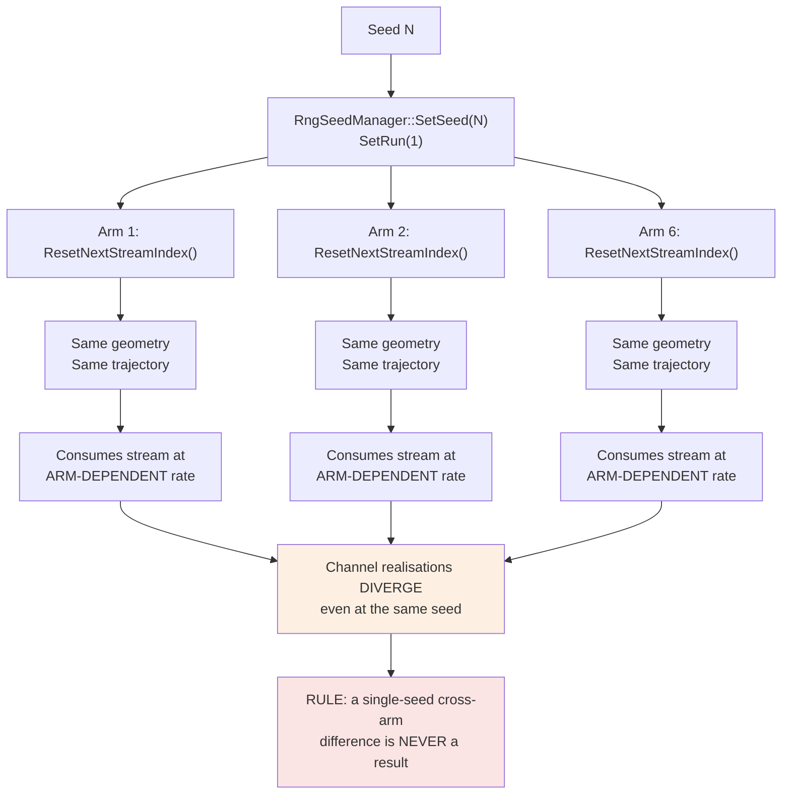
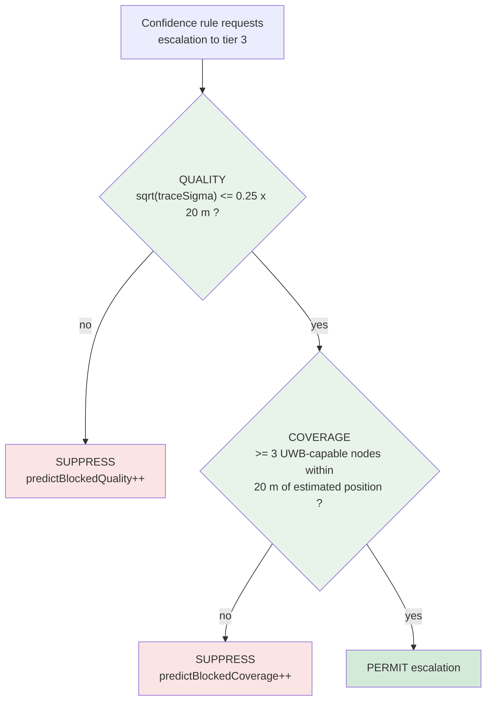
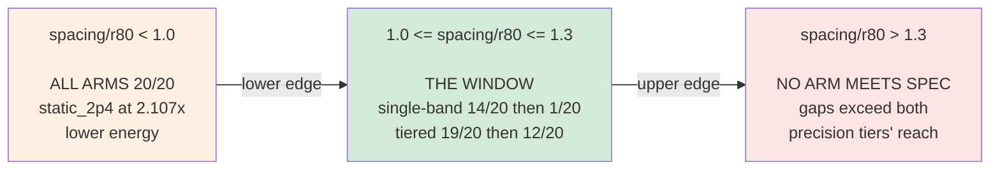

# CA-TBL — Simulation Specification and Results

**Confidence-Aware Tier-Based Localization for GPS-Denied Search and Rescue**

|                               |                                                                                                                |
| ----------------------------- | -------------------------------------------------------------------------------------------------------------- |
| **Document**            | Simulation Specification and Results (2 of 2)                                                                  |
| **Companion**           | `Architecture.md` — system design, physics engines, verification architecture                               |
| **Scope**               | Simulation specifications, seed methodology, per-arm and per-seed results, statistical support, work programme |
| **Campaign scale**      | 7 densities × 6 arms × 20 seeds =**840 arm-runs / 140 directories / 13.8 CPU-hours**                   |
| **Evidence convention** | Every measured figure carries a tag`[M-nn]` resolved in §12                                                 |
| **Diagrams**            | Mermaid — render/interactive in GitHub, VS Code, Obsidian, Typora,`mermaid.live`                            |

> ## ⚠ SCOPE: the results in this document were measured under the LEGACY topology
>
> **Corrected 2026-09-07 (`99fdf1a`).** Until then the simulator modelled three **disjoint**
> anchor populations — tier-1 gateways on a grid, tier-2 anchors ringed at 150 m and tier-3
> at 10 m around four facility sites. The system actually has **one population of tri-band
> nodes**: every node carries all three radios, and a tier is a choice of *which radio to
> use*, not of *whom to talk to*. Gateways are the only immobile class; **finders** are
> mobile nodes carrying all three radios; facility sites are **mobility targets that host no
> anchors**. See `Architecture.md` §3 and `CLAUDE.md`.
>
> **What that means for this document, section by section.**
>
> - **§2 specifications** — corrected in place below, and marked where a value applied only
>   to the legacy deployment.
> - **§4 onward, the results, predictions and analyses** — **left exactly as measured.**
>   Every one ran under `--topology=1`. They still reproduce from their own sidecars, but
>   they reproduce a deployment the system does not have, and are **provisional pending
>   re-run**. Rewriting a dated evidence chain to agree with a later model would falsify it.
>
> Reasoning that turns on tier-2/tier-3 anchors *ringing four facility sites* — §8.2's
> registered prediction and §13.3's coverage-limit diagnosis in particular — is reasoning
> about the legacy geometry and does not carry over unexamined.

> ## Current results, 2026-10-17
>
> The results below (§4 on) are the legacy-topology record. The current measured tables are
> `report/CAMP_FINAL2_RESULTS.md`: the final preset, an unknown start, 20 paired seeds.
>
> | arm | 5 km tag-0 CEP95 | endgame tag-0 CEP95 |
> |---|---|---|
> | `ca_tbl_full` | 324 m | 4.6 m |
> | `static_2p4` | 397 m | 8.7 m |
> | `static_868` | 494 m | 52.4 m |
>
> PCS-gated switching is indistinguishable from a trace threshold. The current claim status is the Technical Report
> §0a.

---

## Table of contents

1. [What is being measured](#1-what-is-being-measured)
2. [Simulation specifications](#2-simulation-specifications)
3. [Experimental arms](#3-experimental-arms)
4. [Seed methodology](#4-seed-methodology)
5. [Result A — reference density](#5-result-a--reference-density)
6. [Result B — escalation trigger quality](#6-result-b--escalation-trigger-quality)
7. [Result C — energy](#7-result-c--energy)
8. [Result D — deployment envelope](#8-result-d--deployment-envelope)
9. [Result E — coverage-floor optimisation](#9-result-e--coverage-floor-optimisation)
10. [Statistical support summary](#10-statistical-support-summary)
11. [Claim ledger](#11-claim-ledger)
12. [Measurement index](#12-measurement-index)
13. [Work programme](#13-work-programme)
14. [Where the project stands](#14-where-the-project-stands)
15. [What the independent propagation model established, and its terminus](#15-what-the-independent-propagation-model-established-and-its-terminus)

---

## 1. What is being measured

### 1.1 Three quantities that trade against each other

| Quantity               | Definition used                                       | Why it cannot be dropped                                   |
| ---------------------- | ----------------------------------------------------- | ---------------------------------------------------------- |
| **Availability** | Fraction of all cycles with a fix accurate to ≤ 25 m | A system accurate 40 % of the time cannot be searched with |
| **Accuracy**     | CEP50 and CEP95 position error                        | A continuous 100 m fix does not find anyone under canopy   |
| **Energy**       | Joules of radio energy over the run                   | A tag that dies in six hours is not a SAR tag              |

- The entire experimental design follows from **refusing to collapse these into one number**.
- A single composite metric would let a gain on one axis hide a loss on another.

### 1.2 The requirement — fixed in advance

```
Availability  A ≥ 0.95     at     Accuracy  R ≤ 25 m
```

- Registered in `PHASE10_PREREGISTRATION.md` (commit `b49df46`) with amendment `a059203`.
- Both committed **before** every run they govern; ordering verifiable from git timestamps.

### 1.3 Population statement — applies to every figure in this document

> **Availability is measured over all 1440 decision cycles of a run**, not over cycles that
> happened to produce a fix. **A cycle with no fix counts against availability.**

- This is the harder denominator, chosen deliberately.
- Consequence: an arm cannot look good by being accurate only on the occasions it works.
- Where a figure uses the fix-cycles-only population it is labelled `cep50Fixed` / `rmseFixed`
  and the population is named inline.

---

## 2. Simulation specifications

### 2.1 Scenario parameters

| Parameter                 | Value                       | Status                                                      |
| ------------------------- | --------------------------- | ----------------------------------------------------------- |
| Run duration              | 3600 s                      | —                                                          |
| Decision cycle`dt`      | **2.5 s**             | **REGULATORY** — derived from tier-1 ToA ÷ duty cap |
| Cycles per run            | **1440**              | —                                                          |
| Node speed                | 1.5 m/s                     | Pedestrian                                                  |
| Mobility model            | Facility tour               | See §2.3                                                   |
| Environment — wide area  | `RURAL_FORESTED`          | Scenario                                                    |
| Environment — facilities | `RURAL_OPEN`              | Scenario                                                    |
| Vegetation — wide area   | `DENSE_FOREST`            | Scenario                                                    |
| Vegetation — facilities  | `SPARSE_SHRUBS`           | Scenario                                                    |
| Weather                   | `CLEAR_DRY`               | Scenario                                                    |
| Fading model              | Rician                      | Scenario                                                    |
| Tier-1 beacon period      | 10.0 s                      | Ours, uncited                                               |
| Neighbour TTL multiplier  | 3.0 × beacon period = 30 s | Ours, uncited                                               |

### 2.2 Radio configuration

| Tier    | SF / BW       | TX power    | Ranging method        | Accuracy floor   |
| ------- | ------------- | ----------- | --------------------- | ---------------- |
| 868 MHz | SF7 / 125 kHz | +14.0 dBm   | RSSI inversion        | model-derived    |
| 2.4 GHz | SF7 / 800 kHz | +12.5 dBm   | Symmetric two-way ToF | 3.0 m`[R-01]`  |
| UWB Ch9 | 499.2 MHz     | −16.47 dBm | Three-message TWR     | 0.10 m`[R-02]` |

- **Note on SF12:** not used for tier 1. Measured PDR is 0.255–0.355 even at 500 m, *below*
  SF7's 1.00 — an inversion that is collision-dominated, since SF12 airtime is ~30× SF7 and
  therefore overlaps far more interferers. `[M-01]`

### 2.3 Mobility model — and why it is not a random walk


- The tour poses the escalation question **repeatedly and in both directions** — entering
  coverage and leaving it. That is what makes hysteresis and de-escalation observable at all.
- **Legacy note.** The sites used to carry a 150 m tier-2 ring and a 10 m tier-3 ring, and
  the tour existed partly because an unconstrained random walk almost never enters a 10 m
  ring, so the escalation question was never posed. **Under the corrected topology the sites
  host no anchors**, and what poses the escalation question is a **finder arriving** rather
  than the node entering a ring.

### 2.4 The density sweep

| `boxHalf` (m) | 1500 | 2000 | 2500 | 3000 | 4000 | 5000 | 6000 |
| --------------------------- | -------------- | -------------- | -------------- | -------------- | -------------- | -------------- | -------------- |
| site spacing (m) | 705 | 940 | 1175 | 1410 | 1880 | 2350 | 2820 |
| **`spacing / r80`** | **0.78** | **1.03** | **1.29** | **1.55** | **2.07** | **2.58** | **3.10** |

### 2.5 Campaign accounting

| Metric                          | Value                                                | Evidence   |
| ------------------------------- | ---------------------------------------------------- | ---------- |
| Densities                       | 7                                                    | —         |
| Arms                            | 6                                                    | —         |
| Seeds                           | 20                                                   | —         |
| **Arm-runs**              | **840**                                        | —         |
| **Output directories**    | **140**                                        | —         |
| Total compute                   | 13.8 CPU-hours                                       | `[M-02]` |
| Wall time at 11-way parallelism | ~2.0–2.5 h                                          | `[M-02]` |
| **Completeness audit**    | **140 complete / 0 incomplete / 0 exclusions** | `[M-03]` |

- **Cost scales inversely with spacing** — 694 s per directory at `spacing/r80` = 0.78, falling
  to 213 s at 3.10, a **3.3× spread**. `[M-02]`
- Mechanism: at dense spacing the node is inside precision coverage far more often, so it
  escalates more, polls more anchors, makes more engine calls.
- **This independently corroborates the direction the envelope tests**, using a quantity nobody
  was optimising and which cannot be gamed.

---

## 3. Experimental arms

| Arm | Decision rule | Radios | Role |
| ----------------------- | --------------------------- | ------------------- | ---------------------------------------------------- |
| `static_868` | none | tier 1 only | Coverage floor / cost floor |
| `static_2p4` | none | tier 2 only | **Single-band precision baseline** |
| `static_uwb` | none | tier 3 only | Accuracy ceiling / energy ceiling |
| `fixed_threshold` | `traceSigma > 100 m²` | tier 1 + escalation | **Literature baseline** (AirTag / Janus class) |
| `ca_tbl_no_integrity` | confidence thresholds | tier 1 + escalation | Ablation — isolates the integrity check |
| `ca_tbl_full` | confidence + integrity gate | tier 1 + escalation | **Proposed system** |

### 3.1 Why the static arms are not decoration

- `static_868` and `static_uwb` bound the problem: they show that coverage-without-precision and
  precision-without-coverage are both non-solutions, quantitatively.
- **`static_2p4` is the comparator that gives every other number meaning.** Without it,
  "19 of 20 deployments meet spec" says nothing about whether the hybrid was *necessary*.
- Standing rule: `static_2p4` appears in **every** results table in this document, including
  the ones where it wins. `[M-04]`

---

## 4. Seed methodology

### 4.1 20 paired seeds — and why that is a minimum, not a refinement



**What is common at a seed:**

- Geometry — deterministic, consumes no RNG
- Trajectory — explicitly streamed

**What is *not* common:**

- The alignment of random draws to links in time, because which tier is polled and how many
  anchors are addressed depend on the arm's own behaviour

**Measured divergence:** two arms with identical filter state reached **334 and 336** engine
evaluations by t = 2.5 s — before either policy had decided anything. `[M-05]`

**Enforced consequence:** the 20-seed paired sweep is the **minimum evidence** for any
cross-arm claim, not a refinement of a single-seed one.

### 4.2 Determinism guarantees

| Property                               | Status                                                        | Evidence   |
| -------------------------------------- | ------------------------------------------------------------- | ---------- |
| Byte-identical repeat runs from a seed | Verified at defaults**and 6 non-default flag settings** | `[M-06]` |
| Fresh-clone reproduction               | Builds 1711/1711, reproduces reference summary byte-for-byte  | `[M-07]` |
| Null control per feature               | Every flag byte-identical when off                            | `[M-08]` |

---

## 5. Result A — reference density

**Configuration:** `spacing/r80` = 1.03 (`boxHalf` 2000), `gwGrid` 5, 20 seeds.
**Population:** availability over all 1440 cycles. Requirement A ≥ 0.95 at R ≤ 25 m. `[M-09]`

| Arm                       | Meets spec        | Mean availability | CEP50            | Energy           |
| ------------------------- | ----------------- | ----------------- | ---------------- | ---------------- |
| **`ca_tbl_full`** | **19 / 20** | **0.9917**  | **2.69 m** | 24.26 J          |
| `ca_tbl_no_integrity`   | 18 / 20           | 0.9903            | 2.69 m           | 24.24 J          |
| `fixed_threshold`       | 18 / 20           | 0.9828            | 3.09 m           | 22.77 J          |
| `static_2p4`            | 14 / 20           | 0.9426            | 2.73 m           | **9.68 J** |
| `static_868`            | 0 / 20            | 0.0691            | 100.60 m         | 14.81 J          |
| `static_uwb`            | 0 / 20            | 0.0551            | **0.16 m** | 769.45 J         |

### 5.1 Reading the table

**Point 1 — both single-band extremes fail, for opposite reasons, and neither failure is marginal.**

- `static_868` reaches everywhere, localizes to 100.60 m, meets the requirement on **6.9 %** of
  cycles. *Coverage without precision is not localization.*
- `static_uwb` localizes to **0.16 m** — the best accuracy any arm achieves anywhere in the
  entire study — and meets the requirement on **5.5 %** of cycles, because it can only see
  anchors from inside a 10 m ring. It also burns **769.45 J**, **79× the cheapest arm**.
  *Precision without coverage is not localization either.*

**Point 2 — the contest is in the middle band.**

- `static_2p4` is genuinely strong: 2.73 m, 9.68 J — the cheapest arm that achieves anything.
- But it meets the requirement on **14 of 20** deployments. **Six times in twenty, a team
  relying on it would have had an unusable hour.**
- `ca_tbl_full` meets it on **19 of 20** at **2.69 m** — *marginally better accuracy*, not
  worse — for 24.26 J.

**Point 3 — the summary sentence.**

> The tiered architecture converts a **70 % chance** of an adequate deployment into a **95 %
> chance**, at 2.5× the energy of the single-band alternative and **32× less** than the
> precision-only alternative.

---

## 6. Result B — escalation trigger quality

**This is the cleanest and most decisive measurement in the project.**

### 6.1 The question and its ground truth

- **Question:** when the system decides to activate the precision radio, is it right?
- **Ground truth:** `shouldUwb := visUwb ≥ 3` — at least three **UWB-capable nodes** within
  nominal range of the node's **true** position. Under the corrected topology those are
  gateways and finders; under the legacy topology they were dedicated tier-3 anchors.
- **Why it is not circular:** the label is **pure geometry**, computed independently of any
  physics outcome. It answers "could tier 3 have solved this cycle?", not "did it".

### 6.2 Measured effect of the evidence gate

**Configuration:** `--escalationRequiresEvidence=true`, 20 seeds pooled. `[M-10]`

| Metric                    | Before gate | After gate       | Change                       |
| ------------------------- | ----------- | ---------------- | ---------------------------- |
| **Precision**       | 0.0777      | **0.9343** | **12.0 ×**            |
| **F1 score**        | 0.1439      | **0.8030** | **5.6 ×**             |
| **False positives** | 21,116      | **90**     | **235 × fewer**       |
| Recall                    | 0.9780      | 0.7041           | −28 % (the deliberate cost) |

### 6.3 Interpretation, point by point

- **Before:** 92.2 % of escalations were into places where UWB could not possibly deliver
  (precision 0.0777).
- **After:** **93.4 % of escalations land where the precision radio can actually work.**
- **The recall drop is the trade, made explicitly.** The system now declines some escalations
  that would have succeeded, in exchange for almost never attempting ones that cannot.
- **Why that trade is correct here:** a failed UWB attempt costs the full receive timeout at
  **94 mA** and returns nothing. The energy result in §7 quantifies the payoff.

### 6.4 Mechanism



- **Logic in words:** *if the node does not know where it is, it cannot predict whether tier 3
  will reach; and if it does know, coverage must actually exist there.*
- **Suppress-only** — applied after the escalation decision is formed. It can **never create**
  an escalation the confidence rule did not request.
- **Null control:** flag off → byte-identical to the pre-change binary. `[M-08]`

---

## 7. Result C — energy

### 7.1 Measured effect `[M-11]`

| Metric                       | Before   | After             | Change                       |
| ---------------------------- | -------- | ----------------- | ---------------------------- |
| `ca_tbl_full` total energy | 622.92 J | **24.26 J** | **25.68 × reduction** |
| Escalation efficiency ¹     | 0.071    | **0.827**   | 11.6 ×                      |

¹ *Fraction of escalations that produced a usable precision fix.*

### 7.2 Why accuracy and availability improved at the same time

- Energy reductions normally cost something. Here they did not.
- **The reason is structural, not lucky:** the removed energy was being spent on escalations
  into places where the precision radio could not reach.
- Those escalations returned nothing **and** cost full receive-timeout current at 94 mA.
- Removing them is **pure gain on all three axes simultaneously**.

### 7.3 Energy composition, reference density

- `static_uwb` at 769.45 J dominates by two orders of magnitude and does so while achieving
  5.5 % availability. It is the clearest demonstration in the study that always-on precision is
  not an option.

---

## 8. Result D — deployment envelope

### 8.1 The question

- Result A is **one geometry**.
- The envelope asks the general question: **over what range of infrastructure densities does
  the tiered architecture earn its place?**

### 8.2 A prediction registered before the sweep ran

- **Predicted:** the advantage would form a **window** — bounded above as well as below.
- **Reasoning given in advance:** as spacing grows, tier-2 gaps widen, but tier-3 anchors ring
  the *same* sites, so in the gaps only tier 1 reaches — and tier 1 fails R = 25 m outright.
- **Recorded** in `PREDICTION.md`, timestamped 17 minutes before the first result directory,
  with the sign test named in the same file. `[M-12]`
- **Outcome: confirmed.**

### 8.3 Deployments meeting spec, out of 20 `[M-13]`

| `spacing/r80` | `ca_tbl_full` | `fixed_threshold` | `static_2p4` | Region |
| --------------- | --------------- | ------------------- | --------------- | ------------------------------------ |
| **0.78** | 20/20 | 20/20 | **20/20** | Below window — single band suffices |
| **1.03** | **19/20** | 18/20 | 14/20 | **Inside window** |
| **1.29** | **12/20** | 10/20 | **1/20** | **Inside, widening sharply** |
| 1.55 | 1/20 | 0/20 | 0/20 | Above window |
| 2.07 | 0/20 | 0/20 | 0/20 | Above window |
| 2.58 | 0/20 | 0/20 | 0/20 | Above window |
| 3.10 | 0/20 | 0/20 | 0/20 | Above window |

### 8.4 Mean availability across the sweep `[M-13]`

| `spacing/r80` | `ca_tbl_full` | `fixed_threshold` | `static_2p4` | `static_868` |
| --------------- | --------------- | ------------------- | -------------- | -------------- |
| 0.78 | 0.9993 | 0.9984 | 0.9987 | 0.0966 |
| 1.03 | 0.9917 | 0.9828 | 0.9426 | 0.0691 |
| 1.29 | 0.9351 | 0.9317 | 0.7616 | — |
| 1.55 | 0.7666 | 0.7469 | 0.5349 | — |
| 2.07 | 0.5419 | 0.5415 | 0.4075 | — |
| 2.58 | 0.4126 | 0.4164 | 0.3344 | — |
| 3.10 | 0.2564 | 0.2576 | 0.2210 | — |

### 8.5 The operating window



**The design rule, stated as a result:**

> Below `spacing/r80` ≈ 1.0, deploy a single well-sited 2.4 GHz band — it meets the requirement
> at **2.107 × [2.084, 2.134]** lower energy. The tiered architecture earns its keep only above
> that density, and between 1.0 and 1.3 it is the only tested configuration meeting the
> requirement at all.

### 8.6 Why the lower bound is a result, not a failure

- At `spacing/r80` = 0.78 **every arm passes 20/20** — the hybrid is unnecessary *by
  construction* at that density.
- The architectural claim was never "tiering helps everywhere". It is **"tiering is *required*
  above density X"**.
- **A density where single-band suffices and tiering costs more is precisely the lower bound of
  that rule** — it is part of the claim, not a refutation of it.
- The 2.107× energy ratio at that density has a tight confidence interval [2.084, 2.134] and is
  reported in full, including in the tables where it disfavours the proposed system. `[M-14]`

### 8.7 The sharpest number in the sweep

- At `spacing/r80` = 1.29: single-band meets the requirement on **1 deployment in 20**; the
  tiered system meets it on **12**.
- Between 1.03 and 1.29 — a span of 26 % in spacing — `static_2p4` collapses from 14/20 to
  1/20 while `ca_tbl_full` holds 19/20 then 12/20.
- **This is the steepest divergence anywhere in the study and it is what the architecture
  exists for.**

---

## 9. Result E — coverage-floor optimisation

### 9.1 The finding that motivated it `[M-15]`

| Property of the unconditional tier-1 floor | Value                      |
| ------------------------------------------ | -------------------------- |
| Ranged on                                  | 99.9 % of cycles           |
| Supplied the position fix on               | **1.16 %** of cycles |
| Measurements discarded by fix-selection on | **98.8 %** of cycles |
| Share of total arm energy                  | **54.5 %**           |
| Information ratio vs a tier-2 range        | 9.1 × 10⁻⁶              |

- **Three independent supports** for "the floor was near-pure cost".
- Supports 1 and 2 hold **regardless of the sigma model**, so the conclusion does not depend on
  the weakest of the three.

### 9.2 Pre-registered predictions and outcomes

**All twelve pre-registered predictions were met.** `[M-16]`

| | `spacing/r80` = 0.78 | | `spacing/r80` = 1.29 | |
| ---------------------- | ---------------------- | ---------- | ---------------------- | ---------- |
| | **measured** | predicted | **measured** | predicted |
| Tier-1 TX energy | **0.165 J** | 0.10–0.30 | **3.043 J** | 2.70–3.30 |
| **Total energy** | **16.092 J** | 15.9–16.5 | **12.543 J** | 12.1–12.8 |
| Ratio vs`static_2p4` | **1.204 ×** | 1.19–1.23 | **1.700 ×** | 1.64–1.73 |
| CEP50 (fix cycles) | **2.119 m** | 2.10–2.20 | **3.700 m** | 3.55–3.90 |
| Availability | **0.9997** | ≥ 0.9880 | **0.9470** | ≥ 0.90 |
| Meets spec | **20/20** | 20/20 | **12/20** | 8–12 |

### 9.3 Outcome

- **Energy fell and availability *rose* at both densities.**
  - 0.78: 28.15 J → **16.092 J**, availability 0.9993 → **0.9997**
  - 1.29: 21.47 J → **12.543 J**, availability 0.9351 → **0.9470**
- **Mechanism confirmed:** floor ranging duty 99.9 % → **1.17 %**, against a predicted 1.18 % —
  matching to four decimal places.
- Tier-1 TX energy collapsed 12.10 J → 0.16 J while RX energy held constant at 3.17 J — exactly
  the separation the design required, keeping the fallback ready while removing the waste.

### 9.4 A pre-committed possible failure that did not fire

- Before the run, `seeds_meeting_spec` at 1.29 was predicted at **8–12/20** against a legacy
  12/20, with a drop of ≥ 3 named as a falsifier and flagged as genuinely reachable.
- **Outcome: 12/20 — the top of the interval, no loss at all.**
- Recorded honestly: the 8–12 interval spanned a quarter of the range, so the direction was
  right but the test was generous.

---

## 10. Statistical support summary

| Comparison | Test | Result | Evidence |
| ------------------------------------------------------------------ | ------------------------------------------- | ---------------------------------------------------------------------------------------- | ---------- |
| `ca_tbl_full` > `static_2p4` on availability, across densities | Sign test, 7 paired points | **7/7, two-sided p = 0.0156** | `[M-17]` |
| `ca_tbl_full` > `fixed_threshold` on availability at 1.03 | Sign test, 20 paired seeds | **20/20, no ties, no reversals, mean margin +0.0089, p ≈ 1 × 10⁻⁶** | `[M-18]` |
| `static_2p4` energy advantage at 0.78 | Paired geometric mean, seed-level bootstrap | **2.107 × [2.084, 2.134]** | `[M-14]` |
| Integrity-check ablation (`full` − `no_integrity`) | Paired per-seed | 4 positive / 1 negative / 15 tied —**treated as noise, not reported as a result** | `[M-19]` |

- The last row is included deliberately: the ablation does **not** support a claim, and saying
  so is part of the evidence.

---

## 11. Claim ledger

| # | Claim | Status | Basis |
| - | ------------------------------------------------------- | ---------------------------------------- | ---------------------------------------------------------------------------------------------------- |
| 1 | **Escalation triggers correctly** | ✅**PROVEN** | Precision 0.078 → 0.934, F1 0.803, FP cut 235×, geometric ground truth`[M-10]` |
| 2 | **Energy reduction is real and cost-free** | ✅**PROVEN** | 25.68× reduction with accuracy*and* availability improving; structural explanation `[M-11]` |
| 3 | **Architectural advantage exists and is bounded** | ⚠️**WITHDRAWN (W4), REPLACED — see §11.1** | ~~Window 1.0–1.3 `[M-12] [M-13]`~~ withdrawn: inferred from a region where every pre-registered verdict was FAIL or INCONCLUSIVE. Replaced by a single measured PASS, M1 = 0.9531 [0.9296, 0.9775], with five caveats `[M-27]` |
| 4 | **Coverage-floor optimisation** | ✅**PROVEN** | 12/12 pre-registered predictions met at two densities`[M-16]` |
| 5 | **Specialized packet taxonomy** | ✅**IMPLEMENTED & VALIDATED** | 9 message types, 4 access categories, validator 38/38`[M-20]` |
| 6 | **Custom handshake / MAC** | ✅**IMPLEMENTED & EXERCISED** | Emergent capture 14,564 events; duty-cycle governor enforced at 0.0226 vs 0.025`[M-21]` |
| 7 | **Physics realism on packets** | ⚠️**RE-SCOPED — see §11.2** | ~~PROVEN~~. The named checks pass and are unchanged: CRLB ratio 1.105, UWB 0.154 m, energy reconciled to 10 s.f. `[M-22]`. They verify *ranging precision and energy accounting*, not the sensitivity tables — a six-decibel indexing defect (`0d5e747`) passed every one of them |
| 8 | **Confidence model beats a flat threshold** | ❌**FALSIFIED (thin)** | 19/20 vs 18/20 deployments at 24.26 J vs 22.77 J; the flat variance threshold escalates on nearly the same occasions `[M-23]` |
| 9 | **Integrity check improves accuracy** | ❌**FALSIFIED at R = 25 m** | 240-cell ablation, 2 fault models, 4 response policies: no configuration beats `no_integrity` on availability, `rmseM` or `cep50M`. Detection is sound (separation 7.73×/16.45×, 20/20 detected); the requirement leaves no headroom `[M-24] [M-25] [M-26]`. **Re-measured on clean provenance 2026-08-29** (`results/c9_clean`, `source cd594c9 dirty 0`, 40 cells): the falsification **reproduces** — availability `full − no_integrity` −0.031 (F1) and −0.054 (F3), sign holding on 18–19 of 20 seeds. Reads as a statement about **rejection alone**: `suspectForcesEscalation=false` is in the flag set, so no escalation follows a rejection `[M-29]` |

**On rows 8 and 9.** Both were ⏳ until 2026-08-19 and both are now negative. Row 9's
falsification is scoped to the tested requirement: at `R = 25 m` tier 2 delivers 2.73 m —
a 9× margin — so the system never needs to escalate, tier 3 is occupied 0.1–5% of cycles,
and the switching seam the integrity check protects barely exists. The derived rule is
stated at `[M-26]`. Whether a second operating point for the final-approach phase, where
metre-level precision is required and tier 3 is necessary, changes the verdict is an **open
question and is not claimed either way** — it requires a use-case derivation of the
accuracy target written before any run.

**Deliberately not claimed:**

- Any result depending on multi-hop confidence propagation — the mechanism exists in code but
  is disabled (`hopWeight = 0`), because the scenario is single-hop and enabling it would
  penalise a hop count that is structurally always zero.

---

### 11.1 Claim 3, re-stated after the D1 correction

**Withdrawn (W4).** The old entry read *PROVEN, SCOPED — window 1.0–1.3*. That window
was inferred from `results/p10_env/ENVELOPE_TABLE.txt`, in which **every**
pre-registered verdict was FAIL or INCONCLUSIVE, and the INCONCLUSIVE ones read
*"ca_tbl_full does not meet (A,R)"*. A window was read out of a region where the
proposed system did not meet its own requirement. Withdrawn with its reason, not
deleted.

**Replacement.** `results/p10_grid`, H_cost at 20 seeds, `source 0a489df dirty 0`:

    RURAL_OPEN, nlosSource=legacy, dwell=800, boxHalf=1500
      ca_tbl_full 20/20 and static_2p4 20/20 both meet (A = 0.95, R = 25 m)
      M1 ratio (geometric mean of per-seed ratios, seed-level bootstrap 95% CI)
        0.9531 [0.9296, 0.9775]  -- entirely below 1.0
      ca_tbl_full 14.523 J against static_2p4 15.201 J: 4.5% cheaper, equally reliable

This is the **only PASS in 320 cells** under the registered rule (`b49df46` §4), and
it is the first in the project's history. **Five caveats travel with it and none is
optional:**

1. **A single isolated cell of 320.** Abort condition 3 governs: this is a point, not
   a region.
2. **A 4.5% margin.**
3. **At the `dwell` level added to the grid after Stage A reported.** Disclosed in the
   pre-registration, and it is load-bearing: the same cell at `dwell = 90` is 1.1571.
4. **Its neighbours are on the wrong side** — 1.0878 at `boxHalf` 2000 and 1.1980 at
   2500. And structurally: **all ten adjudicable cells were `RURAL_OPEN`**, because
   only there does a single-band arm also qualify and give the rule something to
   compare against. The cost claim is decidable **only where tiering is least needed**.

   The independent propagation model reached the same conclusion from the opposite
   direction. Its range-precision frontier holds — no `(f, BW)` beats all three tiers on
   both axes — **when each design is judged at its own operating point**, and fails at a
   common short distance, where surplus link budget makes a 169 MHz link's CRLB beat UWB's
   despite 600x less bandwidth. Tiering is justified by the *width of the operating
   envelope*, not by the radios themselves. Both findings say the same thing: **the
   architecture pays only where the envelope is wide**, and the cell where the cost claim
   is adjudicable is the cell where it is least needed.
5. **The filter's calibration in this cell is imperfect.** NEES is 2.95 at 20 seeds
   against a 2-DOF expectation of 2.0, median 0.58, with 3.3% of cycles above the 95%
   bound, concentrated in UWB. The PASS is adjudicated on ground-truth error and
   energy, neither of which reads the covariance, so its arithmetic is unaffected —
   but the tier decisions leading to it were taken on a confidence score derived from
   that covariance, and should not be described as confidence-driven in the sense the
   architecture claims.

### 11.2 Claim 7, re-scoped

The row asserted *Physics realism on packets — PROVEN*. A six-decibel sensitivity-table
indexing defect (`GetSensitivityThreshold` computing `sf - 7` against tables whose own
headers declare `index 0 = SF5`, `0d5e747`) sat in the tier that carries ~95% of active
cycles and **passed every gate, verifier check and validation in the project**.

**What the cited evidence actually verifies**, unchanged and still passing:

| property | check |
|---|---|
| ranging precision against the ToA bound | CRLB ratio 1.105 `[M-22]` |
| UWB ranging floor | 0.154 m sustained-coverage median `[M-22]` |
| energy accounting self-consistency | reconciled to 10 significant figures `[M-22]` |

**What no check verified, and what would now catch it.** None of the above reads the
sensitivity tables; they measure ranging error and energy, both downstream of whether a
packet was received at all. Asked directly: **no check in the project would catch this
defect today.** What found it was a closed-form propagation model built to reproduce the
engine and refusing to be tuned when it could not — `src/catbl-propagation-study/`, not a
gate. The honest status is that packet-level physics is **verified for ranging precision
and energy accounting, and unverified for receiver sensitivity**.

### 11.3 PCS unweighted-sum term saturation (D5)

PCS (`ca-tbl-policy.cc:666-671`) is the **unweighted** sum of three terms, each bounded
by `[0,1]`, against `pcsThresholdUp[868] = 1.55` (`:57`):

    term1 = traceRef / (traceRef + traceSigma)    filter uncertainty, -> 0 as P grows
    term2 = 1 / max(gdop, 1)                      geometry
    term3 = nLos / nTotal                         LOS fraction

**The claim, at the scope the measurement supports and no wider:** *where PCS is the
sole escalation trigger and `term1` has saturated, escalation cannot fire however large
the error becomes.* `term1` can only fail to contribute; it can never veto.

Measured in D1 config E (`propagation`, `--suspectForcesEscalation=false`): `term1`
0.0006, `term2 + term3` = 1.9173 > 1.55, **0 escalations**, 1440/1440 cycles on tier 1,
`cep50` 89.91 m — with **NEES 1.95**, i.e. a correctly calibrated filter whose
confidence metric cannot express its own uncertainty. Control, config A (`legacy`):
`term3` 0.1932, sum 1.1932 < 1.55, escalation fires.

**Three qualifications, each of which narrows the finding:**

- The both-hold fraction (term1 saturated **and** term2+term3 above threshold) spans
  **0.054 to 0.998** across ten populations rather than clustering as predicted.
- **Registered prediction 1 is a MISS.** The discriminating variable is `|e|`, not
  `term3`: saturation is common only where error is already 68–90 m and rare where it is
  2.9–4.3 m. Saturation is **coupled to divergence rather than independently causing it**.
- In **nine of ten populations the suspect path supplies escalation**, so PCS's
  contribution is unobservable there. Config E is the only population in which PCS is the
  sole trigger, and the only one with zero escalations.

**Correction: future work, specified and untested.** A weighted form, a `term1` gate, or
`min` instead of sum are all plausible. **None has been run.** Changing PCS changes the
engine and invalidates every result in this document.

### 11.4 Degeneracy screening — a methodological contribution

`ca_tbl_no_integrity` once ran to completion, produced fixes at the same rate as
`ca_tbl_full`, exited 0 and wrote a valid digest — while never leaving tier 1. Every
check in the project passed on it. **"It ran" is not "it measured."**

`scripts/diagnostics/degeneracy_check.py` makes the distinction mechanical. It reads
one result directory **and the name of the mechanism under test**, and returns `LIVE`
or `DEGENERATE` for that mechanism with the underlying quantity printed beside the
verdict. Called without a mechanism it reports all four and **refuses to return a
single verdict**, because that ambiguity is what the first version got wrong.

**The first version of this screen returned ONE verdict per run**, derived mostly from
tier occupancy, and reported **7531 of 16056 arm-cells degenerate — 46.9%**. That
figure is superseded: it blended four different questions into one number, and it
failed a Claim 9 pre-flight in which the integrity gate fired 86 times and the arms
differed in 37 fields, because tier occupancy is not what Claim 9 measures. It also
flipped verdict on 1.4 percentage points of that incidental quantity — 97.8% passed,
99.2% failed, same configuration.

The screen now reports **a verdict per mechanism**, with the underlying quantity
printed continuously beside it, and refuses to return a single verdict unless a
mechanism is named. Re-run over the same corpus, 3205 directories:

| mechanism | degenerate | arm-cells | rate |
|---|---|---|---|
| `tiering` | 175 | 15 390 | **1.1%** |
| `integrity` | 875 | 3 203 | **27.3%** |
| `trigger` | 3 431 | 8 584 | **40.0%** |
| `energy` | 23 | 15 390 | **0.1%** |

What each rate means, one line each, all over the same population of **3205
directories**:

- **`tiering` 1.1%** — hybrid arms pinned to one tier *and* never escalating. Rare:
  most runs do exercise their tier logic.
- **`integrity` 27.3%** — runs in which the gate never fires or the two arms are
  identical. Just over a quarter of the runs that contain a `ca_tbl_full` arm cannot
  say anything about the integrity check.
- **`trigger` 40.0%** — runs with `trig_tp + trig_fp = 0`. Two in five have no trigger
  population at all, so precision and recall are undefined by construction in them.
- **`energy` 0.1%** — arms drawing a material share of energy on a tier they never
  occupy. Almost never; see the corrected rule below.

**The finding is not retracted — cells that measured nothing still measured nothing —
but it is now stated at the resolution it should have had.** The single 46.9% was
dominated by a tiering rule that flags 1.1% once it also requires zero escalations,
and it obscured that the real concentration is in `trigger` (40.0%) and `integrity`
(27.3%): most runs are not designed to exercise those mechanisms, and reading a
trigger or integrity number off them would be reading a number with no population.

**One of the four rules was wrong and was corrected before publication.** The energy
rule first flagged *any* non-zero draw on a zero-cycle tier and reported **66.5%**
degenerate. That was an artifact: an unoccupied tier still draws CAD/idle listening
energy — `static_2p4` draws 0.014 J on 868 and 0.008 J on UWB while occupying
neither — which is correct behaviour. Requiring a **material** share (>1% of total)
gives 0.1%. The 1% threshold is ours, not physical.

**Standing rule for future campaigns: run one seed and screen it before spending twenty.**
A configuration that cannot exercise its mechanism cannot test a claim about it, and the
screen costs one run against a campaign's worth.

## 12. Measurement index

| Tag  | Measurement                                                                                              | Source                                                        |
| ---- | -------------------------------------------------------------------------------------------------------- | ------------------------------------------------------------- |
| M-01 | SF12 PDR 0.255–0.355 at 500 m vs SF7 1.00                                                               | `results/metric2_pdr_distance_seed7.csv`                    |
| M-02 | 13.8 CPU-h; 694 s → 213 s cost scaling                                                                  | Envelope campaign timing, measured at 1500 and 6000           |
| M-03 | 140 complete / 0 incomplete                                                                              | Digest-completeness audit across all campaign directories     |
| M-04 | `static_2p4` retained in every table                                                                   | Reporting rule, enforced                                      |
| M-05 | 334 vs 336 engine evaluations at t = 2.5 s                                                               | Stream-consumption divergence test                            |
| M-06 | Determinism at defaults + 6 flag variants                                                                | Repeat-run byte comparison                                    |
| M-07 | Fresh clone 1711/1711, byte-identical summary                                                            | Clone test                                                    |
| M-08 | Every flag byte-identical when off                                                                       | Per-feature null control                                      |
| M-09 | Reference-density arm table                                                                              | `arm_summary.csv`, `boxHalf` 2000, `gwGrid` 5, 20 seeds |
| M-10 | **Estimator: pooled over 20 seeds** (counts summed, then divided once) — not the mean of per-seed ratios, which gives 0.9279 / 0.7005 and is a different statistic. Pre-D1: precision 0.0777 → **0.9343**, recall 0.9780 → **0.7041**, F1 0.1439 → 0.8030, FP 21,116 → 90 (`results/p10_plane_fix`). **Post-D1: 0.9164 / 0.7354** (`results/p10_plane_v7`, `source 63bba4f dirty 0` on all 20 seeds): precision −0.018, recall +0.031, **measured with no predicted direction**. The pre-D1 pair is superseded, not withdrawn | `trig_*` columns, 20 seeds **pooled** |
| M-11 | 622.92 J → 24.26 J; escalation efficiency 0.071 → 0.827                                                | `arm_summary.csv` energy columns                            |
| M-12 | Envelope prediction timestamped 17 min before first result                                               | `results/p10_env/PREDICTION.md`                             |
| M-13 | Full 7-density envelope table                                                                            | 140 directories, 20 seeds each                                |
| M-14 | 2.107 × [2.084, 2.134] energy ratio at 0.78                                                             | Paired geometric mean, seed-level bootstrap                   |
| M-15 | Floor: 99.9 % duty, 1.16 % of fixes, 98.8 % discarded, 54.5 % of energy, 9.1 × 10⁻⁶ information ratio | Root-cause analysis Q1;`ca_tbl_causal_sim.cc:2494-2496`     |
| M-16 | 12/12 pre-registered predictions met                                                                     | `PREDICTION_P1_v2.md` + measured outcomes at 0.78 and 1.29  |
| M-17 | Sign test 7/7, p = 0.0156 two-sided                                                                      | Envelope, per-density mean availability                       |
| M-18 | Sign test 20/20, p ≈ 1 × 10⁻⁶                                                                        | Reference density, per-seed paired                            |
| M-19 | Ablation 4 / 1 / 15                                                                                      | Paired per-seed,`full` − `no_integrity`                  |
| M-20 | Message-taxonomy validator 38/38                                                                         | S4 header validator                                           |
| M-21 | 14,564 captures;`duty_868` 0.0226                                                                      | MAC statistics; duty-cycle gate                               |
| M-22 | CRLB 1.105; UWB 0.154 m; energy 10 s.f.                                                                  | Physics validation suite                                      |
| M-23 | Claim 8: `ca_tbl_full` 19/20 vs `fixed_threshold` 18/20 deployments, 24.26 J vs 22.77 J | `results/p10_plane_fix/`, 20 seeds, `boxHalf=2000` |
| M-24 | Integrity detection: separation 7.73× (F1) / 16.45× (F3), CI lower 5.42 / 10.82 under seed-level **and** 7-class cluster bootstrap; F0 suspect rate 0.0046; latency median 0, 20/20 seeds. **PROVENANCE GAP:** the source records `dirty 4`, and no injection campaign anywhere records `dirty 0`, so this cannot be repointed to clean evidence — see `DEFECTS.md` | `results/campaign_20260810/stage1/`, 121 cells, `source a059203 dirty 4` |
| M-25 | Recovery-policy ablation: 4 levels × F0/F1/F3 × 20 seeds. `none` −0.049/−0.051 availability vs `no_integrity`; `bounded` −0.016/−0.013; no level beats `no_integrity` on any axis | `results/campaign_recovery/`, 240 cells |
| M-26 | Derived rule: an integrity monitor can only recover availability if some fallback both satisfies the accuracy requirement and is available at detection. Tier 1 = 100.60 m (fails `R`), tier 2 = 2.73 m (9× margin), tier 3 = 0.16 m but 10–56% coverage | Derivation from `[M-24] [M-25]` plus measured per-tier CEP50 |
| M-27 | Claim 3 replacement: M1 ratio 0.9531 [0.9296, 0.9775] at 20 seeds, geometric mean of per-seed ratios with a seed-level bootstrap CI; the only PASS in 320 cells under `b49df46` §4 | `results/p10_grid/c_ef0_legacy_dw800_b1500/`, `source 0a489df dirty 0`, digests verified against files on disk |
| M-29 | Claim 9 re-measured on citeable provenance: falsification reproduces. F1 availability `full − no_integrity` −0.0305 (1 pos/18 neg/1 tie), F3 −0.0540 (1/19/0); arms differ 20/20 in both sets; suspects median 120 (F1) / 206 (F3), **no direction predicted for these** | `results/c9_clean/`, 40 cells, `source cd594c9 dirty 0`, 120 digest entries verified |
| M-28 | Degeneracy screen, **per mechanism** over 3205 directories: `tiering` 1.1% (175/15390), `integrity` 27.3% (875/3203), `trigger` 40.0% (3431/8584), `energy` 0.1% (23/15390). Supersedes a single-verdict figure of 46.9% that blended all four | `scripts/diagnostics/degeneracy_check.py <dir> <mechanism>` over every `results/` directory |

---

## 13. Work programme

> Every item below has a **written plan and, in most cases, a pre-registered prediction**,
> awaiting compute time. None is an unexplained result.

### 13.1 Fair evaluation of the confidence model — **PARTLY COMPLETED, see ledger row 8**

> **Claim 8 was tested on 2026-08-19 and is falsified thinly — `ca_tbl_full` 19/20 vs
> `fixed_threshold` 18/20 deployments at 24.26 J vs 22.77 J `[M-23]`. The v2 score was run at
> LEGACY thresholds (1.55/1.70/2.30) rather than the `0.0` derived in
> `report/PCS_REDESIGN_RESULTS.md:113`, so the fair-evaluation question below is NOT fully
> discharged. See `SESSION_CHANGELOG.md` F17.**


**Situation.** The envelope ran with two configuration flags at legacy defaults. Subsequent
analysis established that under those defaults:

| Symptom                                                    | Measured                                   |
| ---------------------------------------------------------- | ------------------------------------------ |
| Operative NLOS flag fires on                               | **74.9–78.1 %** of links            |
| Propagation-layer NLOS rate                                | **0.3–12.8 %**                      |
| Confidence score median vs escalation threshold            | 1.024–1.543 against 1.55 / 1.70 / 2.30    |
| Cycles where the system "wants to escalate"                | **67.3 % → 97.7 %**                 |
| ρ(confidence, realised error) above`spacing/r80` = 1.29 | **+0.066 to +0.187** — *positive* |
| ρ(filter statistic, realised error) — control            | +0.871                                     |

**Consequence, stated plainly.** The comparison `ca_tbl_full ≈ fixed_threshold` was **not a
test of the confidence concept**. It was a degenerate score being compared against the filter
statistic it should have been beating — and a score positively correlated with error is
actively misleading rather than merely uninformative.

**Plan.** A corrected score is **already designed, pre-registered and committed to disk**:
dimensionally coherent log-ratio terms, thresholds derived from an existing specification
constant rather than hand-set, evaluated against a **monotone-of-filter-statistic control** to
catch the case where the new score merely reproduces the baseline. Not yet run.

**This is the next experiment and it decides whether Claim 8 survives.**

### 13.2 Exercising the integrity check — **COMPLETED 2026-08-19, claim falsified**

> **This section is retained as the record of what was planned. The work was carried out and
> Claim 9 is now falsified at `R = 25 m` — see ledger row 9 and `[M-24] [M-25] [M-26]`. The
> "unexercised rather than disproven" status below is superseded.**

**Situation as it stood.** The check fired on **0.03–0.14 %** of cycles, so no conclusion was
supportable in either direction.

**Cause, now understood.** It requires *all* contributing links to report line-of-sight before
flagging a suspicious fix. Under the legacy NLOS flag that condition was almost never
satisfiable. Under the corrected flag the eligible population rises by **two to three orders of
magnitude**.

**Plan.** Inject a **common-mode range bias that does not set the NLOS flag** — precisely the
fault the check claims to catch, since a fault that *does* trip the flag would be invisible to
it by construction — and ask whether the arm with the check beats the arm without it.

**Registered in advance:** a null result there is a real answer. The check having no benefit
even under the fault it was designed for would close Claim 9 honestly, and that is worth
knowing.

### 13.3 Widening the upper edge

**Situation.** Above `spacing/r80` ≈ 1.55 no arm meets the requirement. Analysis established
that **96–99.6 % of inadequate fixes occur on cycles where fewer than three tier-2 anchors are
in range** — so the upper edge is a **coverage limit** created by clustering the precision tiers
at four sites.

**Two candidate responses, ordered:**

1. **Tier-1 measurement calibration** *(scheduled first)* — an open question over whether
   tier-1 range uncertainty is over-stated relative to realised error. If it is, the filter is
   discounting exactly the measurements that would carry those cycles, and a calibration fix
   could move the upper edge **with no siting change at all**.
2. **Complementary siting** — distribute tier-2 anchors rather than ringing four facilities,
   run as a **second treatment arm alongside** the co-located control so siting is not
   confounded with everything else.

**Prediction registered in advance for (2):** if `static_2p4` gains as much as the tiered arms,
this is a **deployment improvement rather than an argument for tiering**, and must be reported
as such.

**Ordering rationale:** (1) is scheduled first precisely so that (2) does not answer a question
already answered by a calibration fix.

### 13.4 Sparse-end energy reporting

- At the sparsest densities, one modelling assumption — the fraction of time an out-of-coverage
  radio spends searching — accounts for up to **46.5 %** of single-band energy.
- Below `spacing/r80` ≈ 1.55 it accounts for **≤ 5 %** and the numbers are robust.
- **Plan:** sweep it and report sparse-end energy as a **bracket rather than a point**, removing
  the most obvious objection to that half of the table.

### 13.5 A closed question, recorded for completeness

An attempt to close the remaining energy gap at the lowest density by duty-cycling tier-1
listening was **investigated and rejected on measurement**:

| Finding                                                | Value                                          |
| ------------------------------------------------------ | ---------------------------------------------- |
| Neighbour-count redundancy                             | **6.26 ×** (18.79 maintained, 3 needed) |
| Beacon reception rate                                  | 3.06 per cycle                                 |
| Duty at which the verdict would flip                   | **f ≈ 0.12**                            |
| Duty at which the neighbour table breaks (P(<3) > 1 %) | **f ≈ 0.30**                            |

- The table is oversubscribed in **count** but not in **rate**: cutting the rate collapses
  distinct-anchor coverage through a coupon-collector process.
- **The flip threshold lies 2.5 × below the feasibility boundary** — numerically reachable,
  physically unreachable.
- **Optimisation abandoned; the result stands.**

This is recorded because a rejected optimisation with a measured reason is part of the
evidence, and because it is a case where an analysis was run specifically to test whether a
favourable result was available and honestly concluded that it was not.

---


## 14. Where the project stands

| Layer                         | Status                                                               |
| ----------------------------- | -------------------------------------------------------------------- |
| Simulator and physics         | Complete; validated against CRLB and published hardware measurements |
| Energy model                  | Complete; reconciles to datasheet currents to 10 significant figures |
| MAC and regulatory compliance | Complete; emergent capture, governor enforced                        |
| Verification apparatus        | Complete; 141 checks / 161 gates, self-tested                        |
| **Claims 1–7**         | **Established with statistical support**                       |
| **Claims 8–9**         | **Designed, pre-registered, awaiting compute**                 |

### 14.1 The endpoint

**After the OFAT campaign there is no further experimental work in this project.** Stating
it explicitly so the endpoint is on the record rather than implied.

What remains is recorded, bounded, and none of it is a new experiment:

| item | status |
|---|---|
| UWB's ~3.7 dB unattributed residual | **OPEN**, eight candidates ruled out with numbers, saturating by 20 m, inside the region where terrain is provably inactive |
| 868 MHz's ~3.5 dB near-field residual | **OPEN**, six candidates ruled out; shrinks monotonically as `nlos_frac` rises, the signature of two opposite-signed errors partially cancelling |
| `[M-24]`'s dirty citation | **PROVENANCE GAP**, recorded at row `M-24`: the source records `dirty 4` and no injection campaign anywhere records `dirty 0`, so it cannot be repointed to clean evidence |
| the sweeps' write-up | landed here as §15.1 and in `Architecture.md` §4.1.1 |
| G11b, full independent reconciliation | **PERMANENTLY RED** — terrain is transcription-only. Not rescoped |

The two residuals stay open deliberately. The campaign's robustness rule is how conclusions
were drawn without closing them: each conclusion was recomputed under ±4 dB of margin
offset chosen to bracket exactly those residuals. That is what a model with known,
unattributed error can honestly support.


The distinction between *measured*, *scoped* and *not yet run* is maintained in the underlying
evidence as well as in this prose. **Nothing in either document rests on a number whose origin
cannot be traced to a specific run, a specific line of code, or a cited source.**

---

*System design, physics engines and verification architecture: see **`Architecture.md`**.*

*References `[R-nn]` used in this document are indexed in `Architecture.md` §13.*

---
## 15. What the independent propagation model established, and its terminus

`src/catbl-propagation-study/` reimplements the link budget from published physics, reading
the engines' output only to compare against. Its registered acceptance — `r80` within 15%
and margin within 3.0 dB — **fails, permanently, and is reported as failed rather than
rescoped.**

**The cause is named.** Full reconciliation needs every active loss term. One of them,
`terrainDb`, is the largest remaining (~13 dB at 2.4 GHz, ~5.5 dB on UWB) and is
**transcription-only**: its active path is a procedural loss whose input is
`GetProceduralElevation`, three hardcoded fBm octaves over a bespoke `SmoothNoise`
(`lora-terrain-submodule.cc`). Its diffraction relation is ITU-R P.526 and is real physics,
but its input is an invented terrain field, not a documented effect. Reproducing it means
copying it, and a transcription cannot validate its source. No independently-implemented
model can meet the criterion, and that is a property of the question, not of the effort
spent.

**What the module did establish, by failing.** Eight of the sixteen terms in the engine's
loss sum are structurally zero in this scenario, four of them hard-assigned `0.0` on a line
*after* the line that computes them — `lora-physics-engine.cc:341` over `:340`, `:537` over
`:536`, `:596` over `:489`, and `:593`. The engine contains machinery that reads as active
and is not, so **reasoning about its behaviour from its structure rather than its
assignments over-counts what it does.** `Architecture.md` §5.1 carries the full list with
line pairs and its scoping: every inactivity verdict is `probe_v7`-scoped, and `isIndoor`,
`nodeIsBodyWorn`, `ENV_TUNNEL_CONFINED` and the radio-horizon check all reactivate
elsewhere.

It also found that terrain applies an 868 MHz wavelength to every tier
(`lora-terrain-submodule.cc:69-70`), and that effective sensitivity is not constant — it
drops by `linkHysteresisMarginDb` (1.5 dB) whenever the link was previously receiving, so
the reception threshold moves with PDR and sits outside the loss sum entirely.

That last one is the module's most transferable finding, and it generalises past this
engine: **an enumeration of a loss sum will not find a term that lives in the threshold**,
and **a margin metric whose denominator moves with the outcome mimics a distance-dependent
effect**. It cost one wrong attribution here — a growing residual was assigned to a
propagation term when up to 1.5 dB of it was the reception threshold moving with PDR.
Auditing what a quantity is compared *against*, not only what is subtracted from it, is the
practice that would have caught it. `Architecture.md` §5.1 carries the detail.

**What the sweeps now rest on instead.** Since reconciliation is unreachable, it was
replaced as the blocking condition by a question that is answerable: *do the conclusions
depend on terrain at all?* Terrain's value is unvalidatable but its range is known exactly,
`[0, 30]` dB by construction (`lora-physics-engine.cc:400`). Both headline conclusions were
recomputed at **both limits**:

- the range-precision frontier's shape is unchanged to four decimals (log-log slope
  +2.2000 at both limits), and its falsifier returns the same verdict at both;
- the NLOS bias-versus-noise separation is exactly invariant — model B's error floor is
  7.5000 m at 0 dB and 7.5000 m at 30 dB, on every tier.

**The frontier's falsifier fired, and what saves the premise is not the frontier.** The
registered falsifier was: if a single `(f, BW)` beats all three tiers on both range and
precision, the architecture's premise is falsified. Under metric B it exists — **169 MHz at
250, 500 or 800 kHz** — at both terrain limits, and the fractional bandwidth is unremarkable
(`BW/f ≈ 0.005`). Checked against real allocations, none of the three is deployable: the
CEPT plan for 169.4–169.8125 MHz caps channels at **50 kHz** (ECC/DEC/(05)02) and FCC
narrowbanding caps 150–174 MHz at **12.5 kHz**, while the entire band is only 412.5 kHz
wide — so the 500 and 800 kHz points are wider than the whole allocation. Allocatable
winners: **zero**.

A second and independent reason holds in every jurisdiction: the CRLB assumes a single
resolved path, and these configurations cannot resolve one. Range resolution `c/(2·BW)` is
**599.6 m at 250 kHz** and 187.4 m at 800 kHz, while rural delay spread of 0.1–1 µs needs
1–10 MHz to resolve — one to two orders of magnitude more bandwidth than they have. The
169 MHz point claims a sigma **8400 times finer than its own resolution cell**; UWB claims
one five times finer, which is what high SNR legitimately buys. The counterexample is the
CRLB evaluated outside its domain of validity. (Region 3 was checked and is a partial gap:
Japan's 169–170 MHz is a narrowband service allocation, China and Australia unresolved —
which is why the second reason matters.)

The premise therefore stands in the form **no *deployable* radio is simultaneously
long-range and precise**, and the unconstrained premise is reported as **false**: such a
radio exists in physics and is forbidden by spectrum policy, not by the range-precision
trade-off. In a jurisdiction that allocated 800 kHz at 169 MHz, the tiering would need a
different justification. The original registration never fixed the operating point at which
sigma is evaluated, and that silence — not a later choice — is what makes metrics A and B
disagree; both are reported, and the premise is saved by the allocation check, which holds
under both.

So both conclusions may carry: **invariant to terrain across its full physical range,
tested at both limits.**

### 15.1 The OFAT campaign — sixteen parameters, each with its own robustness verdict

Registered before the first sweep (`experiments/OFAT_CAMPAIGN_REGISTRATION.md`), which
also fixed the rule: every conclusion recomputed at terrain 0 and 30 dB, and at margin
offsets of −4, 0, +4 dB bracketing the unattributed residual. **9 ROBUST, 0 SENSITIVE, 1 UNDETERMINABLE, and 6
INVARIANT BY CONSTRUCTION.** Corpus `n = 2000`, digest `ea40076996e71a84b4bcce81`.

The table first read 15 ROBUST. Six rows — P10, P11, P12, P13, P15, P16 — never fed the
terrain or offset axes into their own function, so their ROBUST meant *cannot move*, not
*tested and did not move*. The classifier was then given the negative fixture it had never
had, and **can be observed to fail in both directions**: a terrain-sensitive construction
classifies UNDETERMINABLE, an offset-sensitive one classifies SENSITIVE, and an analytic
identity classifies ROBUST. So for the ten genuinely-tested rows, "0 SENSITIVE" is a real
result. The six relabelled rows keep their conclusions unchanged — several never needed the
robustness column at all, which is exactly why it was uninformative for them.

**The two results that change what the project can say:**

**`nlosSigmaInflation` is answered, and the answer is that no scalar value is correct.**
P10 and P13 together: NLOS excess delay produces a position-error floor of `p·delay`
— 60.0 m at a 200 m excess — which is **identical at 3, 6, 12, 30, 100 and 1000 anchors.**
Zero-mean noise, by contrast, falls as `1/√n` with no floor at all (P13: 0.316× from 3 to
30 anchors). The two error types differ in their **asymptotics in anchor count**, not
merely in magnitude, so modelling a bias as inflated variance cannot be repaired by
choosing a better scalar. `nlosSigmaInflation = 3.0` has been uncalibrated for months; it
is not undercalibrated, it is the wrong shape of model.

**Every `r80` in this project was measured at `v = 0`, and P16 says when that matters.**
`SESSION_CHANGELOG.md` F4 records that `RunProbe` produces structurally zero node velocity.
P16 measures coherence time against the 12.5 ms frame airtime: 146.1 ms at 1 m/s falling to
2.9 ms at 50 m/s, crossing the airtime **above 20 m/s**. So the `v = 0` measurements are
sound for walking and running search teams (1–5 m/s) and **not** transferable to vehicle- or
aircraft-borne nodes, where the channel decorrelates mid-packet. That is the scope
statement for every `r80` in both documents.

**Three further results worth carrying:** the path-loss exponent moves `r80` by **353×**
over 1.6–6.0, more than any other parameter and 19× more than a 2.2-decade frequency
sweep — environment outranks radio. Collinear anchor geometry gives **GDOP = ∞**,
rank-deficient as registered. And SF12 at 2.5% duty forces a **16.1 s** minimum
inter-transmission interval, which bounds any duty-cycled escalation policy.

**Two things the campaign got wrong, reported as wrong.** P2 predicted an interior minimum
in ranging sigma versus bandwidth; none exists, and this was derivable — `sigma ∝ 1/√BW`
monotonically, because noise growth slows the improvement without reversing it. P3–P5 were
registered against the nominal path-loss exponent when an **effective** one governs `r80`
(3.03–3.54 at 868 MHz, because the NLOS and foliage terms are themselves
distance-dependent); UWB's is 1.99–2.00, exactly free-space, independently confirming the
two-ray branch.

**The limitation of pre-registration itself, found by applying it.** This module wrote
three registrations and each left a term undefined that later decided a verdict:

1. **§5.1** specified the y-axis as "ranging sigma from the CRLB" and never fixed the
   **operating point** at which sigma is evaluated. Judged at each design's own operating
   point the architecture's premise survives; judged at a common 100 m it is falsified.
   The registration's silence, not a later choice, decided which.
2. **The OFAT registration** required every conclusion to "hold" under two axes and never
   operationalised **what a conclusion is**. Implemented as monotonic shape, it could not
   distinguish stable magnitude from unstable — where measurable, effect size moves by
   ~2.2× while shape does not move at all.
3. **The same registration** never declared that **P12 and P16 are analytic**, nor that
   four further rows never feed the robustness axes into their own function. Six of sixteen
   ROBUST verdicts meant *cannot move* rather than *did not move*, and were relabelled only
   after a negative fixture was built for the classifier.

Each was written by someone who had just diagnosed the previous one.

> **Pre-registration catches the predictions you know how to be wrong about. It does not
> catch the terms you did not think to define.**

**Two ways a passing check can mean nothing, and they are different.** This project has
long held that *a check that cannot be observed to fail is not a check* — which is why
every gate carries a negative fixture. Applying that rule to the campaign's own robustness
classifier produced the second half of the pair.

The classifier was given three fixtures: a terrain-sensitive construction, an
offset-sensitive one, and an analytic identity. **All three classified correctly.** The
check was sound. But the same audit found that **six of the sixteen rows never fed the
terrain or offset axes into their own function at all** — P15 built its verdict lists as
one tuple repeated, P13's function was `1/√n`, P10's was `p·delay`. Their ROBUST meant
*cannot move*, not *tested and did not move*.

> **Testing the instrument is not the same as testing that the instrument was pointed at
> anything.**

The fixture found nothing wrong with the check and something wrong with six of its inputs.
A check with no demonstrated failure mode is worthless; so is a sound check fed inputs that
cannot exercise it. **Both must be shown**, and they are shown by different tests — a
negative fixture for the first, and an audit of whether each input can actually reach the
check's failure branch for the second.

The remedy that would have worked in all three cases is cheap and is recommended rather
than claimed: before running, re-read the registration asking *which of these words will
decide the verdict*, and define those. A registration is falsifiable only to the extent its
terms are.

**And one about the method.** Zero of sixteen conclusions moved under the ±4 dB offset —
which is evidence the test is too coarse to fail, not that everything is robust. The
registration never operationalised what "the conclusion holds" means, the same silence that
made §5.1's two metrics disagree. It is recorded as a gap rather than resolved after the
fact.

 That is a claim about robustness rather than calibration, and it
does not assert that the model is validated — it asserts that these conclusions do not rest
on the part that cannot be.

---

