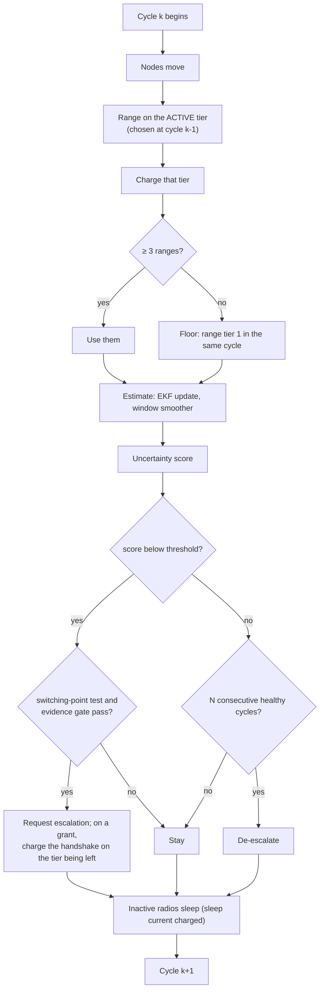

# The per-cycle loop

Decisions run on a **2.5 s cycle**. 2.5 s is not a tuning knob: Indian regulation caps a field node at a 2.5 % transmit
duty cycle, and a tier-1 ranging frame is 56.58 ms, so the minimum compliant period is about 2.24 s
([regulatory considerations](../energy-and-compliance/regulatory.md)).

## The invariant the energy comparison rests on

> Every transmission is made inside the per-cycle loop, by a radio awake that cycle, and charged to the tier that made
> it. A tier an arm never uses accrues its sleep current and nothing else.

This was not always true. An earlier pipeline generated all three tiers' data unconditionally and selected afterwards,
under which **the energy saved by not escalating was structurally unmeasurable**. Fixing that is what made the energy
claim testable. Any change that moves a transmission outside the loop, or charges a tier that did not transmit, breaks
the only thing that gives the energy axis meaning.

The older wording, "exactly one tier transmits per cycle", has three **deliberate** exceptions:

- the **tier-1 floor**, ranged in the same cycle when the active tier returns fewer than three ranges. The tier-1
  radio stays awake and listening while another tier is active, because sleeping it clears its neighbour table; that
  listening is charged;
- the **dual LoRa base** (`--loraDualBase`, in the preset): hybrid arms keep both LoRa radios awake and range both
  every cycle, pooling every range into one fix set, and every radio that ranged is billed;
- the **`poucet_fusion`** comparator, which ranges every tier by design.

A UWB exchange also polls finders heard on either LoRa band that stand near the node's estimate (`--uwbCrossTierPoll`),
because the UWB beacon is never decoded on a stint's first cycle, when the radio has just woken.
