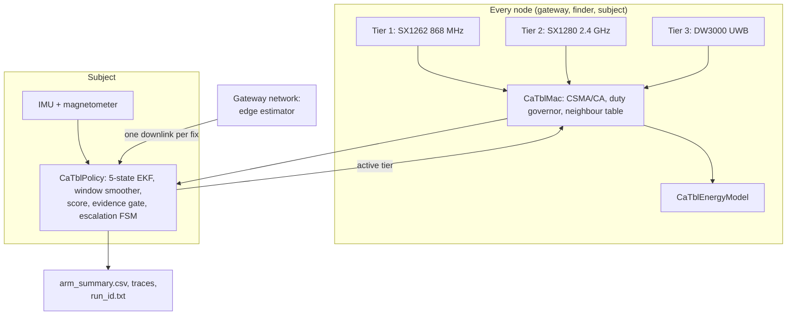

# System overview

The authoritative description is [`Architecture.md`](https://github.com/YKushal-hub/ca-tbl-localization/blob/main/Architecture.md); this page summarises the system **as built**
under the preset (`--specProfile=true`).

## One population of tri-band nodes

**Every node carries all three radios; a tier is a choice of radio, not of peer.** The classes differ in mobility and
role only.

| class | mobile | ids | duty cap | notes |
|---|---|---|---|---|
| **gateway** | no; surveyed, on a 15 m mast | `101+` | 10 % | beacons on all three tiers; hosts the edge estimator |
| **finder** | yes | `501+` | 2.5 % | a searcher with GNSS (2 m per axis error); registered on all tiers exactly as a gateway is |
| **subject** | yes | `1`–`5` | 2.5 % | the field node to be located; tag 0 is node 1, the *lost node*; may relay for other subjects |

Because UWB reaches only metres, a fixed gateway offers tier 3 only to a subject already standing beside it. **Tier 3
reaches a subject when a finder arrives.** That is the mechanism the design rests on, and it is why the evaluation is a
search rather than a monitored enclosure.

## Block diagram

## Where the estimator runs

The brief puts estimation on the gateways, and the preset models it there (`--gatewayEdgeServer`, default true since
2026-09-29). The node broadcasts, the gateways measure and report over the backhaul, and the fix returns in **one
downlink per fix**. The filter's inputs and arithmetic are the same as node-side estimation, so only energy differs.
Tiers 2 and 3 range by two-way time of flight because their endpoints share no clock; there the edge estimator only
adds the downlink.

## Deployment in the evaluated preset

| parameter | adopted | brief's, pinned back |
|---|---|---|
| gateways | 12 on a 3 km ring (0.6 of the box half-width) | 3 (`--nGateways=3 --gwLayout=star`) |
| finders | 12, tasked in pairs | 8 |
| subjects | 5, all measured, unknown start | same |
| box half-width | 5 km (*5 km*); 750 m (*endgame*) | same |
| environment | forested, dense vegetation, all tiers | same |

Why 12 gateways: DEPLOY-REQ measured gateways × finders at 5 km; three gateways fail at any finder count up to 24,
eight sat on the line, twelve met it with a margin ([results](../research/results.md#the-deployment-requirement)).

[Components](components.md) · [The per-cycle loop](cycle-loop.md) · [Failure modes](failure-modes.md)
