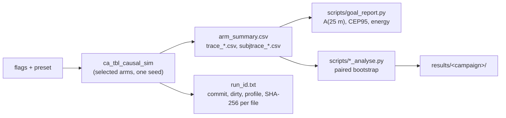

# Execution and provenance

## From a run to a result

Each run writes, among other files, `arm_summary.csv` (one row per arm), a tag-0 trace per arm and a trace per subject.
`goal_report.py` reads the traces' `errM` column and scores the design requirement; the registered analysers add paired
statistics.

## Registered campaigns

A campaign is **pre-registered**: predictions, falsifiers and abort conditions are committed in
`report/PREREG_*.md` **before the first cell runs**, so directory timestamps can be checked against the commit. The
runner (`scripts/*_run.sh`) freezes one binary with a SHA-256 manifest and checks it before every cell; a cell that
does not exit 0, a sidecar that is not `dirty 0`, more than one source, or an arm with fewer than 20 seeds aborts the
campaign.

Statistics: 20 paired fresh seeds per cell; the interval is a 95 % bootstrap percentile interval of the mean paired
difference, 10 000 resamples. A **single-seed cross-arm difference is never a result**: arms share the random stream
but consume it at their own rate (two arms with identical filter state reached 334 and 336 engine evaluations by
t = 2.5 s under the earlier shared stream).

## Provenance

Every run writes `run_id.txt`: the invocation, the build profile, the source commit, the count of modified tracked
files, the binary's SHA-256 and a SHA-256 for each output file, **written after the last stream closes**. A run with
`dirty > 0` or a non-optimized profile is not citable.

- 1 283 sidecars cite commit SHAs changed by an attribution rewrite on 2026-09-01; they resolve through
  [`SHA_MAP.md`](https://github.com/YKushal-hub/ca-tbl-localization/blob/main/SHA_MAP.md). **Sidecars are evidence and are never edited.**
- Per-cycle `trace_*.csv` files are not tracked (about 13 GB); they regenerate from the recorded invocation.
- **Verification must not mutate its subject.** The gate suite once regenerated tracked results in place and re-dated
  their sidecars; regeneration now goes to a temporary directory and a gate fails the suite if it exits with a
  modified tree.

## Determinism

Repeat runs from a seed are byte-identical at defaults and at six non-default flag combinations; random draws are keyed
so that a transmission elsewhere no longer displaces every later draw. One tier-1 sampler ignores its seed
(`lora-distribution-sampler.cc`); this is recorded as a decision not to fix, and no result is known to be affected.
