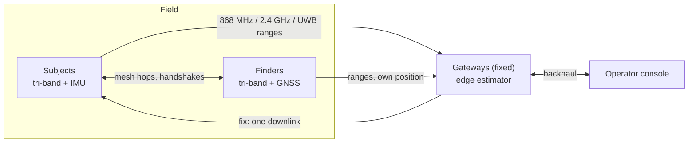

---
hide:
  - navigation
  - toc
---

# CA-TBL

**Covariance-Aware Tier-Based Logic for GPS-denied search and rescue.** An ns-3.47 simulation of three radio tiers,
868 MHz LoRa, 2.4 GHz LoRa time of flight and UWB, with a decision layer that escalates between them and a per-action
energy model traceable to datasheet currents.

[Install and build](getting-started/installation.md){ .md-button .md-button--primary }
[Architecture](architecture/system-overview.md){ .md-button }
[Results](research/results.md){ .md-button }
[Source :material-github:](https://github.com/YKushal-hub/ca-tbl-localization){ .md-button }

!!! info "What this is, and what it is not"
    This is a **simulation** and its measurement apparatus. Every number on this site comes from a registered campaign
    in the repository, run under `--build-profile=optimized`. No field test of the radio models has been made against
    hardware. The system's name is expanded in the repository's GitHub description as *Covariance-Aware*; older
    documents in the repository, and the code's identifiers (`pcs*`), still say *confidence*. They name the same
    system and the same score; see [the uncertainty score](theory/uncertainty-score.md).

## The problem

Search and rescue in GPS-denied terrain needs both long reach and fine ranging, and no single radio delivers both.
Range wants low frequency and narrow bandwidth; precision wants wide bandwidth, which shortens reach and, on a
DW3000-class UWB part, makes the receive current (94 mA) larger than the transmit current (82 mA), so a precision
exchange is spent mostly listening. A wearable's battery rules out keeping that radio on. The design answer is a
hierarchy of radios plus a decision layer that spends precision only where it is useful and reachable.
[More](project/overview.md).

## Key concepts

| tier | radio | role | measured reach, `r80` |
|---|---|---|---|
| 1 | 868 MHz LoRa, SX1262 | wide-area coverage floor; RSSI ranges, TDoA where three gateways hear a broadcast | 2390 m |
| 2 | 2.4 GHz LoRa, SX1280 | mid-range time-of-flight refinement | 320 m |
| 3 | UWB, DW3000 | short-range precision, double-sided two-way ranging | 5.4 m |

`r80` is the distance at which 80 % of frames are received, measured by the simulator's range probe under the
evaluated configuration ([Radios](radios.md)).

Every node carries all three radios. A *tier* is a choice of **radio**, not of peer. Nodes are **gateways** (fixed,
surveyed), **finders** (mobile searchers with GNSS) and **subjects** (the field nodes being located). A
five-state inertial filter carries each subject's position between fixes. The decision layer escalates one tier when
a **covariance-based uncertainty score** falls below a per-tier threshold, subject to two suppress-only checks.
[Escalation](theory/tier-escalation.md).

## Architecture at a glance

[System overview](architecture/system-overview.md) · [Per-cycle loop](architecture/cycle-loop.md)

## The design requirement, and where it stands

**A ≥ 0.95 at R ≤ 25 m**: the share of *all* decision cycles with a position within 25 m. A cycle with no fix counts
against it.

| configuration (CA-TBL, 12 gateways, 12 finders) | tag 0 | five-node pool |
|---|---|---|
| 5 km | 0.986 | 0.952 |
| endgame | 0.999 | 0.993 |

Source: PRESET-5, registered, 20 fresh seeds. With the brief's three gateways the five-node pool reaches 0.875 at
5 km, and no finder count up to 24 closes the gap. The 5 km margin is modest. The tiered system is **level** with
flat-threshold switching and with a static 2.4 GHz arm on availability; what it buys is against a static 868 MHz
arm and, against a POUCET-style fusion of all radios, the same availability at about 1/34 of the subject energy at
5 km. [All results, with intervals](research/results.md).

## Features confirmed in the repository

- Three physics engines (868 MHz, 2.4 GHz, UWB) with about 35 submodules each, and emergent collisions with a 6 dB
  capture rule.
- A five-state IMU filter (position, heading offset, gyro bias, stride scale) with a 60-cycle window smoother and
  particle-filter acquisition from an unknown start.
- Relay-aware uncertainty inflation, σ²eff = σ² + uᵀPBu.
- A per-action energy model: charged per radio action from datasheet currents, with one tier charged per cycle.
- Registered campaigns with a provenance sidecar (`run_id.txt`, SHA-256 per output) and 166 regression gates.

## Project status

| area | status |
|---|---|
| simulation of the three tiers, MAC, energy model | implemented and verified by 12 unit suites (401 checks) |
| decision layer, filter, preset | implemented; evaluated in registered campaigns |
| integrity check | implemented, evaluated, **removed from the preset** (recall 0.003–0.074 of injected faults) |
| field test against hardware | **not done** |
| self-deploying gateway mesh | **not implemented** |
| 5 km margin, terrain realism | open; see [limitations](research/limitations.md) |

## Cite and licence

See [Licence and citation](reference/licence.md). The simulator is built on ns-3.47 and is GPL-2.0-only.
